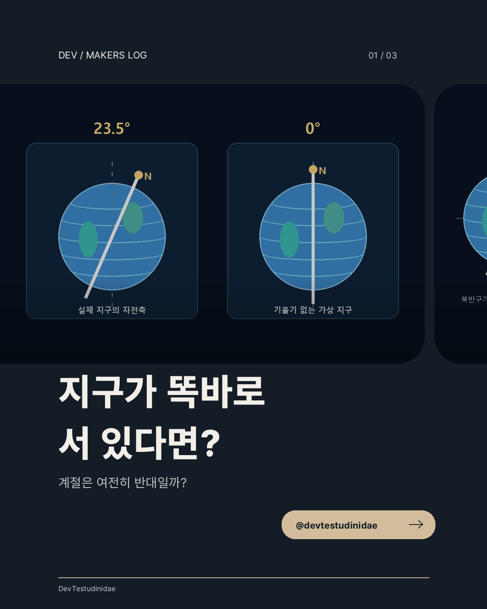
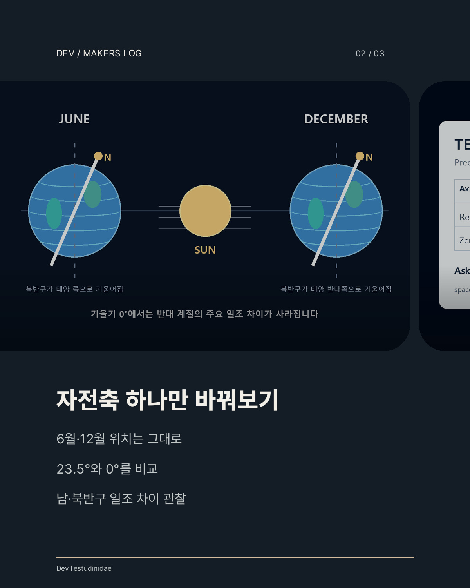

> 한국어판: [지구 자전축이 0°라면? 15분 계절 실험과 무료 활동지](/earth-seasons-no-tilt-experiment-ko/)

# Would the seasons still oppose each other if Earth had no tilt?

With **zero axial tilt**, the strong, opposite seasonal sunlight patterns of the Northern and Southern Hemispheres would disappear. On real Earth, an axial tilt of about 23.5° changes which hemisphere gets more direct sunlight and longer days as the planet moves around the Sun. That does **not** mean a zero-tilt planet would have perfectly constant temperatures.

The [free two-page Space Atlas investigation](https://spaceatlasedu.org/assets/handouts/earth-seasons-no-tilt.html) turns that idea into a controlled question. Pupils predict what will happen before observing a globe at two positions, first tilted and then upright.

<figure>
  
  <figcaption>An original teaching diagram, not a photograph or a screenshot of a live simulator. Sizes and axis lengths are illustrative.</figcaption>
</figure>

## What to prepare

The original guide is a **teacher-led 12–15 minute activity for approximately Grades 5–8**. It calls for a printed worksheet, a pencil, a small marked foam globe, a **fixed cool LED lamp** representing the Sun, and enough room for two opposite orbit positions. A teacher-drawn diagram can replace the physical globe.

An adult should handle the lamp. Avoid strong or hot bulbs, do not look directly into a bright light, and never use the real Sun as the experimental lamp. The setup demonstrates illumination, not actual surface temperature or weather.

## Run the comparison

1. **Predict — 3 minutes.** Before touching the model, ask: *If Earth's spin axis were upright, would the hemispheres still experience strong opposing seasonal sunlight patterns?* Write a prediction.
2. **Control — 4 minutes.** Keep the LED lamp fixed. Tilt the globe by about 23.5° and position it at two opposite points around the lamp. As you move between those points, keep the axis pointing in the **same direction in the room**. Compare the noon-light direction and paths through the sunlit half at matching northern and southern latitudes.
3. **Zero-tilt test — 4 minutes.** Leave the lamp and the two orbit positions unchanged. Set the globe upright and observe the same latitudes again. **Change only axial tilt**.
4. **Explain — 3–4 minutes.** Write down two observations and use them to explain which variable produces the strong north–south seasonal contrast.

| Model | June position: hemisphere receiving more direct sunlight | December position: hemisphere receiving more direct sunlight |
|---|---|---|
| Realistic tilt, 23.5° | Record your observation | Record your observation |
| Hypothetical zero tilt | Record your observation | Record your observation |

Keep the observations blank until pupils have tested the conditions. The [original student worksheet](https://spaceatlasedu.org/assets/handouts/earth-seasons-no-tilt.html) has space for an initial claim, two pieces of evidence, reasoning and an exit question.

<figure>
  
  <figcaption>The axis keeps its direction at both orbit positions. Planet and Sun sizes and distances are not to scale.</figcaption>
</figure>

## Interpret the evidence

With the real tilt, the Northern Hemisphere leans toward the Sun around June, receiving more direct rays and longer daylight. Around December, the Southern Hemisphere leans toward it instead. That reversal helps explain why the two hemispheres have opposing seasons.

At zero tilt, neither hemisphere leans toward the Sun at either test position. The major opposite **daylength and solar-angle** changes disappear. Earth's slightly elliptical orbit would still make a modest difference to incoming solar energy for both hemispheres together; the globe-and-lamp model cannot predict actual temperatures. For the physical explanation, see [NASA's seasonal overview](https://science.nasa.gov/earth/earth-observatory/an-epic-view-of-the-seasons/) and the [U.S. Naval Observatory's orbit and axial tilt reference](https://aa.usno.navy.mil/faq/seasons_orbit).

A useful exit question is: **If Earth is closer to the Sun in early January, why is the Northern Hemisphere in winter?** The task is to connect the observations about axis direction, light angle and daylight rather than guess a temperature from distance alone.

## Get the worksheet and inspect the live model

Open the [two-page teacher guide and student worksheet](https://spaceatlasedu.org/assets/handouts/earth-seasons-no-tilt.html), then choose **Print → Save as PDF** in your browser. After saving, the activity needs no internet connection or student login. The separate [interactive Earth Seasons model](https://spaceatlasedu.org/earth/seasons/) lets a teacher compare the same 23.5° and 0° conditions on screen.

The UK home-education resource site [The Home Ed Daily](https://www.thehomeeddaily.co.uk/resources/science) also links to the worksheet as **“Space Atlas: Test a No-Tilt Earth,”** listing it as a free adult-led activity for ages 10–14. I verified the public listing on November 15, 2026; its original publication date and classroom usage are not established.

The development choice behind this exercise is narrow but important: **hold the orbit positions and light source fixed while changing only the axis angle**. Otherwise learners cannot tell which variable caused the sunlight pattern to change. The wider engineering context is in the [Space Atlas project notes](/space-atlas-student-en/) and the [educator-resource case study](/space-atlas-education-resource-paths-en/).
