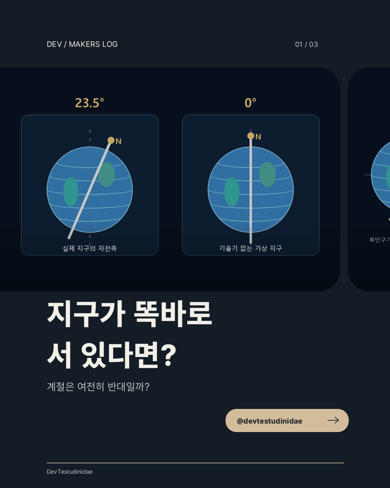
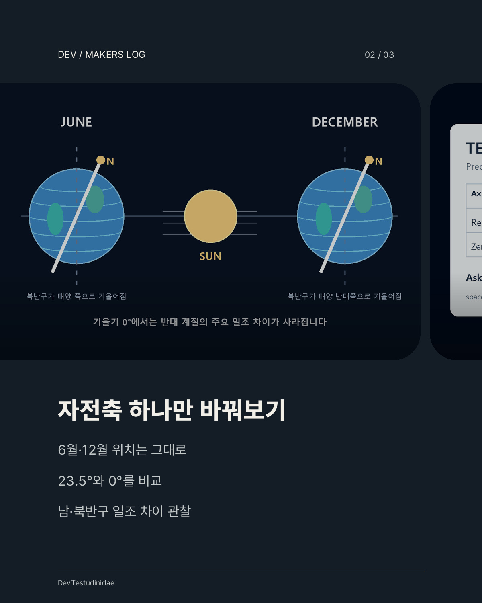

> English edition: [What If Earth Had No Axial Tilt? A 15-Minute Investigation](/earth-seasons-no-tilt-experiment-en/)

# 지구 자전축이 0°라면 계절은 어떻게 달라질까?

지구 자전축이 0°라면 북반구와 남반구가 **서로 반대 시기에 받는 햇빛의 큰 차이**가 사라집니다. 실제 지구는 자전축이 약 23.5° 기울어져 있어서, 6월과 12월에 햇빛이 더 직접 비치는 반구가 바뀝니다. 다만 0°가 된다고 매일의 기온이 똑같아지는 것은 아닙니다.

이 차이는 [Space Atlas의 무료 2쪽 실험 활동지](https://spaceatlasedu.org/assets/handouts/earth-seasons-no-tilt.html)로 확인할 수 있습니다. 교사가 설명만 하는 대신 학생이 먼저 예상하고, 기울기 하나만 바꾸어 두 조건을 비교하도록 만들었습니다.

<figure>
  
  <figcaption>자체 제작한 설명용 그림. 지구 사진이나 실제 시뮬레이터 화면이 아니며 크기와 축 길이는 실제 비율이 아닙니다.</figcaption>
</figure>

## 준비물과 진행 시간

원본 활동지는 **5~8학년 수준의 성인 지도형 12~15분 실험**을 안내합니다. 준비물은 인쇄물, 연필, 위도 위치를 표시할 수 있는 작은 지구본(또는 구 모형), 고정할 수 있는 **발열이 적은 LED 램프**, 지구본을 놓을 두 지점입니다. 지구본이 없다면 지도자가 두 위치를 그려 설명할 수 있습니다.

램프는 어른이 다루고, 강한 빛을 직접 바라보거나 뜨거운 전구 또는 실제 태양을 실험 광원으로 사용하지 마세요. 이 모델은 지구에 들어오는 빛의 방향을 보여주는 도구이지 온도나 날씨를 재현하는 장치는 아닙니다.

## 4단계로 비교하기

1. **예측 · 3분:** “자전축이 똑바로 선다면 북반구와 남반구의 여름은 여전히 반대일까?”를 먼저 적습니다.
2. **실제 기울기 · 4분:** LED 램프를 태양으로 정하고 지구본을 약 23.5° 기울입니다. 공전 궤도에서 서로 반대인 두 위치를 정한 뒤, 이동할 때 **자전축 방향이 공간에서 평행하게 유지**되도록 합니다. 북쪽과 남쪽의 같은 절댓값 위도에서 빛의 입사 방향과 밝은 영역을 지나는 낮의 길이를 비교합니다.
3. **기울기 0° · 4분:** 램프와 두 관찰 지점은 유지하고 지구본만 똑바로 세웁니다. 같은 위도를 다시 관찰합니다. 바뀌는 변수는 **자전축 기울기 하나**여야 합니다.
4. **관찰 설명 · 3~4분:** 6월 위치와 12월 위치의 차이를 기록하고, 반대 계절의 햇빛 패턴이 왜 달라졌는지 설명합니다.

| 비교 조건 | 6월 위치: 직접 빛을 받는 반구 | 12월 위치: 직접 빛을 받는 반구 |
|---|---|---|
| 23.5° 기울기 | 직접 관찰해 기록 | 직접 관찰해 기록 |
| 0° 기울기 | 직접 관찰해 기록 | 직접 관찰해 기록 |

이 표의 빈칸이 중요합니다. 예시 답을 먼저 보여주면 “내가 본 것”과 “설명에서 들은 것”을 구분하기 어렵습니다. [원본 학생용 기록표](https://spaceatlasedu.org/assets/handouts/earth-seasons-no-tilt.html)에는 예상, 증거 두 가지, 이유, 마지막 확인 질문이 들어 있습니다.

<figure>
  
  <figcaption>두 위치에서 지구의 축 방향이 바뀌지 않는다는 조건을 보여주는 원본 도식. 천체 크기와 거리는 축척에 맞지 않습니다.</figcaption>
</figure>

## 관찰 후 확인할 설명

23.5° 조건에서는 북반구가 태양 쪽으로 기울어지는 6월에 북반구의 햇빛 입사각과 낮 길이가 증가하고, 12월에는 남반구가 상대적으로 더 직접적인 빛을 받습니다. 같은 위도끼리 비교했을 때 서로 반대인 계절 패턴이 나타나는 이유입니다.

0° 조건에서는 어느 반구도 6월이나 12월 위치에서 태양 쪽으로 기울지 않습니다. 따라서 이 실험에서 비교하는 **큰 남북 일조·낮 길이의 계절적 반전이 사라집니다**. 실제 지구의 공전 궤도는 약간 타원이므로 태양과의 거리로 인한 전체 태양 에너지 변화는 남을 수 있지만, 그것으로 북·남반구의 반대 여름을 설명할 수는 없습니다. [NASA의 계절 설명](https://science.nasa.gov/earth/earth-observatory/an-epic-view-of-the-seasons/)과 [미 해군천문대의 궤도·자전축 해설](https://aa.usno.navy.mil/faq/seasons_orbit)도 이 구분을 설명합니다.

활동지의 마지막 질문도 여기에 연결됩니다. **“지구가 1월 초에 태양과 더 가까운데, 왜 북반구는 겨울일까?”** 가까운 거리보다 기울기가 낮 길이와 햇빛 각도에 미치는 효과가 핵심이라는 설명을 스스로 구성해 보게 하세요.

## 원본 활동지와 개발 기록

[실험 활동지 열기](https://spaceatlasedu.org/assets/handouts/earth-seasons-no-tilt.html)에서 브라우저의 **인쇄 → PDF로 저장**을 선택할 수 있습니다. 저장한 뒤에는 인터넷이나 학생 로그인이 필요하지 않습니다. [계절 인터랙티브 모델](https://spaceatlasedu.org/earth/seasons/)에서는 같은 23.5°·0° 조건을 화면에서 비교할 수 있습니다.

이 활동지는 영국 [The Home Ed Daily의 과학 자료 목록](https://www.thehomeeddaily.co.uk/resources/science)에도 **“Space Atlas: Test a No-Tilt Earth”**라는 이름으로 연결돼 있습니다. 2026년 11월 15일 공개 목록을 확인했으나, 최초 등재 날짜나 실제 수업 사용량은 확인되지 않았습니다.

개발 과정에서 중요했던 결정은 **같은 두 공전 위치를 유지하면서 축 기울기만 바꾸도록 실험을 설계한 것**입니다. 변수 비교가 흐려지면 그림은 멋있어도 학생이 어떤 변화가 계절의 원인인지 말하기 어려워집니다. 전체 모델과 관련 구현은 [Space Atlas 개발 기록](/space-atlas-student/) 및 [교육 자료 공개 사례](/space-atlas-education-resource-paths-ko/)에 정리했습니다.
