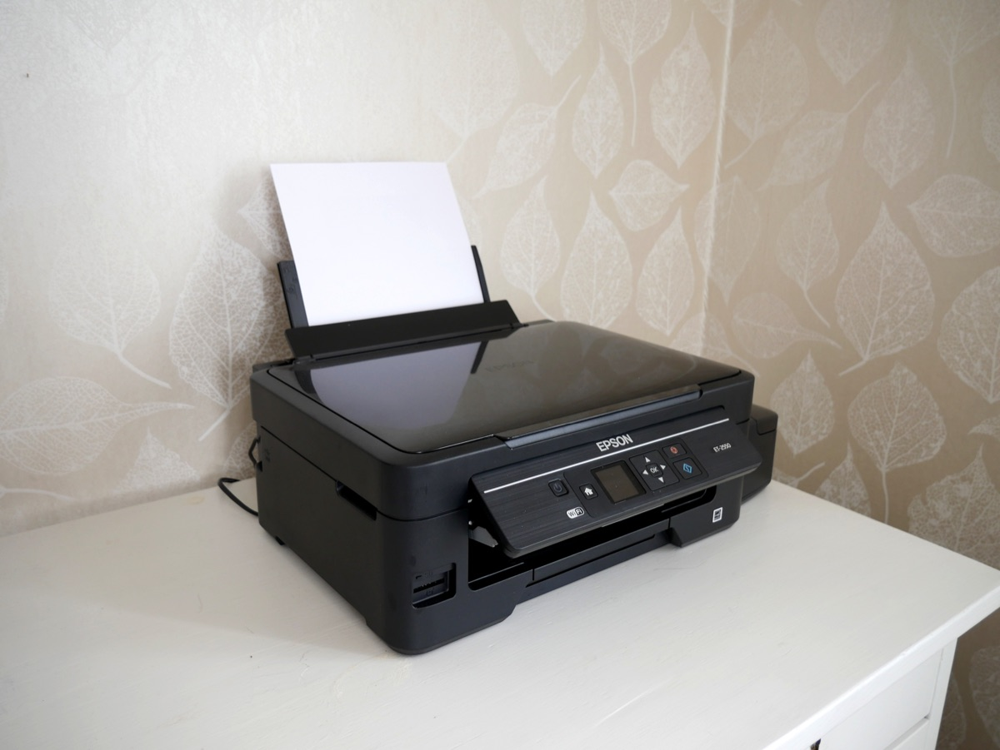
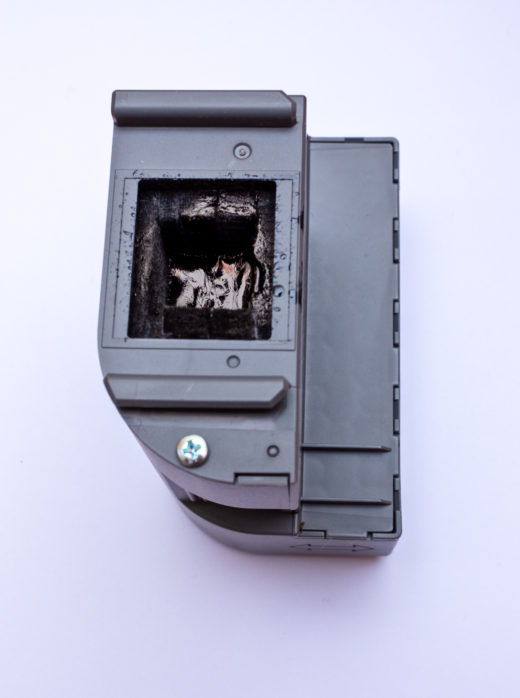

<p style="background: rgba(0, 120, 212, 0.08); border-left: 4px solid #0078d4; padding: 10px 14px; margin-bottom: 24px; border-radius: 4px; font-size: 0.95rem;">
  🇰🇷 <strong>한국어 안내:</strong> 한국어 가이드 및 국내 호환 부품 구매 안내는 <a href="/epson-waste-ink-pad-reset-without-key/"><strong>엡손 잉크패드 리셋: L3106 작업 사례와 모델별 주의 (한국어)</strong></a> 포스팅을 참고하세요.
</p>

> **Compatibility and servicing note (9 Nov 2026):** The [reinkpy-fix repository](https://github.com/LeFZdev/reinkpy-fix) describes a tool for some Epson printers, with confirmed operation on the L3060 series and similar devices. It does not verify support for every one of the 33 variants previously listed here. The L3106 sequence below is the author's original account. [Epson's ink-pad guidance](https://epson.com/support/wa00369) explains that the physical pads may require servicing, and some are not user-serviceable. A software counter reset does not replace physical maintenance. If exact model support is unclear, consult an authorized technician.

### Exact Epson Waste Ink Pad Error Messages & Symptoms

<picture>
  <source type="image/webp" srcset="epson-printer-400.webp 400w, epson-printer-800.webp 800w, epson-printer.webp 1200w" sizes="(max-width: 690px) calc(100vw - 40px), (max-width: 768px) 650px, 660px">
  
</picture>
<p style="font-size:0.8em; color:#888; margin-top:-10px;">Epson EcoTank Printer (Photo: Santeri Viinamäki, CC BY-SA 4.0 via Wikimedia Commons)</p>

If you own an Epson EcoTank / L-Series printer (such as the L3100~L3168, L1110, L5190, ET-2710, ET-4700), after printing a certain threshold of pages, printing will suddenly halt with the **Power light and Ink/Paper warning lights flashing alternately**.

Depending on your driver version and OS, EPSON Status Monitor 3 will throw one of these **exact verbatim warning messages**:

> **Message 1 (Final Service Lockout - Most Common):**  
> *"A printer's ink pad is at the end of its service life. Please contact Epson Support."*  
> *(Or: "The printer's ink pads are at the end of their service life.")*

> **Message 2 (Pre-lockout Warning):**  
> *"A printer's ink pad is nearing the end of its service life. Please contact Epson Support."*

> **Message 3 (Status Code on LCD / Utility):**  
> **Error Code: `E-11`** *(Ink pad life expired / Service required)*

If you found this page after receiving an ink-pad service alert, the steps below document one reported approach. Your model may require professional service, and resetting a counter cannot replace saturated ink pads.

When searching for solutions online, users typically hit two frustrating roadblocks:
1. **Software and platform limits**: Commercial reset utilities may charge for a key. Some free alternatives are Windows `.exe` files, which may be difficult to run directly on macOS or Linux. Check vendor documentation and the exact model before selecting software.
2. **Overpriced plastic assembly**: Buying the entire plastic cartridge housing costs significantly more and creates unnecessary plastic waste, even though the plastic case itself is completely intact and reusable.

In the documented case, felt-pad work and an open-source counter-reset attempt were used. The reported cost was about $4–$5 and the process took roughly 10 minutes for that case. Neither the timing nor compatibility is established for other models.

---

### 1. Cost & Waste Comparison: Full Assembly vs. Felt Pads Only

<picture>
  <source type="image/webp" srcset="epson-maintenance-box-400.webp 400w, epson-maintenance-box-800.webp 800w, epson-maintenance-box.webp 895w" sizes="(max-width: 690px) calc(100vw - 40px), (max-width: 768px) 650px, 660px">
  
</picture>
<p style="font-size:0.8em; color:#888; margin-top:-10px;">Epson Ink Maintenance Box / Waste ink absorber (Photo: Ll1324, CC0 Public Domain via Wikimedia Commons)</p>

A maintenance box or waste ink pad assembly can differ by printer model. Felt pads collect discarded ink, and the owner should not assume every casing is reusable or every ink pad is a user-serviceable part.

| Aspect | Full Maintenance Box Assembly | Felt Absorber Pads Only (model-dependent) |
| :--- | :--- | :--- |
| **Typical Cost** | \$7 – \$10 + shipping | **\$4 – \$5 (Free shipping available online)** |
| **Hardware Work** | Remove 1 screw, swap box | Remove 1 screw, swap inner felt pads |
| **Time in the example** | ~3 minutes | ~5 minutes |
| **Eco Impact** | Throws away durable plastic | Reuses plastic housing, zero extra plastic waste |

Replacement pads and access procedures differ by model. Verify whether the service is intended for users before purchasing parts or opening the printer. The costs shown above are historical examples, not current prices.

---

### 2. Hardware Replacement (Takes 5 Minutes)

**Items needed**: Cross-head screwdriver, disposable gloves (or tweezers), paper towels, new felt pads.

1. **Power Off**: Disconnect the power cord and USB cable.
2. **Remove Outer Screw**: Locate the single screw on the lower right back panel of the printer. Unscrew it and slide the small plastic cover downwards to remove it.
3. **Slide Out Ink Box**: Remove the inner screw securing the waste ink container. Slide the container out gently towards the right.
4. **Swap Sponges**: Wearing gloves, pull out the ink-soaked sponges and discard them into a trash bag. Wipe the inside of the plastic casing with a paper towel, then insert the new, clean felt pads in the exact same orientation.
5. **Reassemble**: Slide the box back into the printer, tighten both screws, and reattach the cover.

---

### 3. Software Counter Reset via reinkpy-fix (Cross-Platform)

Physical pad replacement is only half the battle. The internal EEPROM memory in the printer still retains the maximum counter value, which must be reset to 0%.

The documented case referenced **`reinkpy-fix`**. Its [README](https://github.com/LeFZdev/reinkpy-fix) reports operation for the L3060 series and similar devices, with fixes focused on LAN/SNMP. The USB procedure below is a historical L3106 case description, not independent proof that the same commands work for another model.

The AI coding assistant prompt below is intended for reviewing setup and model support. It instructs the assistant to stop before writing to the printer and ask for separate confirmation after checking physical pad servicing and compatibility.

---

#### 💡 Ready-to-use AI Agent Prompt (Copy & Paste)

Confirm the exact printer model and physical pad service requirements before using this prompt. It asks the coding assistant to stop for confirmation before resetting anything. Other models cannot be assumed compatible just by changing a model name:

````text
My Epson printer (model: L3106 / L3100 or ET-2710 series) is locked due to "waste ink pad at the end of its service life".
It is connected via USB to my macOS/Linux machine. Review the following steps, but do not send any reset command to the printer until the exact model's support and physical waste-pad servicing have been confirmed. Explain the findings and ask for my separate approval before any counter write:

1. Clone repository: https://github.com/LeFZdev/reinkpy-fix
2. Ensure libusb is installed (e.g. run 'brew install libusb' on macOS or 'apt-get install libusb-1.0-0-dev' on Linux).
3. Set up a virtualenv (python3 -m venv venv) and install dependencies:
   venv/bin/pip install pyusb pysnmp zeroconf
   venv/bin/pip install -e .
4. (CRITICAL BUG FIX) In reinkpy/__init__.py, find two occurrences of 'from usb import UsbIO' and replace them with 'from .usbtest import UsbIO'.
5. Replace reinkpy/main.py with this reset routine:
```python
import reinkpy
printer = reinkpy.Device.from_usb(manufacturer='EPSON')
driver = printer.epson
if not driver.spec.model:
    driver.configure("L3106")  # adjust to your model e.g. L3150, ET-2710
print("Connected Printer:", printer)
print("Configured Model:", driver.spec.model)
driver.reset_waste()
print("Waste ink pad counter successfully reset to 0%!")
```
6. Do not run sudo venv/bin/python3 reinkpy/main.py yet. Wait until model support and physical pad service are confirmed and I authorize the counter write separately.
````

---

#### 🛠 Step-by-Step Manual Terminal Guide

If you prefer executing the commands manually without an AI assistant:

#### Step 1 — Clone the Repository

Clone the patched repository locally:

```bash
git clone https://github.com/LeFZdev/reinkpy-fix
cd reinkpy-fix
```

#### Step 2 — Install libusb

`libusb` is required for raw USB device communication on macOS and Linux.

On macOS (via Homebrew):
```bash
brew install libusb
```

On Ubuntu/Debian Linux:
```bash
sudo apt-get install libusb-1.0-0-dev
```

#### Step 3 — Create Virtual Environment & Install Dependencies

```bash
python3 -m venv venv
venv/bin/pip install pyusb pysnmp zeroconf
venv/bin/pip install -e .
```

#### Step 4 — Fix Library Import Bug (Crucial Step!)

In the current `reinkpy-fix` repository commit, running the script immediately results in an `ImportError`. The underlying file `usb.py` was renamed to `usbtest.py`, but `reinkpy/__init__.py` was not updated.

Open `reinkpy/__init__.py` and search for `from usb import UsbIO`. You will find two occurrences. **Change both lines to:**

```python
# Before
from usb import UsbIO

# After
from .usbtest import UsbIO
```

*(If you are using an AI coding agent, simply tell it: "Fix the UsbIO import in reinkpy/__init__.py to import from .usbtest", and it will patch the file instantly.)*

#### Step 5 — Replace main.py with USB Reset Routine

The sample below calls `driver.reset_waste()`, which attempts to write to the printer counter when run. Before using it, confirm that **reinkpy-fix supports your exact model and the physical waste pads have been serviced**. L3106 is the documented case; replacing its model name does not establish compatibility.

The following is the L3106 example for `reinkpy/main.py`. Do not execute it until those checks are complete:

```python
import reinkpy

# Discover connected EPSON USB printer
printer = reinkpy.Device.from_usb(manufacturer='EPSON')

driver = printer.epson
if not driver.spec.model:
    driver.configure("L3106")  # Documented L3106 case; verify other models separately

print("Connected Printer:", printer)
print("Configured Model:", driver.spec.model)

# Reset waste ink counter to 0%
driver.reset_waste()
print("Waste ink pad counter successfully reset to 0%!")
```

#### Step 6 — Execute with Elevated Privileges

**Before running:** This command executes `driver.reset_waste()` and attempts a counter write on the connected printer. Do not run it unless the exact model support and physical waste-pad servicing have been confirmed.

The documented command uses elevated privileges for raw USB access:

```bash
sudo venv/bin/python3 reinkpy/main.py
```

You will see output identifying your printer followed by:
```text
Connected Printer: <Device EPSON ...>
Configured Model: L3106
Waste ink pad counter successfully reset to 0%!
```

If the waste ink counter action appears successful but the alert remains, avoid repeating writes and check the service procedure for the exact printer. A software result alone does not establish that the physical pad has been serviced.

---

### Epson model names to check individually (not a verified compatibility list)

The following printer names are a reference list from the earlier version of this guide. **They are not a verified list of models supported by reinkpy-fix.** The public fork describes confirmed work on the L3060 series and similar printers; it does not establish all the variants below.

#### 1) Asian / domestic L-series examples (verify each model)
- **L3100 Models**: L3100, L3101, L3104, L3105, L3106, L3107, L3108, L3109
- **L3110 Models**: L3110, L3111, L3114, L3115, L3116, L3117, L3118, L3119
- **L3150 Models (Wi-Fi)**: L3150, L3151, L3152, L3153, L3156, L3158
- **L3160 Models (with LCD)**: L3160, L3161, L3163, L3165, L3166, L3168
- **L1110 Models (Single-function)**: L1110, L1118, L1119
- **L5190 Models (Fax / ADF)**: L5190, L5196, L5198

#### 2) North American & European Models (EcoTank / ET Series)
EcoTank model names or similarities do not verify identical EEPROM layouts, firmware behavior, or counter-reset support. Check the model-specific information before attempting any writes.
- **ET-1110 ~ ET-1118** (Global equivalent of L1110)
- **ET-2710 ~ ET-2728** (Global equivalent of L3110 / L3150)
- **ET-4700** (Global equivalent of L5190 Fax All-in-One)

> **Configuration warning:** Replacing `driver.configure("L3106")` with another model name in `main.py` does not prove the driver will target the correct memory register. Do not attempt the write before verifying that the tool actually supports that model.

---

### Important: Physical Disassembly Nuances by Model

Identical counter-reset behavior has not been established across these models. Physical teardown steps can also vary, and the relevant service documentation takes precedence:

- **L3100 ~ L3119 (including L3106)**: Similar-looking models may use different fasteners or service procedures. Do not assume the same one-screw removal method applies to each variant.
- **L3150 / L3160 Series**: Differences in housing, Wi-Fi and LCD assemblies mean the waste pad access procedure should be verified for each exact model.
- **L1110 Series (Compact Single-function)** / **L5190 Series (ADF / Fax)**: Different physical form factors. Screw locations and exterior casing latches may vary, so double-check your model's specific service casing layout before pulling the box out.

---

### Summary: Cost and time reported for this case

- **Reported felt-pad expense**: roughly $5 in the original case; not a current quote or a verified price for other printers.
- **Reported time**: about five minutes each for pad work and software reset in the original account. This is not a general repair estimate.
- **Practical limitation**: The software is open source, but the operating system, model compatibility, USB permissions and firmware may affect whether it works.

---

### Frequently Asked Questions (FAQ)

<details style="margin-bottom: 1rem; border: 1px solid rgba(128,128,128,0.2); border-radius: 6px; padding: 12px 16px;">
  <summary style="font-weight: 700; cursor: pointer; color: inherit;">Q1. Can I wash and reuse the old waste ink felt pads with water?</summary>
  <p style="margin-top: 8px; font-size: 0.95rem; line-height: 1.6;">
    <strong>Not recommended.</strong> Saturated felt pads produce significant hazardous runoff when washed, take days to dry thoroughly, and lose fiber density during washing. Lower fiber density drastically increases the risk of ink leakage onto your desk or printer base. Replacing them with a pre-cut replacement felt pad set (~$5) is by far the safest and cleanest approach.
  </p>
</details>

<details style="margin-bottom: 1rem; border: 1px solid rgba(128,128,128,0.2); border-radius: 6px; padding: 12px 16px;">
  <summary style="font-weight: 700; cursor: pointer; color: inherit;">Q2. The red ink and paper lights are still alternately flashing after running the reset script.</summary>
  <p style="margin-top: 8px; font-size: 0.95rem; line-height: 1.6;">
    Immediately after resetting the counter, <strong>unplug the printer's power cord completely from the wall outlet for at least 60 seconds</strong>, then plug it back in. Also verify that your exact printer model was set in <code>reinkpy/main.py</code> and that the script successfully printed <code>Waste ink pad counter reset successfully</code> without USB endpoint communication errors.
  </p>
</details>

<details style="margin-bottom: 1rem; border: 1px solid rgba(128,128,128,0.2); border-radius: 6px; padding: 12px 16px;">
  <summary style="font-weight: 700; cursor: pointer; color: inherit;">Q3. What is the technical difference between paid WIC Reset keys and open-source reinkpy-fix?</summary>
  <p style="margin-top: 8px; font-size: 0.95rem; line-height: 1.6;">
    The public <code>reinkpy-fix</code> fork documents confirmed use for L3060-series and similar devices, not all Epson models. No source reviewed establishes protocol parity with WIC Reset across the models in this article. Check <a href="https://github.com/LeFZdev/reinkpy-fix">the repository</a> and <a href="https://epson.com/support/wa00369">Epson’s ink-pad servicing guidance</a> before attempting a counter write.
  </p>
</details>

