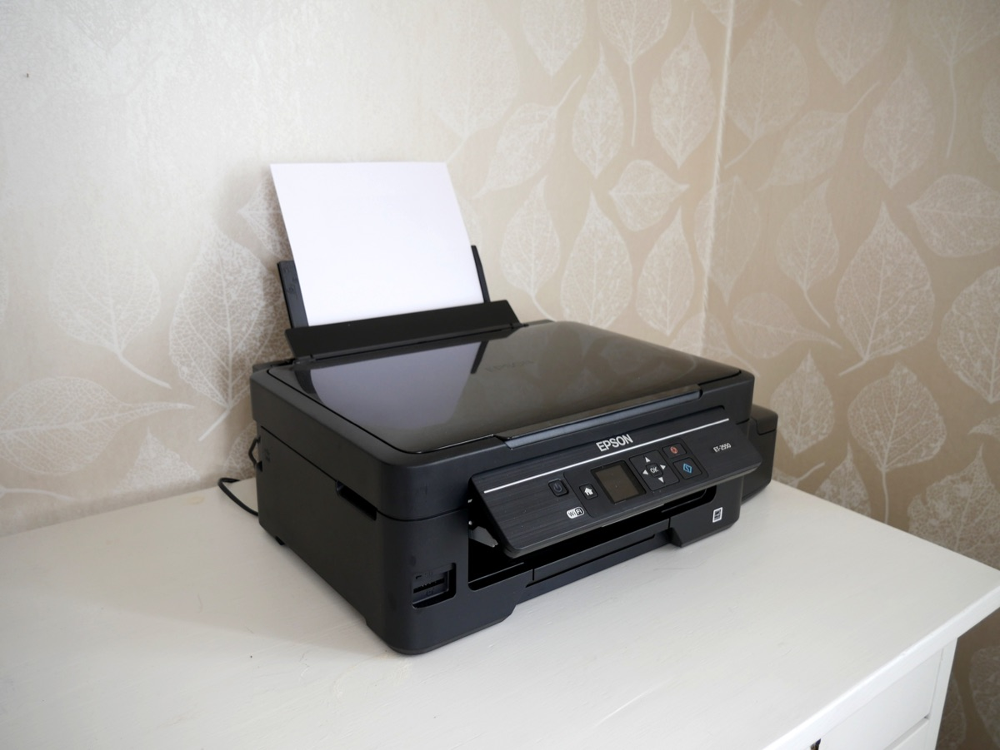
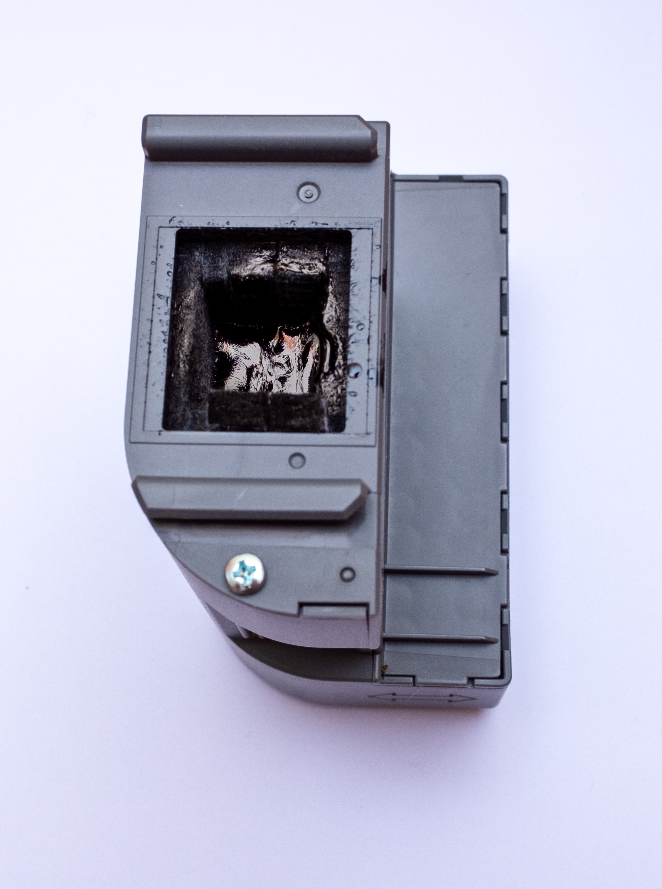

<p style="background: rgba(0, 120, 212, 0.08); border-left: 4px solid #0078d4; padding: 10px 14px; margin-bottom: 24px; border-radius: 4px; font-size: 0.95rem;">
  🌐 <strong>English Edition available:</strong> Looking for the English step-by-step guide? Read <a href="/en-epson-waste-ink-pad-reset-without-key/"><strong>Epson Waste Ink Counter Reset: L3106 Case and Model Checks</strong></a>.
</p>

> **2026-11-09 호환성·정비 주의:** [reinkpy-fix 공개 저장소](https://github.com/LeFZdev/reinkpy-fix)는 일부 Epson 프린터용 도구라고 설명하며, 동작 확인 기종은 L3060 계열 및 유사 모델이라고 기재합니다. 기존 글에 열거된 33개 모델을 모두 검증했다는 자료는 확인되지 않았습니다. 아래 L3106 과정은 작성자가 남긴 개별 작업 기록입니다. [Epson 공식 안내](https://epson.com/support/wa00369)에 따르면 폐잉크 패드는 실제 정비가 필요하며, 모델에 따라 사용자 교체가 불가능합니다. 소프트웨어 카운터 리셋은 패드 정비를 대신하지 않습니다. 정확한 기종과 도구 지원 여부가 불분명하면 전문 수리를 이용하세요.

### 엡손 프린터 잉크 패드 서비스 수명 에러 메시지 정확한 문구와 증상

<picture>
  <source type="image/webp" srcset="epson-printer-400.webp 400w, epson-printer-800.webp 800w, epson-printer.webp 1200w" sizes="(max-width: 690px) calc(100vw - 40px), (max-width: 768px) 650px, 660px">
  
</picture>
<p style="font-size:0.8em; color:#888; margin-top:-10px;">Epson EcoTank Printer (Photo: Santeri Viinamäki, CC BY-SA 4.0 via Wikimedia Commons)</p>

엡손 무한잉크 복합기(L3100~L3168, L1110, L5190 등)를 오래 사용하다 보면 갑자기 인쇄가 전면 중단되면서 **전원 램프와 잉크/용지 경고등(빨간불)이 번갈아 깜빡이는 상태(교차 점멸)**가 됩니다.

PC 모니터 화면과 엡손 상태 모니터(EPSON Status Monitor 3)에는 드라이버 버전에 따라 다음과 같은 **정확한 공식 경고 메시지**가 팝업됩니다:

> **메시지 1 (가장 흔한 최종 락 상태):**  
> *"프린터 내부의 잉크 패드 수명이 다 되었습니다. 서비스 센터에 문의하십시오."*  
> *(The printer's ink pads are at the end of their service life. Please contact Epson Support.)*

> **메시지 2 (수명 종료 직전 사전 경고):**  
> *"프린터 내부의 잉크 패드 수명이 거의 다 되었습니다. 서비스 센터에 문의하십시오."*  
> *(The printer's ink pad is nearing the end of its service life. Please contact Epson Support.)*

> **메시지 3 (일부 구형/영문 드라이버 또는 오류 코드 표시 기종):**  
> *"프린터 내부 부품의 수명이 다 되었습니다."* / **오류 코드: `E-11`** (잉크 패드 수명 만료 서비스 요청 에러)

포털 검색창에 **"프린터 내부의 잉크 패드 수명이 다 되었습니다"**를 그대로 복사해 검색해 보셨다면 바로 이 문제입니다.

보통 이 상황에서 검색을 해보면 크게 두 가지 벽에 부딪힙니다:
1. **소프트웨어 리셋의 번거로움과 유료 결제**: WIC Reset 같은 툴을 쓰면 편하다고 하지만, 카운터 리셋 1회당 **약 1만 원 안팎의 유료 리셋키를 결제**해야 합니다. 일부 무료 대안은 Windows 실행 파일(`.exe`)로 제공되어 macOS·Linux에서 바로 실행하기 어렵습니다.
2. **부품 구매 비용 거품**: 플라스틱 카트리지 케이스가 포함된 통짜 호환 잉크패드를 사려면 제품가 약 4,000원대에 배송비 3,000원이 더해져 7,000원 이상의 비용이 듭니다.

제 경우 흡수재 정비와 오픈소스 도구를 사용한 카운터 리셋을 시도했습니다. 당시 지출은 5,700원이었지만, 작업 시간과 성공 여부는 모델·기기 상태·소프트웨어 지원 범위에 따라 달라집니다.

---

### 1. 비용 비교: 통째 교체 vs 흡수재 단독 교체

<picture>
  <source type="image/webp" srcset="epson-maintenance-box-400.webp 400w, epson-maintenance-box-800.webp 800w, epson-maintenance-box.webp 895w" sizes="(max-width: 690px) calc(100vw - 40px), (max-width: 768px) 650px, 660px">
  
</picture>
<p style="font-size:0.8em; color:#888; margin-top:-10px;">Epson Ink Maintenance Box / Waste ink absorber (Photo: Ll1324, CC0 Public Domain via Wikimedia Commons)</p>

기종에 따라 폐잉크를 수집하는 구조와 정비 가능한 부품이 다릅니다. 제 작업에서는 흡수재를 교체했지만, 모든 프린터에서 케이스를 그대로 재사용하거나 사용자가 직접 정비할 수 있다는 뜻은 아닙니다.

| 구분 | 통짜 호환 잉크패드 어셈블리 | 흡수재 단독 교체 (기종별 확인) |
| :--- | :--- | :--- |
| **구매처** | 일반 오픈마켓(지마켓 등) | 네이버 '수이몰 상사' 등 전용 흡수재 몰 |
| **가격** | 부품가 4,050원 + 택배비 3,000원 = **7,050원** | 맞춤 재단 흡수재 세트 = **5,700원 (무료배송)** |
| **작업 난이도** | 나사 1개 풀고 통째 교체 | 나사 1개 풀고 내부 솜만 핀셋/비닐장갑으로 교체 |
| **과거 작업 시간 예시** | 약 3분 | 약 5분 |
| **환경/비용** | 불필요한 플라스틱 폐기물 발생 | 기존 케이스 재사용, 가성비 최고 |

기존 사례에서는 플라스틱 케이스를 재사용하고 규격 흡수재를 교체했습니다. 위 가격은 당시 구매 기록이며, 현재 가격과 해당 기종에서 사용자 교체가 가능한지 여부는 별도로 확인해야 합니다.

---

### 2. 하드웨어 교체 (5분 소요)

준비물: **십자드라이버, 비닐장갑(또는 핀셋), 물티슈, 새 흡수재**

1. **프린터 전원 분리 및 후면 확인**: 프린터 뒷면 우측 하단을 보면 나사 1개로 고정된 작은 플라스틱 커버가 있습니다.
2. **나사 풀기**: 십자드라이버로 나사를 풀고 커버를 아래로 살짝 밀어 탈거합니다.
3. **잉크 패드 통 분리**: 안쪽에 고정된 나사 1개를 더 풀고, 패드 어셈블리 통을 오른쪽/바깥쪽으로 살짝 당기면 쏙 빠집니다.
4. **흡수재 교체**: 비닐장갑을 끼고 잉크에 절어있는 기존 스펀지들을 빼서 신문지나 비닐봉지에 담아 종량제 봉투에 버립니다. 빈 플라스틱 통 안쪽을 물티슈로 가볍게 닦아낸 뒤, 새로 배송받은 5,700원짜리 흡수재 조각들을 원래 모양대로 차곡차곡 끼워 넣습니다.
5. **재조립**: 분해의 역순으로 통을 밀어 넣고 나사를 조이면 하드웨어 작업은 끝납니다.

---

### 3. 소프트웨어 리셋: 왜 유료 키를 살 필요가 없는가?

많은 블로그에서 "WIC Reset 유틸리티를 다운받고 1회용 리셋키를 구매하라"고 권장합니다. 하지만 엡손 프린터의 폐잉크 카운터(Waste Ink Counter)는 하드웨어 결함이 아니라 **USB 양방향 통신(ESC/P-R 프로토콜 / Vendor Command)으로 기록되는 단순 내부 EEPROM 수치**일 뿐입니다.

기존 방식의 단점:
- **유료 결제**: 리셋 1회마다 키 비용 약 1만 원 발생.
- **윈도우 종속성**: 무료 툴(AdjProg 등)은 윈도우 전용 바이너리로만 유통되며, 악성코드 위험이나 백신 오진단이 잦음.
- **맥(macOS) / 리눅스 이용자 소외**: 맥북 환경에서는 공식 유틸리티를 돌릴 수 없어 가상머신(Parallels)을 켜거나 윈도우 노트북을 빌려와야 함.

---

### 4. reinkpy-fix: 지원 기종 확인과 카운터 조정 절차

원래 작업에서 참고한 오픈소스 도구는 **`reinkpy-fix`**입니다. [프로젝트 README](https://github.com/LeFZdev/reinkpy-fix)는 L3060 계열 및 유사 기종의 동작 확인과 LAN/SNMP 수정 내용을 설명합니다. 아래 USB 절차는 과거 L3106 작업의 기록이며, 다른 모델에서 동일하게 작동한다는 검증 자료는 아닙니다.

다음 AI 코딩 에이전트용 프롬프트는 준비 절차를 검토하기 위한 것입니다. 기종별 지원과 실제 패드 정비가 확인되고 사용자가 별도로 승인하기 전까지 카운터 변경 명령을 실행하지 않도록 했습니다.

---

#### 💡 AI 에이전트에게 바로 복사해서 붙여넣는 프롬프트 (Copy & Paste)

AI 코딩 에이전트에 붙여넣기 전에 정확한 프린터 기종과 폐잉크 흡수재 정비 가능 여부를 확인하세요. 아래 프롬프트는 확인 단계에서 멈추도록 작성했으며, L3100·L3156 등 다른 모델은 이름만 바꿔도 작동한다는 근거가 없습니다.

````text
내 엡손 프린터(모델: L3106 / L3100 계열)가 "잉크 패드 서비스 수명 만료" 에러로 락이 걸렸어.
맥북(macOS)에 USB로 연결되어 있어. 아래 절차는 먼저 검토만 하고, 정확한 기종의 지원 여부와 실제 폐잉크 패드 정비 상태를 확인하기 전에는 프린터로 초기화 명령을 보내지 마. 초기화를 실행하기 전 내게 결과를 설명하고 별도 승인을 요청해줘:

1. https://github.com/LeFZdev/reinkpy-fix 리포지토리를 클론해줘.
2. Homebrew로 libusb가 설치되어 있는지 확인하고 없으면 brew install libusb를 실행해줘.
3. python3 -m venv venv 가상환경을 만들고 pyusb, pysnmp, zeroconf 설치 및 pip install -e . 를 실행해줘.
4. (중요 버그 수정) reinkpy/__init__.py 파일에서 'from usb import UsbIO' 2군데를 찾아서 'from .usbtest import UsbIO'로 치환해줘.
5. reinkpy/main.py 파일을 아래 코드로 교체해줘:
```python
import reinkpy
printer = reinkpy.Device.from_usb(manufacturer='EPSON')
driver = printer.epson
if not driver.spec.model:
    driver.configure("L3106") # 본인 모델명
print("연결된 프린터:", printer)
print("모델:", driver.spec.model)
driver.reset_waste()
print("잉크패드 카운터 초기화 완료")
```
6. sudo venv/bin/python3 reinkpy/main.py 명령은 아직 실행하지 마. 해당 기종 지원 여부와 흡수재 정비가 확인되고 내가 별도로 동의할 때까지 기다려줘.
````

---

#### 🛠 직접 수동으로 진행할 때의 단계별 가이드

AI 없이 터미널에서 직접 실행하실 분들은 다음 6단계를 순서대로 진행하시면 됩니다:

#### 1단계 — 코드 클론

오픈소스 저장소를 로컬로 내려받습니다.

```bash
git clone https://github.com/LeFZdev/reinkpy-fix
cd reinkpy-fix
```

#### 2단계 — libusb 설치

맥북(macOS)과 리눅스 환경에서 프린터와 USB 저수준 통신을 하기 위해 필수적인 라이브러리입니다.

```bash
brew install libusb
```

#### 3단계 — 가상환경 생성 및 의존성 패키지 설치

시스템 파이썬과 격리된 venv 환경을 만들고 필요한 라이브러리를 설치합니다.

```bash
python3 -m venv venv
venv/bin/pip install pyusb pysnmp zeroconf
venv/bin/pip install -e .
```

#### 4단계 — 라이브러리 내부 임포트 버그 수정 (★ 핵심 포인트)

현재 `reinkpy-fix` 저장소 최신 커밋 기준으로, 설치 후 바로 실행하면 `ImportError`가 발생합니다. 소스코드 내부에서 `usb.py`가 `usbtest.py`로 이름이 바뀌었는데 `reinkpy/__init__.py`의 임포트 경로가 미처 갱신되지 않은 버그입니다. 

`reinkpy/__init__.py` 파일을 열고 `from usb import UsbIO`를 검색하면 나오는 **두 줄을 모두 아래와 같이 수정**합니다.

```python
# 수정 전
from usb import UsbIO

# 수정 후
from .usbtest import UsbIO
```

> **AI 에이전트에게 맡길 때의 장점**: 사람이 직접 파일 열어서 고치려면 번거롭지만, AI 하네스에 "reinkpy-fix 클론해서 초기화 준비해줘"라고 전달하면 이런 내부 파일 버그까지 에이전트가 파일 검색 및 치환으로 즉시 수정해 줍니다.

#### 5단계 — main.py를 USB 통신 코드로 교체

아래 예제에는 `driver.reset_waste()`가 포함되어 있습니다. 실행하면 프린터에 카운터 변경을 시도하므로, 먼저 **정확한 모델의 도구 지원 여부와 실제 폐잉크 패드 정비 상태**를 확인하세요. L3106은 이 글의 작업 사례이며, 다른 모델명으로 바꾸는 것만으로 호환성이 입증되지는 않습니다.

`reinkpy/main.py` 파일의 기존 내용을 지우고 아래 L3106 사례 코드를 참고합니다. 지원과 정비가 확인되기 전에는 실행하지 마세요.

```python
import reinkpy

# EPSON 제조사 USB 디바이스 탐색
printer = reinkpy.Device.from_usb(manufacturer='EPSON')

driver = printer.epson
if not driver.spec.model:
    driver.configure("L3106")  # 이 글의 L3106 작업 사례; 다른 모델은 별도 검증

print("연결된 프린터:", printer)
print("모델:", driver.spec.model)

# 폐잉크 카운터 0 초기화 실행
driver.reset_waste()
print("잉크패드 카운터 초기화 완료")
```

#### 6단계 — 관리자 권한으로 실행

**실행 전 최종 확인:** 이 명령은 위 코드의 `driver.reset_waste()`를 실행해 프린터 카운터 변경을 시도합니다. 모델 지원과 실제 폐잉크 패드 정비를 확인하지 못했다면 실행하지 마세요.

USB 디바이스 제어 권한(Raw USB Access)을 위해 `sudo` 권한으로 실행합니다.

```bash
sudo venv/bin/python3 reinkpy/main.py
```

실행하면 터미널에 프린터 모델명과 연결 상태가 출력된 뒤, `잉크패드 카운터 초기화 완료` 메시지가 뜹니다.

카운터 변경이 정상 처리되고 실제 패드 정비가 완료됐더라도 경고가 지속되면 반복해서 초기화하지 말고 해당 모델의 서비스 안내를 확인하세요.

---

### 5. 개별 호환 확인이 필요한 모델 목록 (지원 확정 목록 아님)

아래 모델명은 기존 안내에서 언급한 기종을 찾기 위한 참고 목록입니다. **reinkpy-fix의 각 모델 동작을 검증한 목록이 아닙니다.** 공개 저장소에서 명시적으로 확인한 동작 범위는 L3060 계열 및 유사 기종 수준입니다.

#### 1) 아시아/국내 판매 L 시리즈 예시 (모델별 검증 필요)
- **L3100 계열 (기본 복합기)**: L3100, L3101, L3104, L3105, L3106, L3107, L3108, L3109
- **L3110 계열 (기본 복합기)**: L3110, L3111, L3114, L3115, L3116, L3117, L3118, L3119
- **L3150 계열 (Wi-Fi 무선 복합기)**: L3150, L3151, L3152, L3153, L3156, L3158
- **L3160 계열 (LCD 패널 탑재)**: L3160, L3161, L3163, L3165, L3166, L3168
- **L1110 계열 (단기능 프린터)**: L1110, L1118, L1119
- **L5190 계열 (ADF / 팩스 복합기)**: L5190, L5196, L5198

#### 2) 북미·유럽 판매 모델 (EcoTank / ET 시리즈)
아래 EcoTank 모델 역시 이름이나 기종군이 비슷하다는 이유만으로 호환을 보장할 수 없습니다. 펌웨어·인터페이스·정비 부품 정보를 개별 확인해야 합니다.
- **ET-1110 ~ ET-1118** (L1110 글로벌 대응 모델)
- **ET-2710 ~ ET-2728** (L3110 / L3150 글로벌 대응 모델)
- **ET-4700** (L5190 팩스 복합기 글로벌 대응 모델)

> **설정 주의:** 5단계의 `driver.configure("L3106")`에서 이름만 다른 기종으로 바꾼다고 올바른 메모리 주소와 리셋 성공이 보장되지는 않습니다. 해당 모델이 도구와 호환된다는 근거를 확인하기 전에는 카운터 쓰기를 실행하지 마세요.

---

### 6. 주의: 모델별 물리 교체(분해 구조)의 차이점

위 기종에서 소프트웨어 리셋이 동일하게 동작한다고 확인할 수 없습니다. 분해 구조도 기종별로 달라 각 모델의 정비 지침을 확인해야 합니다.

- **L3100 ~ L3119 (L3106 포함)**: 외관이 비슷해 보여도 모든 기종에 같은 나사 위치와 분해 순서를 적용할 수는 없습니다. 공식 정비 자료로 해당 기종의 구조를 확인하세요.
- **L3150 / L3160 시리즈**: Wi-Fi·LCD 등 구성이 다르므로 패드 위치와 분해 절차가 같다고 가정하지 마세요. 모델별 정비 지침이 우선입니다.
- **L1110 시리즈 (단기능)** / **L5190 시리즈 (ADF 팩스)**: 스캐너가 없는 콤팩트 모델이거나 상단 자동급지장치(ADF)가 달린 대형 폼팩터이므로, 외관 케이스 결합 위치나 폐잉크 박스 체결 나사 위치가 다를 수 있습니다. 따라서 분해 시 본인 기종의 서비스 매뉴얼이나 후면 결합부를 한 번 더 확인하고 분해하시는 것을 권장합니다.

---

### 마무리: 작성자가 기록한 비용과 작업 시간

- **당시 기록한 흡수재 비용**: 5,700원 (2026년 9월 당시 구매 사례이며 현재 판매 가격이나 다른 기종 비용은 확인되지 않음)
- **당시 작업 기록**: 흡수재 정비 약 5분, 도구 실행 약 5분. 다른 기종의 소요시간이나 성공을 보장하지 않습니다.
- **장점**:
  - 추가 유료 리셋키 결제 비용(1만 원 절약) 없음
  - 윈도우 PC 찾아 헤맬 필요 없이 맥북(macOS)에서 바로 작업 가능
  - 불필요한 플라스틱 케이스 버리지 않고 재사용

잉크패드 경고를 받았다면 실제 흡수재 정비가 필요한지와 해당 모델이 소프트웨어 리셋을 지원하는지부터 확인하세요. 정확한 정비 절차가 불분명한 경우 Epson 고객지원 또는 전문 수리점에 문의하는 것이 안전합니다.

---

### 7. 자주 묻는 질문 (FAQ)

<details style="margin-bottom: 1rem; border: 1px solid rgba(128,128,128,0.2); border-radius: 6px; padding: 12px 16px;">
  <summary style="font-weight: 700; cursor: pointer; color: inherit;">Q1. 폐잉크 패드 솜(스펀지)을 물로 세척해서 말린 뒤 재사용해도 되나요?</summary>
  <p style="margin-top: 8px; font-size: 0.95rem; line-height: 1.6;">
    <strong>권장하지 않습니다.</strong> 펠트 흡수재는 수성 잉크에 절어있어 세척 시 대량의 오수가 발생하고, 완전 건조에 수일이 걸립니다. 무엇보다 세척 과정에서 섬유 조직의 흡수 밀도가 떨어져 재장착 시 프린터 하부 누수 위험이 큽니다. 5,700원에 맞춤 재단된 새 흡수재 세트로 교체하는 것이 가장 안전합니다.
  </p>
</details>

<details style="margin-bottom: 1rem; border: 1px solid rgba(128,128,128,0.2); border-radius: 6px; padding: 12px 16px;">
  <summary style="font-weight: 700; cursor: pointer; color: inherit;">Q2. 소프트웨어 리셋 후에도 빨간 경고등이 계속 번갈아 깜빡입니다.</summary>
  <p style="margin-top: 8px; font-size: 0.95rem; line-height: 1.6;">
    카운터 리셋 직후에는 <strong>프린터 전원 플러그를 콘센트에서 완전히 분리한 뒤 약 1분 후 다시 켜보세요.</strong> 또한 <code>reinkpy/main.py</code>에서 본인 프린터 모델명이 정확히 설정되었는지, 실행 시 터미널에 <code>잉크패드 카운터 초기화 완료</code> 메시지가 정상 출력되었는지 점검하세요.
  </p>
</details>

<details style="margin-bottom: 1rem; border: 1px solid rgba(128,128,128,0.2); border-radius: 6px; padding: 12px 16px;">
  <summary style="font-weight: 700; cursor: pointer; color: inherit;">Q3. WIC Reset 유료 리셋키와 오픈소스 reinkpy-fix의 기술적 차이는 무엇인가요?</summary>
  <p style="margin-top: 8px; font-size: 0.95rem; line-height: 1.6;">
    <code>reinkpy-fix</code>는 일부 Epson 모델을 대상으로 한 공개 도구이며, 상용 WIC Reset과 동일한 프로토콜이나 모든 모델의 성공을 보장한다는 근거는 확인되지 않았습니다. <a href="https://github.com/LeFZdev/reinkpy-fix">원본 저장소의 지원 범위</a>와 <a href="https://epson.com/support/wa00369">Epson의 패드 정비 안내</a>를 함께 확인하세요.
  </p>
</details>
