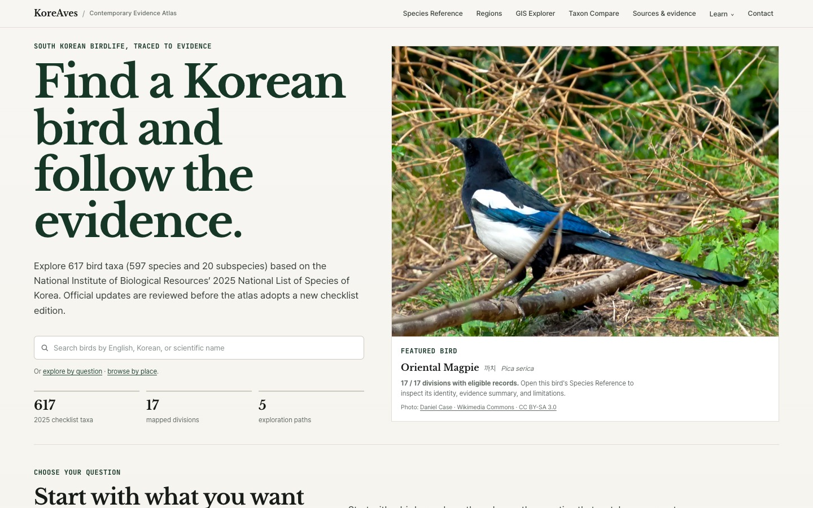

An independent project can be available on the web for months without being particularly discoverable. One useful indication of progress is when **someone else's resource index provides a way to find it**. That has happened for KoreAves, the bird evidence atlas I have been developing for South Korea.

This is a record of what I can actually verify—not a claim of institutional partnership, scientific approval or measurable traffic growth.

## The project behind the links

KoreAves connects species and subspecies identities, regional occurrence evidence, source provenance, and images that can be reused responsibly. The aim is to help readers understand **where bird records come from and what they do not prove**. A recorded occurrence is not a population estimate; an administrative region with qualifying evidence is not a biological range polygon.

The atlas covers a reference of 597 species and 20 subspecies, 617 taxa in total. The underlying documentation is public through the [dataset notes](https://koreaves.com/dataset/) and [methodology](https://koreaves.com/methodology/).

## Where the project appears

Seven public source pages link readers to KoreAves, with different audiences and publication status:

- **[Beary Birding](https://www.bearybirding.com/resources)** includes KoreAves under *Online Field Guides*, alongside other bird-reference tools. This is an external resource listing, not a review or formal endorsement.
- **[New Zealand Birds](https://www.nzbirds.com/bar/links.html)** links to the project on its birding links page and labels it a Korean bird evidence atlas.
- **[FMHY Educational Wiki](https://github.com/fmhy/FMHY/wiki/Educational)** includes KoreAves in its biology learning resources. This is a community-maintained directory entry.
- **[Kartoza Awesome Geodata](https://github.com/kartoza/awesome-geodata/blob/main/README.md#kr)** links to KoreAves in its South Korea section. The public README describes a free bird occurrence-evidence atlas with regional GIS views and source links. Its geodata focus gives GIS readers a different way to encounter the atlas. The listing does not document a formal endorsement or measured use.
- **[Nav-AI](https://nav-ai.net/ai/koreaves)** has a public KoreAves software-directory entry with a direct link to the live atlas. Its overview draws on the project's published homepage. It does not establish independently tested functionality, user reviews, or adoption.

- **[Bird Album — South Korea](https://birdalbum.com/countries/kr/)** (birdalbum-koreaves-further-reading) includes KoreAves as a *Further reading* link to the live atlas. I checked that same link in four public editions: [English](https://birdalbum.com/countries/kr/), [Korean](https://birdalbum.com/ko/countries/kr/), [Japanese](https://birdalbum.com/ja/countries/kr/) and [French](https://birdalbum.com/fr/countries/kr/). This is one inclusion presented in several languages, not four separate endorsements.
- **[Kantorilode's legacy Birds of Japan links page](https://kantorilode.weebly.com/links.html)** (kantorilode-koreaves-legacy-links) includes KoreAves under *East Asia and beyond*. The [current primary-domain links page](https://kantorilode.com/links.html) did not display the link when checked. I am recording the specific working Weebly page, not claiming the newer domain has been updated.

These lists serve different readers. Bird Album's country reference offers a bird-information route alongside the older software and geodata directories. Bird Album's [data-source explanation](https://birdalbum.com/about/) uses IOC World Bird List 15.2, while the [KoreAves dataset notes](https://koreaves.com/dataset/) describe a Korean national checklist foundation. A link between the projects does not make their taxon concepts identical. None of these listings measures actual reader visits to KoreAves.

## A separate kind of record: GBIF Literature

The [GBIF Literature API record](https://api.gbif.org/v1/literature/dc2c4f8b-062c-3eb1-8073-8a15529823b5) identifies KoreAves as a `WEB_PAGE`, with the project website as the linked resource. This is a **catalogue/data-use record**. It should not be read as a peer-reviewed publication, a quality certification, or an institutional endorsement by GBIF.

That distinction matters because the words *indexed*, *listed*, *published* and *partnered* are not interchangeable.

## What this changes—and what it does not

These public listings give the project additional discovery paths. They also reinforce a practical design choice: source attribution and limitations are part of the product, not merely footnotes.

What I **cannot** infer from the listings alone is audience size, adoption, institutional approval or scientific validation. Those would require other evidence. I will keep recording external references with a link to the original page and an exact description of the relationship.

## Next steps

The most valuable work is still the difficult work: better source coverage, taxon alignment, more rights-cleared imagery and clearer explanations of the atlas's limits. External links are encouraging because they connect those efforts to actual discovery—not because they finish the work.

For the full engineering context, see the [KoreAves case study](/portfolio/koreaves/) and the [original technical introduction](/koreaves-bird-evidence-atlas-en/).
