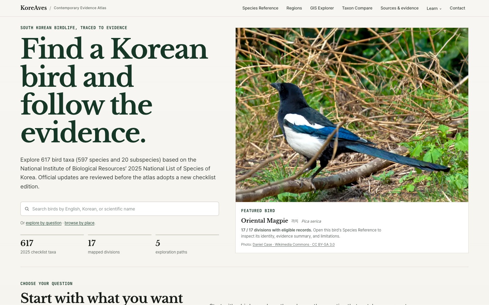

개인 프로젝트를 공개하는 일과, 다른 사람이 그 프로젝트를 **찾을 수 있는 경로가 생기는 일**은 다르다. 한국의 조류 기록을 다루는 [KoreAves](https://koreaves.com/)를 개발하면서 해외 조류 정보 목록과 교육 리소스 페이지에 프로젝트가 연결되는 사례를 확인했다.

이 글에서는 확인 가능한 페이지를 중심으로 기록한다. 외부 링크가 있다는 사실을 특정 기관의 공식 협약, 학술적 검증 또는 실사용자 증가로 확대해 해석하지 않는다.

## 어떤 프로젝트인가

KoreAves는 한국 조류의 이름과 분류, 지역별 출현 기록, 데이터 출처, 이용 권리를 확인한 이미지를 연결하려는 독립적인 정보 아틀라스다. 핵심은 데이터를 하나의 그럴듯한 지도로 만드는 데 있지 않다. **해당 표현을 뒷받침하는 기록이 무엇이며 무엇까지 주장할 수 있는지** 보여주는 것이다.

예를 들어 한 지역의 기록 수는 개체수가 아니다. 공공 데이터에서 조건에 맞는 기록을 찾지 못했다고 해서 그 지역에 새가 없다고 할 수도 없다. 프로젝트는 597종과 20아종, 총 617분류군을 기준으로 다룬다.

## 외부에서 확인되는 세 가지 연결

- **[Beary Birding](https://www.bearybirding.com/resources)**: *Online Field Guides* 항목에서 KoreAves를 소개한다. 해당 페이지에는 다른 국제 조류 관찰 도구도 함께 정리되어 있다.
- **[New Zealand Birds](https://www.nzbirds.com/bar/links.html)**: 외부 조류 관련 링크 목록에 KoreAves를 한국 조류 증거 아틀라스로 연결해 놓았다.
- **[FMHY Educational Wiki](https://github.com/fmhy/FMHY/wiki/Educational)**: 교육 위키의 생물학 리소스 목록에서 KoreAves를 볼 수 있다.

세 사례는 성격이 조금씩 다르다. 그러나 모두 **프로젝트 자체가 아닌 독립된 웹페이지에서 KoreAves로 향하는 링크가 공개되어 있다**는 점에서 의미가 있다. 등재 당시 날짜까지 확인되지 않은 항목에는 임의의 날짜를 붙이지 않았다.

## GBIF Literature 기록은 무엇을 뜻할까

[GBIF 공개 API](https://api.gbif.org/v1/literature/dc2c4f8b-062c-3eb1-8073-8a15529823b5)에서 KoreAves라는 제목의 기록을 확인할 수 있으며 자료 유형은 `WEB_PAGE`다. 즉 GBIF 자료 이용을 기록하는 체계 안에 웹페이지가 등록되어 있다는 의미이지, **학술 논문 게재나 GBIF의 공식 품질 인증을 받았다는 뜻은 아니다.**

외부 성과를 기록할 때 이 구분은 중요하다. 누군가 링크를 건 것, 편집자가 기고문을 게재한 것, 기관과 실제로 공동 활동을 한 것은 서로 다른 사건이다.

## 무엇을 얻었고, 아직 무엇을 모르는가

외부 리소스 목록에 등장했다는 사실로부터 확인할 수 있는 것은 프로젝트를 발견할 새로운 경로가 생겼다는 점이다. **그로 인한 방문자 수 증가나 실질적 채택 효과는 별도 자료가 없으므로 단정할 수 없다.**

앞으로도 새로운 외부 언급을 발견하면 원문 링크, 성과 유형, 검증 가능한 날짜를 함께 기록할 생각이다. 구현과 데이터 품질 면에서는 분류군 정합성, 출처 설명, 재사용 가능한 사진의 확보가 계속 중요한 과제다.

프로젝트의 기술적 배경은 [KoreAves 사례 페이지](/portfolio/koreaves/)와 [개발 기록](/koreaves-bird-evidence-atlas/)에서 볼 수 있다.
