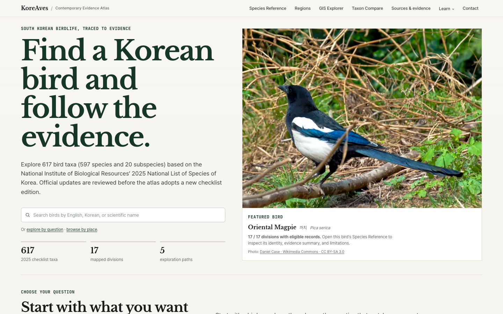

개인 프로젝트를 공개하는 일과, 다른 사람이 그 프로젝트를 **찾을 수 있는 경로가 생기는 일**은 다르다. 한국의 조류 기록을 다루는 [KoreAves](https://koreaves.com/)를 개발하면서 해외 조류 정보 목록과 교육 리소스 페이지에 프로젝트가 연결되는 사례를 확인했다.

이 글에서는 확인 가능한 페이지를 중심으로 기록한다. 외부 링크가 있다는 사실을 특정 기관의 공식 협약, 학술적 검증 또는 실사용자 증가로 확대해 해석하지 않는다.

## 어떤 프로젝트인가

KoreAves는 한국 조류의 이름과 분류, 지역별 출현 기록, 데이터 출처, 이용 권리를 확인한 이미지를 연결하려는 독립적인 정보 아틀라스다. 핵심은 데이터를 하나의 그럴듯한 지도로 만드는 데 있지 않다. **해당 표현을 뒷받침하는 기록이 무엇이며 무엇까지 주장할 수 있는지** 보여주는 것이다.

예를 들어 한 지역의 기록 수는 개체수가 아니다. 공공 데이터에서 조건에 맞는 기록을 찾지 못했다고 해서 그 지역에 새가 없다고 할 수도 없다. 프로젝트는 597종과 20아종, 총 617분류군을 기준으로 다룬다.

## 외부에서 확인되는 아홉 가지 연결

- **[Beary Birding](https://www.bearybirding.com/resources)**: *Online Field Guides* 항목에서 KoreAves를 소개한다. 해당 페이지에는 다른 국제 조류 관찰 도구도 함께 정리되어 있다.
- **[Wetland Link International(WLI)의 철새 자료](https://wli.wwt.org.uk/resources/priority-theme-resources/migratory-birds/)** (wli-migratory-birds-koreaves): *Migratory birds* 자료 페이지에서 KoreAves를 한국 조류 기록을 영어로 살펴보면서 원출처를 확인할 수 있는 사이트로 소개하고 [공식 홈페이지](https://koreaves.com/)에 직접 연결한다. 외부 자료 페이지의 수록 사실이며, WLI 회원 자격이나 기관의 공식 제휴·추천을 의미하지 않는다.
- **[New Zealand Birds](https://www.nzbirds.com/bar/links.html)**: 외부 조류 관련 링크 목록에 KoreAves를 한국 조류 증거 아틀라스로 연결해 놓았다.
- **[FMHY Educational Wiki](https://github.com/fmhy/FMHY/wiki/Educational)**: 교육 위키의 생물학 리소스 목록에서 KoreAves를 볼 수 있다.
- **[Kartoza Awesome Geodata](https://github.com/kartoza/awesome-geodata/blob/main/README.md#kr)**: 한국 지리공간 자료를 모은 공개 README에 KoreAves 링크가 있다. 해당 설명은 지역별 GIS 화면과 출처를 확인할 수 있는 조류 출현 기록 아틀라스라고 소개한다. 지리공간 자료를 찾는 사람에게도 프로젝트로 이어지는 경로가 생긴 셈이다. 목록에 있다는 사실만으로 추천이나 실사용을 입증할 수는 없다.
- **[Nav-AI](https://nav-ai.net/ai/koreaves)**: 소프트웨어 디렉터리에 KoreAves 소개와 공식 사이트로 향하는 링크가 있다. 설명은 공개 홈페이지 정보를 기반으로 작성돼 실제 기능의 독립 평가나 이용자 증가를 입증하지는 않는다.

- **[Bird Album 한국 페이지](https://birdalbum.com/countries/kr/)** (birdalbum-koreaves-further-reading): *Further reading* 항목에서 KoreAves 공식 사이트를 연결한다. 실제 공개 화면에서 [영어](https://birdalbum.com/countries/kr/), [한국어](https://birdalbum.com/ko/countries/kr/), [일본어](https://birdalbum.com/ja/countries/kr/), [프랑스어](https://birdalbum.com/fr/countries/kr/) 네 언어판의 링크를 확인했다. 네 언어에서 보인다고 별도 추천 네 건으로 계산하지 않는다.
- **[GREENUS Resources & Tools](https://greenus.upb.ro/share.php?t=t_35802c3c02e2be7201)** (greenus-koreaves-community-tool): KoreAves가 독립 개발자 Jihun Oh의 *Mapping Tool*로 등록돼 있다. 자료 설명은 조류 관찰 근거를 지도로 살피고, 기록의 빈칸과 출처를 질문하는 환경 데이터 읽기 활동을 제안한다. *LEAF Pillars*에는 *Learning*으로 분류돼 있다. 이 등재는 공개된 교육 자료 목록에 관한 사실이며 실제 수업 도입이나 기관의 공식 검증을 뜻하지 않는다. 원문 페이지의 **Open Tool** 버튼은 현재 이전 `/explorer/` 경로(HTTP 404)를 사용하므로, [작동하는 KoreAves GIS 탐색기](https://koreaves.com/gis/)로 직접 이동해 [지도 표현 기준](https://koreaves.com/methodology/)을 함께 확인할 수 있다.
- **[Kantorilode의 Birds of Japan 링크 목록](https://kantorilode.com/links.html)** (kantorilode-koreaves-legacy-links): 2026년 11월 15일, 기본 도메인과 [web.app 페이지](https://kantorilode.web.app/links.html)에서 *SOUTH KOREAN BIRDING*이라는 링크가 [KoreAves](https://koreaves.com/)로 연결되는 것을 직접 확인했다. [기존 Weebly 목록](https://kantorilode.weebly.com/links.html)에는 *KOREAVES (South Korean bird database)*라는 이름으로 남아 있다. 이전에 기본 도메인에는 링크가 없다고 적었던 부분을 바로잡는다. 같은 목록의 여러 주소를 별도 등재나 실제 방문으로 계산하지 않는다.

각 목록의 독자는 다르다. 특히 GREENUS에서는 출처를 추적할 수 있도록 설계한 GIS가 교육용 데이터 문해력 활동의 예시로 제시된다. 개발자로서 구현한 것은 지도 색만이 아니라 **어떤 기록이 그 색을 뒷받침하는지 사용자가 확인할 수 있는 경로**다. 교육자는 지도에서 색이 있는 지역과 빈 지역을 비교하고, 기록의 존재와 새의 개체 수를 구분하는 질문을 만들 수 있다. 이런 활용 가능성과 실제 수업에서의 사용 실적은 구분한다.

Bird Album의 국가별 조류 정보 페이지는 기존 소프트웨어·지리공간 자료 목록과 다른 방식으로 KoreAves를 발견할 경로다. [Bird Album의 자료 설명](https://birdalbum.com/about/)은 IOC 15.2 목록을 사용한다고 밝히고, [KoreAves 데이터 설명](https://koreaves.com/dataset/)은 한국 국가목록을 기준으로 한다. 두 사이트가 연결됐다고 동일한 분류 개념을 적용한다는 뜻은 아니다. 링크를 통한 실제 방문이나 사용자 수는 확인되지 않았다. 최초 게재일 근거가 없는 항목에는 날짜를 붙이지 않았다.

## 순천만 탐조 안내에서 지도 설명을 검토하다

[현재 2026년 11월 19일로 날짜가 표시된 Daily Korea의 순천만 첫 탐조 안내](https://dailykorea.net/ko/travel/suncheon-bay-first-birdwatching/)는 처음 방문하는 사람이 흑두루미를 관찰할 때 참고할 자료로 [KoreAves 지역 기록 지도](https://koreaves.com/gis/)와 [기록 읽는 법](https://koreaves.com/guide/)을 연결한다. 기사에서는 지역에 색이 있다는 사실이 해당 조건의 관찰 기록을 뜻하며, 기록 수를 개체 수로 해석해서는 안 된다는 점도 설명한다.

나는 초보 탐조객을 위한 순천만 안내를 제안했고, 한국어 초안을 검토해 KoreAves 지도 설명의 수정 문구를 전달했다. 편집진은 지도 설명을 고쳐, 색이 칠해진 광역 행정구역에 기준을 충족한 조류 관찰 기록이 있다는 뜻이라고 밝혔다. 이 표시는 순천만 안에서 현재 새를 볼 수 있다는 예측이나 개체 수를 나타내지 않는다. 겨울 입장 시간과 순천역 출발 투어 정보는 편집진이 운영자의 최신 예약 정보와 별도로 대조했다. 공개 페이지의 발행 주체는 *Daily Korea Editorial*이다. 내 역할은 지도 해석에 대한 사실 검토였고, 기고나 공동 집필 크레딧은 없다. 기사에서 KoreAves로 유입된 방문은 측정하지 않았다.

## GBIF Literature 기록은 무엇을 뜻할까

[GBIF 공개 API](https://api.gbif.org/v1/literature/dc2c4f8b-062c-3eb1-8073-8a15529823b5)에서 KoreAves라는 제목의 기록을 확인할 수 있으며 자료 유형은 `WEB_PAGE`다. 즉 GBIF 자료 이용을 기록하는 체계 안에 웹페이지가 등록되어 있다는 의미이지, **학술 논문 게재나 GBIF의 공식 품질 인증을 받았다는 뜻은 아니다.**

외부 성과를 기록할 때 이 구분은 중요하다. 누군가 링크를 건 것, 편집자가 기고문을 게재한 것, 기관과 실제로 공동 활동을 한 것은 서로 다른 사건이다.

## 무엇을 얻었고, 아직 무엇을 모르는가

외부 리소스 목록에 등장했다는 사실로부터 확인할 수 있는 것은 프로젝트를 발견할 새로운 경로가 생겼다는 점이다. **그로 인한 방문자 수 증가나 실질적 채택 효과는 별도 자료가 없으므로 단정할 수 없다.**

앞으로도 새로운 외부 언급을 발견하면 원문 링크, 성과 유형, 검증 가능한 날짜를 함께 기록할 생각이다. 구현과 데이터 품질 면에서는 분류군 정합성, 출처 설명, 재사용 가능한 사진의 확보가 계속 중요한 과제다.

프로젝트의 기술적 배경은 [KoreAves 사례 페이지](/portfolio/koreaves/)와 [개발 기록](/koreaves-bird-evidence-atlas/)에서 볼 수 있다.
