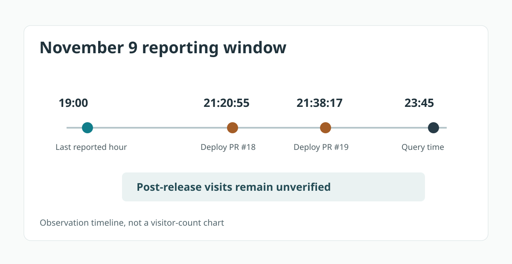

> **한국어:** [배포는 21시 38분, GA4 보고 행은 19시까지였다](/ga4-deployment-report-window-ko/)

**An empty GA4 report immediately after a deployment cannot establish that there were zero visitors.** Compare the release time with the last hour actually returned by Analytics, in the property's time zone. Missing rows might mean the data has not been processed, no matching event occurred, or collection was not working. A single report cannot tell those cases apart.

On November 9, I shipped two GitHub Pages changes to the [developer portfolio](/portfolio/) and its [Threads links](/about/). PR #18 merged at **21:20:55**, and PR #19 at **21:38:17**, both Korea Standard Time. At about **23:45 KST** that evening, I queried GA4 Data API for the same day.

<figure>
  <a href="/assets/img/dev-ga4-report-window-20261110/timeline-en.svg"></a>
  <figcaption>Original timeline from actual releases and an aggregate query. This is neither a traffic chart nor a screenshot of the Analytics interface.</figcaption>
</figure>

## Eight events are not eight people

With `eventName = page_view`, the report returned **six rows totaling eight events**. The latest `dateHour` was `2026110919`, or **19:00 KST**. Two more tightly filtered reports returned **zero rows**: `page_view` on `/about/` and `click` on that page for [this exact Threads post](https://www.threads.com/@devtestudinidae/post/DfgMbvdkni7).

Those are observations of the report at query time. Eight counts event occurrences, not unique people. Six counts grouped rows. Neither figure is a visitor count. An empty post-deployment interval does not establish whether processing was late or there were simply no matching recorded events.

## Align the deployment and reporting clocks

The property's time zone is `Asia/Seoul`. GA4's `dateHour` dimension uses the property time zone and the `YYYYMMDDHH` format. I requested `eventCount` grouped by `dateHour`, `eventName`, `pagePath` and `linkUrl`, using a dated [GA4 Data API `runReport`](https://developers.google.com/analytics/devguides/reporting/data/v1/basics) query:

```json
{
  "dateRanges": [{"startDate": "2026-11-09", "endDate": "2026-11-09"}],
  "dimensions": [
    {"name": "dateHour"}, {"name": "eventName"},
    {"name": "pagePath"}, {"name": "linkUrl"}
  ],
  "metrics": [{"name": "eventCount"}],
  "dimensionFilter": {
    "filter": {"fieldName": "eventName",
      "stringFilter": {"matchType": "EXACT", "value": "page_view"}}
  }
}
```

This is the request body; an actual API call also needs an authorized property. I ran separate filters for `pagePath = /about/` and for `eventName = click` with the exact `linkUrl`. Page views and clicks were not combined into a person count.

On November 10, I checked the rendered `/about/` HTML and confirmed that a real `href` pointed to the Threads post. That does not confirm that link clicks were captured. The [GA4 enhanced-measurement setting](https://support.google.com/analytics/answer/9216061?hl=en), consent behavior and browser-side collection still need separate checks.

## Wait for a usable reporting window

Google's [data freshness guidance](https://support.google.com/analytics/answer/11198161?hl=en) distinguishes intraday from daily processing and notes that reported figures may change for **24–48 hours**. That is general guidance, not a guaranteed completion time for this property.

The 23:45 query therefore cannot establish the effect of either deployment. A useful follow-up checks a more complete November 9 report, focusing on hours after **21:20 and 21:38 KST**, plus `/about/` views and the exact outbound `linkUrl` as separate results. If rows are still absent, collection configuration needs inspection before making a traffic claim.

This follows [my earlier account of a six-record browser test breaking when the portfolio grew to eight entries](/portfolio-evidence-release-qa-en/). That article covers release correctness; this one documents the limits of the observation window. Even a collected outbound click cannot establish that someone read the article or adopted the project.
