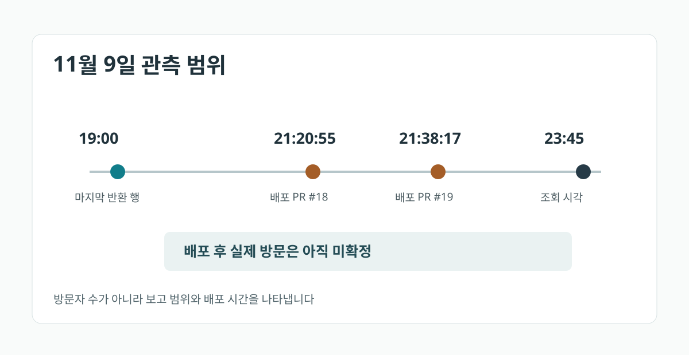

> **English:** [The site deployed at 21:38. GA4 last reported 19:00](/ga4-deployment-report-window-en/)

**배포 직후 GA4 보고서에 새 이벤트가 보이지 않는다고 방문자 수를 0명으로 판정할 수는 없습니다.** 먼저 배포 시각과 마지막으로 반환된 이벤트의 시간대를 비교해야 합니다. 빈 행의 원인은 아직 처리되지 않은 데이터일 수도 있고, 해당 이벤트가 발생하지 않았거나 수집되지 않았을 수도 있습니다.

11월 9일 [개발자 포트폴리오](/portfolio/)와 [Threads 연결](/about/) 관련 GitHub Pages 변경 두 건을 배포했습니다. PR #18은 **21:20:55**, PR #19는 **21:38:17**에 머지됐습니다(한국시간). 같은 날 **23:45 무렵**, GA4 Data API로 그날의 이벤트를 조회했습니다.

<figure>
  <a href="/assets/img/dev-ga4-report-window-20261110/timeline-ko.svg"></a>
  <figcaption>실제 배포 기록과 조회 결과로 그린 시간표입니다. 방문량 그래프나 GA4 화면 캡처가 아닙니다.</figcaption>
</figure>

## 이벤트 8개와 방문자 8명은 다르다

`eventName = page_view`로 제한한 보고서는 **6행, 총 8개 이벤트**를 반환했습니다. 마지막 `dateHour`는 `2026110919`, 즉 **19시 KST**였습니다. `/about/` 페이지의 `page_view`, 그리고 이 페이지에서 [기존 Threads 글](https://www.threads.com/@devtestudinidae/post/DfgMbvdkni7)로 이동하는 `click`의 조회 결과는 각각 **0행**이었습니다.

확인된 것은 조회 당시의 응답입니다. 8은 이벤트 발생 횟수이고 6은 집계 결과 행의 수입니다. 고유 방문자 수를 뜻하지 않습니다. 배포 이후 시간대의 행이 없다는 사실만으로 **데이터 지연**과 **측정 가능한 활동의 부재**를 구별할 수 없습니다.

## 같은 시간대를 기준으로 다시 조회하기

먼저 GA4 속성 시간대가 `Asia/Seoul`임을 확인했습니다. `dateHour`는 속성 시간대로 `YYYYMMDDHH` 형식을 사용합니다. [GA4 Data API `runReport`](https://developers.google.com/analytics/devguides/reporting/data/v1/basics)에는 다음과 같은 요청 본문을 사용할 수 있습니다. 실제 호출 시에는 접근 권한이 있는 GA4 속성을 별도로 지정해야 합니다.

```json
{
  "dateRanges": [{"startDate": "2026-11-09", "endDate": "2026-11-09"}],
  "dimensions": [
    {"name": "dateHour"}, {"name": "eventName"},
    {"name": "pagePath"}, {"name": "linkUrl"}
  ],
  "metrics": [{"name": "eventCount"}],
  "dimensionFilter": {
    "filter": {"fieldName": "eventName",
      "stringFilter": {"matchType": "EXACT", "value": "page_view"}}
  }
}
```

이후 `pagePath = /about/`와 `eventName = click` 및 정확한 `linkUrl`을 각각 별도 보고서로 확인했습니다. 서로 다른 이벤트를 방문자 수로 합산하지 않았습니다.

11월 10일 실제 렌더된 `/about/` HTML에서 해당 Threads 글로 연결되는 `href`도 확인했습니다. 그러나 링크의 존재가 곧 클릭 측정을 보장하지는 않습니다. [GA4 향상된 측정](https://support.google.com/analytics/answer/9216061?hl=en)의 외부 링크 클릭 기능, 동의 설정, 브라우저의 추적 방지 여부는 별도 확인 대상입니다.

## 데이터가 충분히 처리되기 전에는 결론을 보류한다

구글의 [데이터 최신성 안내](https://support.google.com/analytics/answer/11198161?hl=en)에 따르면 일중 처리와 일간 처리 시점이 다르며 보고된 수치는 **24~48시간 동안 변경될 수 있습니다**. 모든 속성에 동일한 완료 시각을 보장한다는 뜻은 아닙니다.

따라서 23:45 조회만으로 두 배포의 유입 효과를 판정하지 않았습니다. 완료된 11월 9일 보고에서 **21시 이후 시간대**, `/about/` 페이지뷰, 정확한 외부 링크 클릭을 분리해 확인해야 합니다. 나중에도 행이 없다면 먼저 이벤트 수집 상태를 점검해야 합니다.

이는 [성과 기록 6건이 8건이 되면서 브라우저 테스트가 실패한 이전 개발일지](/portfolio-evidence-release-qa-ko/)의 후속 측정 사례입니다. 앞선 글에서 검증한 것은 배포 코드이고, 이번에 확인한 것은 **보고서가 보여 주는 범위**입니다. 링크 클릭이 확인되더라도 외부 기사 열람이나 제품 이용을 뜻하지는 않습니다.
