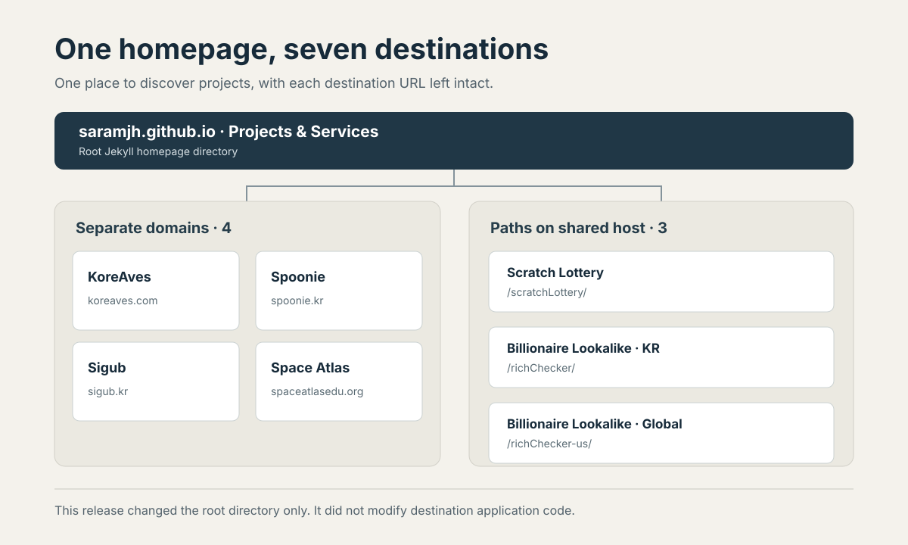

> **한국어:** [GitHub Pages 홈에서 일곱 목적지를 찾기 쉽게 만든 방법](/homepage-project-directory-ko/)

The `Projects & Services` section on my GitHub Pages homepage gives seven destinations a name, a short description and an icon. It lets visitors move from the blog to a project without having to infer the destination from a raw URL.

On November 2, [PR #11](https://github.com/saramjh/saramjh.github.io/pull/11) refined the existing directory with project icons, clearer descriptions and a responsive layout. Its entries are KoreAves, Spoonie, Sigub, Scratch Lottery, Space Atlas, Billionaire Lookalike · KR and Billionaire Lookalike · Global. Four links use separate domains; three use paths under the shared `saramjh.github.io` hostname.

A hostname describes the address. Code and deployment ownership remain with each project. PR #11 changed the root Jekyll homepage template and SCSS, added seven project icons, and updated `scripts/check_growth_ownership.py` and the directory tests. It did not change destination application code.

<figure>

<figcaption>An original diagram based on the actual PR #11 links and URL structure. It is not a product screenshot or a traffic chart.</figcaption>
</figure>

## Give every link a readable destination

Each entry is a real anchor inside a labeled `nav` and `ul`. The surrounding `section` is associated with its heading, and the link text contains both the project name and a short description.

The icon uses `alt=""` because the adjacent text already identifies the destination. That keeps a screen reader from announcing the same name twice. The decorative arrow is marked `aria-hidden="true"`.

## Keep the layout usable at different sizes

The directory uses two columns on wider screens and collapses to one column on narrow screens. A `:focus-visible` style marks the active link for keyboard users, and the dark theme has its own colors.

The [project directory test](https://github.com/saramjh/saramjh.github.io/blob/7535410927b254b2f655ccfcf152dcff7d8f3cd0/tests/test_project_showcase.py) checks the seven exact destination URLs, all seven local icon files and the semantic navigation structure. It also checks the responsive column rules, focus style and dark-theme selector. These are source and stylesheet contract checks, not a full assistive-technology evaluation.

## What the release verified

[GitHub Actions run 41400905664](https://github.com/saramjh/saramjh.github.io/actions/runs/41400905664) completed both the build and deployment jobs. The build included the project directory test, Jekyll build, image and sitemap checks, SEO checks and post-asset checks.

On November 10, I checked the public homepage again. It returned HTTP 200 and rendered all seven destinations. Each of the seven linked icon assets also returned HTTP 200.

This verifies that the directory and its icons are reachable. Search indexing, visitor counts, link clicks and destination use require separate evidence. I have not retrieved a dated report of directory-link selections.

The live directory is on the [homepage](https://saramjh.github.io/). The [project portfolio](/portfolio/) and [external recognition archive](/portfolio/recognition/) provide more context about the work. My earlier [portfolio browser-test note](/portfolio-evidence-release-qa-en/) records a related change where the test expectations were updated to follow the source data.
