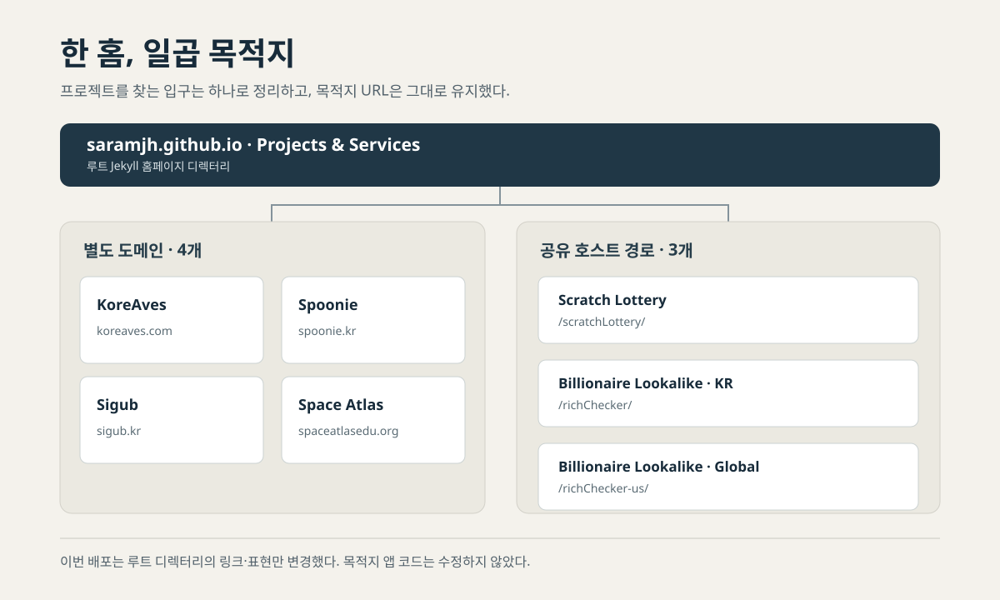

> **English:** [Making seven destinations easier to find from a GitHub Pages homepage](/homepage-project-directory-en/)

홈페이지의 `Projects & Services` 영역은 일곱 목적지를 이름, 한 줄 설명, 아이콘으로 안내한다. 방문자가 최근 글 목록을 거치지 않고 실제 프로젝트로 이동할 수 있도록 만든 탐색 영역이다.

11월 2일 [PR #11](https://github.com/saramjh/saramjh.github.io/pull/11)에서 기존 디렉터리에 아이콘과 설명을 보강하고 화면 배치를 다듬었다. 목록에는 KoreAves, Spoonie, Sigub, Scratch Lottery, Space Atlas, Billionaire Lookalike · KR, Billionaire Lookalike · Global이 들어 있다. 네 항목은 별도 도메인으로 연결되고, 세 항목은 `saramjh.github.io` 아래 경로를 사용한다.

호스트 이름은 주소를 나타내며, 코드와 배포의 소유 범위는 각 프로젝트에 따라 달라진다. PR #11은 루트 Jekyll 블로그의 홈 템플릿과 SCSS를 수정하고 프로젝트 아이콘 일곱 개를 추가했다. `scripts/check_growth_ownership.py`와 디렉터리 테스트도 함께 갱신했다. 목적지 애플리케이션 코드는 수정하지 않았다.

<figure>

<figcaption>PR #11의 실제 링크와 URL 구조를 바탕으로 직접 그린 개념도입니다. 실제 서비스 화면이나 방문 통계가 아닙니다.</figcaption>
</figure>

## 링크는 이름과 설명을 가진다

각 항목은 이름만 적은 문자열이 아니라, 실제 링크를 담은 `nav`와 `ul` 안에 배치했다. 바깥 `section`은 제목과 연결하고, 링크 안에는 프로젝트 이름과 짧은 설명을 함께 둔다.

아이콘은 옆에 같은 프로젝트 이름이 표시되므로 `alt=""`로 처리했다. 링크를 읽을 때 이미지 설명이 이름을 반복하지 않도록 하기 위해서다. 장식용 화살표에도 `aria-hidden="true"`를 지정했다.

## 모바일과 키보드 상태

넓은 화면에서는 두 열로 배치하고 좁은 화면에서는 한 열로 접는다. 키보드로 이동할 때 현재 링크를 찾을 수 있도록 `:focus-visible` 스타일을 두었고, 다크 테마에도 별도 색상을 지정했다.

[프로젝트 디렉터리 테스트](https://github.com/saramjh/saramjh.github.io/blob/7535410927b254b2f655ccfcf152dcff7d8f3cd0/tests/test_project_showcase.py)는 일곱 목적지 URL과 일곱 아이콘 파일, 시맨틱 내비게이션 구조를 확인한다. 반응형 열 구성과 포커스·다크 테마 스타일도 검사한다. 이 테스트는 마크업과 스타일 계약을 검증하며, 실제 보조기기 사용성 평가를 대신하지는 않는다.

## 배포에서 확인한 범위

[PR #11의 GitHub Actions 실행](https://github.com/saramjh/saramjh.github.io/actions/runs/41400905664)은 빌드와 배포를 모두 통과했다. 빌드 단계에서는 프로젝트 디렉터리 테스트, Jekyll 빌드, 이미지·사이트맵 검사, SEO 검사와 포스트 자산 검사를 실행했다.

11월 10일 공개 홈페이지를 다시 확인했을 때 HTML은 HTTP 200을 반환했고 일곱 목적지가 모두 렌더링됐다. 연결된 아이콘 파일 일곱 개도 각각 HTTP 200이었다.

이 결과가 확인해 주는 범위는 디렉터리와 아이콘 파일의 공개 경로 응답까지다. 검색엔진 색인, 실제 방문자 수, 링크 클릭과 각 프로젝트의 이용량은 별도 데이터로 확인해야 한다. 디렉터리 링크의 클릭 수를 집계한 날짜별 보고서는 아직 조회하지 않았다.

현재 디렉터리는 [홈페이지](https://saramjh.github.io/)에서 볼 수 있다. 프로젝트별 설명은 [포트폴리오](/portfolio/)와 [외부 성과 아카이브](/portfolio/recognition/)에서 이어서 확인할 수 있다. 앞선 [포트폴리오 브라우저 테스트 개발일지](/portfolio-evidence-release-qa-ko/)에는 목록 데이터가 바뀌었을 때 테스트를 함께 수정한 과정이 정리돼 있다.
