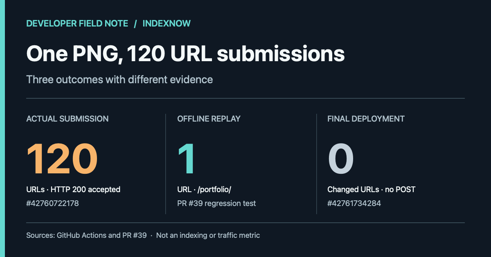

> **한국어:** [이미지 한 장을 바꿨는데 IndexNow에는 URL 120개가 전송됐다](/indexnow-image-page-scope-ko/)

On November 10, 2026, I added a Playwright CI case and an original preview image to my [developer portfolio](/portfolio/). The GitHub Pages deployment passed. Its search-notification step, however, sent **120 URLs to IndexNow**, which returned HTTP 200 Accepted. Only one portfolio page needed the new image.

<figure>

<figcaption>Three separate evidence types: 120 URLs actually submitted, one URL selected in an offline replay, and zero changed URLs in a later code-only deployment. None measures indexing or traffic.</figcaption>
</figure>

The [native workflow run](https://github.com/saramjh/saramjh.github.io/actions/runs/42760722178) records the submission. HTTP 200 here means the request was accepted. It says nothing about whether those 120 pages changed, were indexed, or received visitors.

## How one PNG expanded into a full sitemap

The blog's notification script compares two Git commits and selects URLs to notify through Bing and IndexNow. Its original rule treated a change anywhere under <code>assets/</code> as potentially affecting the whole site.

That is a reasonable fallback for a shared header image or global stylesheet. It was too broad for this change. The PNG added in [PR #38](https://github.com/saramjh/saramjh.github.io/pull/38) was referenced by the portfolio page, not a shared layout. The script still selected every URL in the sitemap.

I kept the original 120-URL submission record. It was a completed provider request, so repeating it would not help diagnose the selection bug.

## Find the pages that use the changed image

The [PR #39 fix](https://github.com/saramjh/saramjh.github.io/pull/39/files) searches Git for exact image-path references in both the before and after revisions. Searching both matters when an image is removed from a page as well as when one is added.

~~~text
Changed image path
    ↓
Find exact references in both Git revisions
    ↓
Resolve the referencing Markdown/HTML page permalink
    ↓
Notify the confirmed page URLs
~~~

A PNG referenced by <code>portfolio/index.html</code> maps to <code>/portfolio/</code>. For an image referenced by a blog post, the script also includes the home page because recent-post previews may use it.

Unknown references still trigger the conservative full-sitemap fallback, as do images in shared templates. If the release diff cannot be verified, the script skips the provider request instead of guessing which URLs changed.

## Separate provider receipts from offline tests

| Case | URL selection | Evidence |
|---|---|---|
| Original live deployment | 120 URLs sent; HTTP 200 Accepted | [Actions #42760722178](https://github.com/saramjh/saramjh.github.io/actions/runs/42760722178) |
| Offline replay of that change with the fix | One page: <code>/portfolio/</code> | [PR #39 regression tests](https://github.com/saramjh/saramjh.github.io/pull/39/files) |
| Script-only deployment after the fix | Zero changed page URLs; Bing and IndexNow skipped | [Actions #42761734284](https://github.com/saramjh/saramjh.github.io/actions/runs/42761734284) |

The middle row is an **offline result**, not a second IndexNow submission. The fix passed 26 Python tests and the subsequent GitHub Pages build and deployment succeeded.

The tests cover an image referenced by one page, the same image used on multiple pages, references from a global template, and assets whose usage cannot be mapped reliably. These cases matter because narrowing every image to a single page would introduce a different notification error.

## Follow-up, November 18: a JavaScript change reached 11 pages, not 194

A second deployment exposed a different dependency problem. I added a source-side click event for a [Space Atlas portfolio link](/portfolio/space-atlas/) in [PR #193](https://github.com/saramjh/saramjh.github.io/pull/193). The event records selection of that specific link on this blog. It cannot tell me whether the visitor arrived at Space Atlas or used the simulator.

The changed file was `assets/js/portfolio.js`. Unlike the PNG in the first case, this script is loaded through `_layouts/portfolio.html`. That layout serves the portfolio index and recognition archive, five project pages, and four published milestone pages. The old notifier did not recognize the script's page consumers. It treated the edit as a shared-asset change and submitted **194 sitemap URLs** to IndexNow in the [original Pages run](https://github.com/saramjh/saramjh.github.io/actions/runs/44317892057). The provider returned HTTP 200 Accepted.

In [PR #194](https://github.com/saramjh/saramjh.github.io/pull/194), I extended the Git-diff resolver to check the exact script inclusion, the project and milestone layout inheritance, and each source page's permalink **in both revisions**. If a new consumer cannot be verified, the broader sitemap fallback remains. A new shared script must not be declared page-local merely because this particular edit had 11 known consumers.

| Verification | Selected URLs | What actually happened |
|---|---:|---|
| November 18 live deployment of PR #193 | 194 | One IndexNow batch was accepted: [Actions #44317892057](https://github.com/saramjh/saramjh.github.io/actions/runs/44317892057) |
| Offline replay of the same Git difference with the PR #194 resolver | 11 | Only the verified portfolio layout consumers were selected in regression tests; no new request |
| PR #194's separate source-only deployment | 0 | The notifier skipped Bing and IndexNow: [Actions #44321890015](https://github.com/saramjh/saramjh.github.io/actions/runs/44321890015) |

The narrow resolver passed 227 Python tests and the site's deployed build and Chrome checks. More importantly, the original deployment log confirms **no second IndexNow submission** for the code-only repair. The earlier accepted batch stays in the audit history.

This is useful beyond my blog: before notifying a search engine about a changed asset, verify where it is rendered. A single shared script might reach several pages without reaching the entire sitemap. The change improved my notification selection, but I have not measured additional indexing, visitors, or conversions from it.

## November 19 follow-up: the documentation looked like a script consumer

The next regression came from a detail in this article itself. On November 19, I added a click-only measurement for the portfolio's public contact link in [PR #208](https://github.com/saramjh/saramjh.github.io/pull/208). The [original deployment log](https://github.com/saramjh/saramjh.github.io/actions/runs/44386020085) shows **195 URLs submitted to IndexNow**, with one batch returning **HTTP 200 Accepted**. The site's dependency checker had already learned to trace the shared portfolio script to 11 pages. Why did it select the full sitemap again?

The Git reference search also found the two language editions of this case study. Each mentions the script's filename inside Markdown inline code to explain the earlier fix. Those words appear on the page as text; neither article loads the script. The resolver could not distinguish an explanation *about* a file from an executable reference *to* it, so it used the conservative fallback.

In [PR #209](https://github.com/saramjh/saramjh.github.io/pull/209), I made that distinction narrow: only these two known documentation pages qualify, with their original permalinks, languages, layouts and single inline-code references checked. An extra mention, a real script inclusion or an unknown consumer still triggers the broader fallback. A **read-only replay** of the PR #208 Git difference then selected the **11 verified portfolio pages**; it did **not** submit another request. The [separate PR #209 deployment](https://github.com/saramjh/saramjh.github.io/actions/runs/44387509083) selected **zero** changed page URLs and skipped Bing and IndexNow.

The earlier 195-URL provider receipt remains part of the record. A passing build and even a valid dependency rule are not enough if source-search matches can include prose written to document that very rule. This follow-up establishes the corrected selection and actual skip behavior, not improved indexing or reader growth.

## The check I will keep

A successful deployment proves that the site built. It does not prove that the notification list describes the pages that changed. I now check the selected URLs separately, including the conservative fallback and the case where no published content URL changed.

This work verified the source-to-URL mapping and the deployment's skip behavior. **I have no verified increase in search indexing, readers or conversions from it.** For another measured GitHub Actions change, see [the Playwright browser setup case](/playwright-github-actions-runner-chrome-en/).
