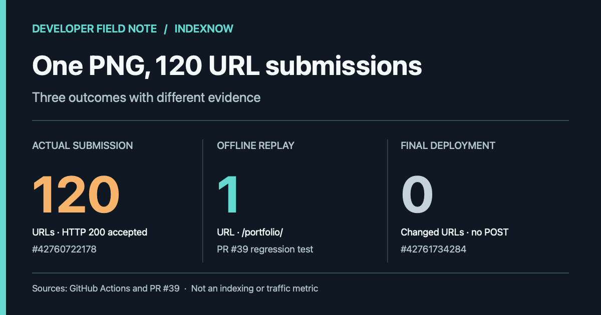

> **한국어:** [이미지 한 장을 바꿨는데 IndexNow에는 URL 120개가 전송됐다](/indexnow-image-page-scope-ko/)

On November 10, 2026, I added a Playwright CI case and an original preview image to my [developer portfolio](/portfolio/). The GitHub Pages deployment passed. Its search-notification step, however, sent **120 URLs to IndexNow**, which returned HTTP 200 Accepted. Only one portfolio page needed the new image.

<figure>

<figcaption>Three separate evidence types: 120 URLs actually submitted, one URL selected in an offline replay, and zero changed URLs in a later code-only deployment. None measures indexing or traffic.</figcaption>
</figure>

The [native workflow run](https://github.com/saramjh/saramjh.github.io/actions/runs/42760722178) records the submission. HTTP 200 here means the request was accepted. It says nothing about whether those 120 pages changed, were indexed, or received visitors.

## How one PNG expanded into a full sitemap

The blog's notification script compares two Git commits and selects URLs to notify through Bing and IndexNow. Its original rule treated a change anywhere under <code>assets/</code> as potentially affecting the whole site.

That is a reasonable fallback for a shared header image or global stylesheet. It was too broad for this change. The PNG added in [PR #38](https://github.com/saramjh/saramjh.github.io/pull/38) was referenced by the portfolio page, not a shared layout. The script still selected every URL in the sitemap.

I kept the original 120-URL submission record. It was a completed provider request, so repeating it would not help diagnose the selection bug.

## Find the pages that use the changed image

The [PR #39 fix](https://github.com/saramjh/saramjh.github.io/pull/39/files) searches Git for exact image-path references in both the before and after revisions. Searching both matters when an image is removed from a page as well as when one is added.

~~~text
Changed image path
    ↓
Find exact references in both Git revisions
    ↓
Resolve the referencing Markdown/HTML page permalink
    ↓
Notify the confirmed page URLs
~~~

A PNG referenced by <code>portfolio/index.html</code> maps to <code>/portfolio/</code>. For an image referenced by a blog post, the script also includes the home page because recent-post previews may use it.

Unknown references still trigger the conservative full-sitemap fallback, as do images in shared templates. If the release diff cannot be verified, the script skips the provider request instead of guessing which URLs changed.

## Separate provider receipts from offline tests

| Case | URL selection | Evidence |
|---|---|---|
| Original live deployment | 120 URLs sent; HTTP 200 Accepted | [Actions #42760722178](https://github.com/saramjh/saramjh.github.io/actions/runs/42760722178) |
| Offline replay of that change with the fix | One page: <code>/portfolio/</code> | [PR #39 regression tests](https://github.com/saramjh/saramjh.github.io/pull/39/files) |
| Script-only deployment after the fix | Zero changed page URLs; Bing and IndexNow skipped | [Actions #42761734284](https://github.com/saramjh/saramjh.github.io/actions/runs/42761734284) |

The middle row is an **offline result**, not a second IndexNow submission. The fix passed 26 Python tests and the subsequent GitHub Pages build and deployment succeeded.

The tests cover an image referenced by one page, the same image used on multiple pages, references from a global template, and assets whose usage cannot be mapped reliably. These cases matter because narrowing every image to a single page would introduce a different notification error.

## The check I will keep

A successful deployment proves that the site built. It does not prove that the notification list describes the pages that changed. I now check the selected URLs separately, including the conservative fallback and the case where no published content URL changed.

This work verified the source-to-URL mapping and the deployment's skip behavior. **I have no verified increase in search indexing, readers or conversions from it.** For another measured GitHub Actions change, see [the Playwright browser setup case](/playwright-github-actions-runner-chrome-en/).
