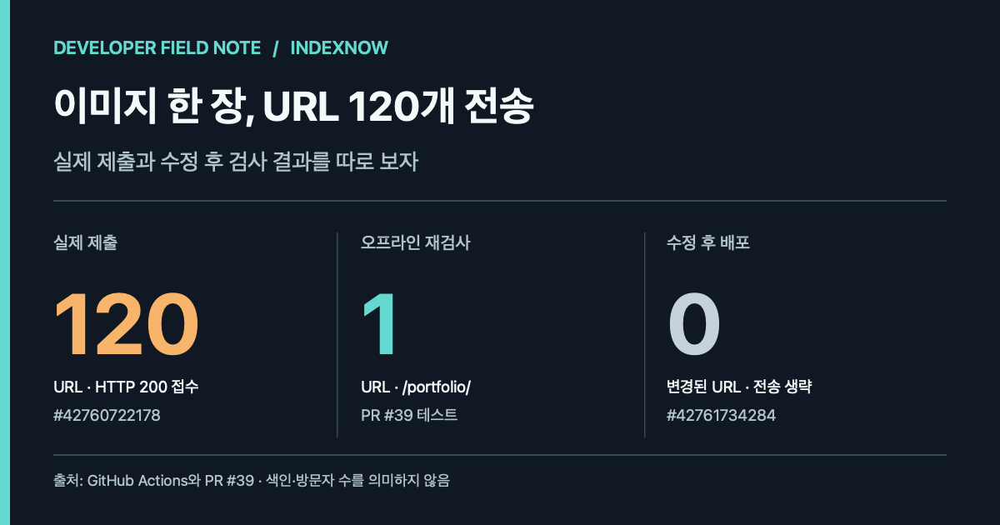

> **English:** [One image change sent 120 URLs to IndexNow](/indexnow-image-page-scope-en/)

2026년 11월 10일, 개발 블로그의 [포트폴리오](/portfolio/)에 Playwright CI 사례와 원본 이미지를 추가했다. 배포는 성공했지만 검색엔진 알림 단계에서 예상 밖의 결과가 나왔다. 변경된 페이지는 한 곳인데 **IndexNow로 URL 120개가 전송됐고 서버는 HTTP 200 Accepted를 반환했다.**

<figure>

<figcaption>동일한 사건에서 나온 세 종류의 증거. 120은 실제 전송, 1은 오프라인 재검사, 0은 수정 후 별도 배포에서 선택된 URL 수다. 검색 색인이나 유입 수치가 아니다.</figcaption>
</figure>

이 숫자는 [해당 GitHub Actions 실행](https://github.com/saramjh/saramjh.github.io/actions/runs/42760722178)에 남아 있다. 120개 페이지가 모두 바뀌었다는 의미도, 검색엔진이 이를 색인했다는 의미도 아니다. 알림 스크립트가 변경 범위를 너무 넓게 잡았다.

## 왜 이미지 한 장이 사이트 전체 변경이 됐나

배포 스크립트는 이전 커밋과 현재 커밋의 차이를 보고 Bing과 IndexNow에 알릴 URL을 고른다. 초기 구현은 <code>assets/</code> 아래 파일이 바뀌면 그 이미지가 어느 페이지에서 쓰이는지 확인하지 않고 사이트맵 전체를 대상으로 삼았다.

공통 헤더나 스타일을 바꾸면 여러 페이지에 영향을 줄 수 있어 보수적인 판단이 필요하다. 하지만 [PR #38](https://github.com/saramjh/saramjh.github.io/pull/38)에 추가한 PNG는 포트폴리오 페이지에서만 참조했다. 이미지 저장 경로만으로 사이트 전체가 수정됐다고 가정한 것이 문제였다. 이미 접수된 120개 URL 제출 기록은 유지했고 다시 보내지 않았다.

## 파일 위치 대신 참조 페이지를 찾다

[PR #39](https://github.com/saramjh/saramjh.github.io/pull/39/files)에서는 이미지 경로를 실제로 참조하는 원본 파일을 Git에서 검색하도록 바꿨다. 기준은 변경 전과 변경 후, 두 리비전이다. 기존 페이지에서 이미지가 제거된 경우도 놓치지 않기 위해서다.

~~~text
변경된 이미지 경로
    ↓
이전·현재 리비전에서 정확한 이미지 참조 검색
    ↓
참조한 Markdown/HTML의 permalink 확인
    ↓
확인된 페이지 URL만 알림 대상으로 선정
~~~

<code>portfolio/index.html</code>이 포트폴리오용 PNG를 참조하면 해당 이미지 변경은 <code>/portfolio/</code>에 연결한다. 블로그 글에서 사용한 이미지라면 글 주소와, 최신 글 미리보기가 나오는 홈 주소도 고려한다.

모든 이미지를 억지로 한 페이지에 귀속시키지는 않았다. 공통 템플릿에서 참조하거나 실제 사용 위치를 확정할 수 없으면 사이트맵 전체를 대상으로 두는 기존 보수적 처리를 유지한다. Git 차이 자체가 검증되지 않으면 알림을 보내지 않는다.

## 실제 제출과 오프라인 검사 구분하기

| 확인 상황 | URL 선정 결과 | 근거 |
|---|---|---|
| 수정 전 실제 배포 | 120개 URL 전송, HTTP 200 Accepted | [Actions #42760722178](https://github.com/saramjh/saramjh.github.io/actions/runs/42760722178) |
| 수정된 코드로 당시 변경분을 재검사 | <code>/portfolio/</code> 한 페이지 | [PR #39 회귀 테스트](https://github.com/saramjh/saramjh.github.io/pull/39/files) |
| 수정 코드만 배포한 최종 실행 | 변경 페이지 URL 0개, Bing·IndexNow 전송 생략 | [Actions #42761734284](https://github.com/saramjh/saramjh.github.io/actions/runs/42761734284) |

두 번째 행은 **오프라인 재검사 결과**다. 수정 뒤 실제로 URL 한 개를 IndexNow에 다시 보냈다는 뜻이 아니다.

수정 작업은 Python 테스트 26개를 통과했고, PR #39의 병합과 GitHub Pages 배포도 성공했다. 회귀 테스트는 이미지가 한 페이지에서 쓰일 때, 여러 페이지에 쓰일 때, 공통 템플릿에서 쓰일 때, 참조 위치가 확인되지 않을 때를 구분한다.

## 11월 18일 후속 사례: JavaScript 변경 1건이 URL 194개 알림으로 이어졌다

이번에는 이미지가 아닌 JavaScript에서 같은 종류의 문제가 드러났다. [PR #193](https://github.com/saramjh/saramjh.github.io/pull/193)에서는 [Space Atlas 포트폴리오 페이지](/portfolio/space-atlas/)의 특정 링크를 선택할 때 블로그 쪽에서 이벤트를 남기도록 수정했다. 이 이벤트만으로 방문자가 Space Atlas에 도착했는지, 시뮬레이터를 실제로 사용했는지는 알 수 없다.

수정한 파일은 `assets/js/portfolio.js`다. 첫 사례의 PNG와 달리 이 스크립트는 `_layouts/portfolio.html`에서 불러온다. 해당 레이아웃은 포트폴리오 메인과 외부 기록 페이지, 프로젝트 페이지 5개, 마일스톤 글 4개에서 사용한다. 기존 알림 코드는 이런 연결을 추적하지 못해 사이트 전체 자산이 바뀐 것으로 판단했다. 그래서 [실제 배포 실행](https://github.com/saramjh/saramjh.github.io/actions/runs/44317892057)에서 **사이트맵 URL 194개를 IndexNow에 제출**했고, HTTP 200 Accepted 응답을 받았다.

[PR #194](https://github.com/saramjh/saramjh.github.io/pull/194)에서는 변경 전후 Git 리비전의 스크립트 참조, 레이아웃 상속 관계, 페이지 permalink를 검사하도록 알림 범위 계산기를 고쳤다. 새로운 사용처가 나타나거나 경로를 확정할 수 없을 때는 기존처럼 사이트맵 전체를 대상으로 삼는다. 이번에 11개를 찾았다고 해서 앞으로 모든 공통 스크립트를 11개 URL에만 연결하면 안 된다.

| 확인 상황 | 선정 URL | 실제 결과 |
|---|---:|---|
| 11월 18일 PR #193의 실제 배포 | 194개 | IndexNow 한 배치 접수: [Actions #44317892057](https://github.com/saramjh/saramjh.github.io/actions/runs/44317892057) |
| 동일한 Git 차이를 PR #194 코드로 오프라인 재검사 | 11개 | 레이아웃 사용 페이지를 확인한 테스트 결과. 새 알림 전송 없음 |
| PR #194의 코드 수정만 반영한 별도 배포 | 0개 | Bing과 IndexNow 전송 생략: [Actions #44321890015](https://github.com/saramjh/saramjh.github.io/actions/runs/44321890015) |

수정한 로직은 Python 테스트 227개와 GitHub Actions의 빌드·Chrome 검사를 통과했다. 무엇보다 배포 로그에 **새 IndexNow 요청이 없었다는 점**이 남았다. 앞서 접수된 194개 URL의 원본 기록도 그대로 유지했다.

이번 사례에서 중요한 것은 파일명보다 **실제로 화면에 사용되는 범위**였다. 공통 JavaScript 한 개가 여러 페이지에 영향을 줄 수는 있지만, 그렇다고 사이트맵 전체가 바뀐 것은 아니다. URL 선정 오류는 고쳤지만, 이 수정 덕분에 색인이나 방문자·전환이 늘었는지는 측정하지 않았다.

## 11월 19일 후속 사례: 설명 문장이 실행 코드의 사용처로 잡혔다

다음 오류는 이 글 자체에서 발생했다. 11월 19일 [PR #208](https://github.com/saramjh/saramjh.github.io/pull/208)에서 포트폴리오의 공개 연락처 링크 선택 이벤트를 추가했다. 그런데 [원본 배포 로그](https://github.com/saramjh/saramjh.github.io/actions/runs/44386020085)에는 **195개 URL을 IndexNow에 제출하고 HTTP 200 Accepted를 받은 기록**이 남았다. 이미 포트폴리오 공통 스크립트의 사용 페이지 11곳을 찾도록 개선했는데도 사이트맵 전체가 선택된 것이다.

원인은 이 사례를 설명하는 한국어·영어 글 두 편에 있었다. 두 글은 앞선 수정 방법을 설명하면서 스크립트 파일명을 Markdown 인라인 코드로 한 번씩 적었다. 화면에는 단순한 설명 문장으로 보일 뿐, 이 글들이 스크립트를 실행하는 것은 아니다. 그러나 Git 참조 검색은 설명 속 파일명도 실제 사용처처럼 발견했고, URL 계산기는 확인할 수 없는 참조가 있다고 판단해 전체 사이트맵으로 돌아갔다.

[PR #209](https://github.com/saramjh/saramjh.github.io/pull/209)에서는 예외를 이 두 문서로만 한정했다. 각 문서의 permalink, 언어, 레이아웃, 인라인 코드 참조가 기존 조건과 일치하는지 확인한다. 언급이 추가되거나 실제 실행 태그가 생기거나 알 수 없는 사용처가 나타나면 여전히 보수적으로 처리한다. 수정 코드로 PR #208의 Git 차이를 **오프라인 재검사**했을 때는 실제 포트폴리오 사용 페이지 **11곳**이 선택됐다. 이를 IndexNow에 다시 보낸 것은 아니다. 이후 [PR #209 별도 배포](https://github.com/saramjh/saramjh.github.io/actions/runs/44387509083)에서는 변경 페이지 URL이 **0개**여서 Bing과 IndexNow 요청을 생략했다.

앞선 195개 URL 접수 이력은 그대로 유지했다. 이번 문제는 파일을 참조하는 코드와 그 파일을 설명하는 글을 구분해야 한다는 점을 보여준다. 수정한 것은 URL 선택 판단이며, 검색 색인이나 독자 증가를 입증한 것은 아니다.

## 다음 배포에서 확인할 것

앞으로는 변경 파일 목록만 보고 알림이 정확하다고 판단하지 않으려 한다. 실제 사용 페이지로 매핑되는지, 공통 자산을 안전하게 처리하는지, 아무 페이지도 바뀌지 않았을 때 알림을 생략하는지를 배포 로그에서 따로 확인해야 한다.

이번 수정으로 확인한 것은 URL 선정 로직과 배포 동작이다. **검색 색인 증가, 방문자 증가 또는 전환 증가는 측정하지 않았다.** 비슷한 GitHub Actions 개선 기록은 [Playwright 브라우저 준비 시간을 줄인 사례](/playwright-github-actions-runner-chrome-ko/)에 정리했다.
