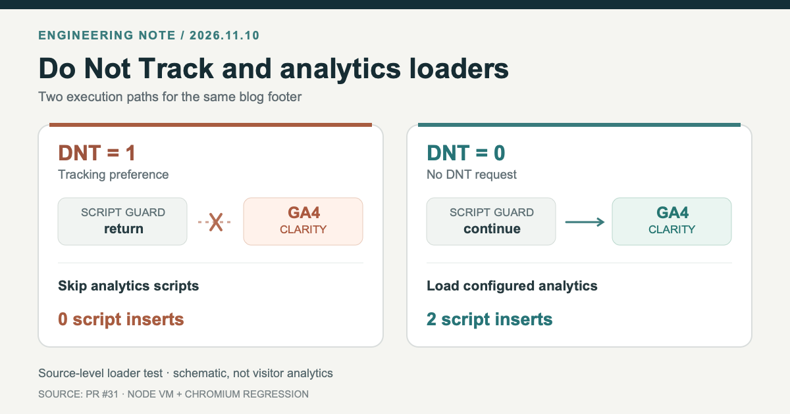

> 한국어판: [DNT를 켜도 GA4는 로드됐다: Jekyll 푸터 수정과 압축 빌드 오류](/jekyll-dnt-analytics-compress-regression-ko/)

**My portfolio's click handler checked Do Not Track, but the shared footer still initialized Google Analytics 4 and Microsoft Clarity.** With the browser's DNT value set to <code>1</code>, the two pieces of code made different decisions. I fixed the loaders, then hit an unrelated JavaScript error in Jekyll's compressed HTML.

Both problems are documented in the real [PR #31 diff and checks](https://github.com/saramjh/saramjh.github.io/pull/31). The case is useful as a narrow test of consistency between event handlers and shared scripts. DNT itself is deprecated; it should not be mistaken for a complete consent or privacy-control system.

<figure>
  
  <figcaption>Original schematic based on the loader's isolated tests, not a screenshot of a user's browser or actual traffic. [Source SVG](/assets/img/dev-dnt-analytics-20261110/loader-gate-en.svg)</figcaption>
</figure>

## The event check was in a different part of the page

The previous [portfolio update, PR #30](https://github.com/saramjh/saramjh.github.io/pull/30), introduced a GA4 <code>select_content</code> event when someone selected one of four developer case-study cards. Its handler skipped the event when <code>navigator.doNotTrack === "1"</code> or the <code>gtag</code> function was unavailable.

The footer did not use that guard. The shared Jekyll include, <code>_includes/footer.html</code>, defined <code>gtag</code>, configured GA4 and scheduled an external Google Tag Manager script. A separate block set up Clarity. Neither loader originally checked DNT before starting.

This left a concrete inconsistency: the case-study click event might be suppressed, yet the shared third-party analytics code could still load. I confirmed the discrepancy by comparing the deployed footer and the click handler. I did not have evidence that a particular visitor's data had been sent.

## Put the guard before initialization

I kept the repair inside the root blog's shared footer. Both loaders now return before creating script tags when the browser explicitly reports DNT as <code>1</code>.

~~~javascript
(function (w, d, id) {
  if (navigator.doNotTrack === "1" ||
      w.doNotTrack === "1" ||
      navigator.msDoNotTrack === "1") return;

  w.dataLayer = w.dataLayer || [];
  w.gtag = function () {
    w.dataLayer.push(arguments);
  };
  w.gtag("js", new Date());
  w.gtag("config", id);
  // The existing script loader follows.
})(window, document, "G-EXAMPLE");
~~~

This is an **illustrative excerpt**, with a placeholder measurement ID, from the change in [PR #31](https://github.com/saramjh/saramjh.github.io/pull/31/files). I applied the same early-return guard to the Clarity loader. The existing GA4 and Clarity configuration remained in place for the DNT-off path.

I also included <code>navigator.msDoNotTrack</code> in the check because the original browser signal has a legacy form. A missing DNT property is not interpreted here as an affirmative grant of consent. This change deals with one explicit signal, on one site.

## CI failed on the comment I had just added

The first [GitHub Actions run, #42737126098](https://github.com/saramjh/saramjh.github.io/actions/runs/42737126098), failed in the Chromium browser step with <code>Unexpected end of input</code>. The DNT condition was valid JavaScript in its original multiline source.

The issue was the Jekyll page layout. The blog uses <code>layout: compress</code>, which collapses whitespace in generated HTML. I had added a single-line <code>//</code> comment inside an inline script. When line breaks disappeared, that comment absorbed the code that followed it.

~~~javascript
// The intent, before the page is compressed
if (skipTracking) return; // explanation
startAnalytics();

// After losing the line break, the call is also a comment
if (skipTracking) return; // explanation startAnalytics();
~~~

This reduced example illustrates the failure mode. JavaScript's [lexical grammar](https://developer.mozilla.org/en-US/docs/Web/JavaScript/Reference/Lexical_grammar#comments) makes <code>//</code> run until a line terminator; a properly closed <code>/* ... */</code> block comment has an explicit endpoint. I changed the new explanatory comment to the block form.

I then extracted the inline loader source and ran Node's syntax check on a whitespace-collapsed version. The original change failed that check; the revision passed. The second [CI run, #42737547315](https://github.com/saramjh/saramjh.github.io/actions/runs/42737547315), passed the full site build and Chromium validation.

## What the tests and deployment actually showed

In an isolated Node test, I ran the extracted loader scripts with controlled browser settings. The scripts' network destinations were not contacted.

| Browser signal | GA4 and Clarity script tags inserted | <code>gtag</code> defined |
|---|---:|---|
| DNT = 1 | 0 | No |
| DNT = 0 | 2 | Yes |
| Legacy msDoNotTrack = 1 | 0 | No |

A separate Chromium regression test covered both DNT-on and DNT-off behavior. [PR #31](https://github.com/saramjh/saramjh.github.io/pull/31) merged on **November 10, 2026**. The [main-branch GitHub Pages build and deployment, #42737713334](https://github.com/saramjh/saramjh.github.io/actions/runs/42737713334), succeeded. I fetched the public [portfolio](/portfolio/) and [privacy policy](/privacy/) and confirmed that the new guards and disclosure were present.

The results establish the code paths, test behavior and live release. They do not measure how many visitors use DNT, how GA4 traffic changed, or whether anyone converted after visiting the portfolio. Advertising scripts and independently maintained project pages were outside the change.

There is also a platform limit. [MDN marks <code>Navigator.doNotTrack</code> as deprecated and non-standard](https://developer.mozilla.org/en-US/docs/Web/API/Navigator/doNotTrack); some browsers no longer expose it. A DNT guard is not a replacement for consent requirements or more current privacy-control mechanisms. For this release, I made the behavior consistent **where the signal is available**, documented its scope, and tested the generated site instead of trusting the source files alone.

Related reading: [the portfolio's source-linked engineering notes](/portfolio/) and [why GA4 collection time differs from reporting time](/ga4-deployment-report-window-en/).
