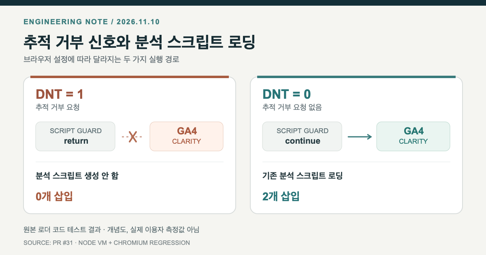

> English: [Do Not Track skipped my click event, but GA4 and Clarity still loaded](/jekyll-dnt-analytics-compress-regression-en/)

**포트폴리오의 클릭 추적을 끄는 코드가 있었는데도, 공통 푸터는 GA4와 Microsoft Clarity를 로드하고 있었습니다.** 브라우저의 Do Not Track(DNT) 값을 <code>1</code>로 설정한 상황에서 두 동작이 일치하지 않는 문제였습니다. 수정 과정에서는 Jekyll의 HTML 압축이 새로 넣은 JavaScript 주석을 깨뜨려 CI까지 한 번 실패했습니다.

이 글은 실제 [수정 PR #31](https://github.com/saramjh/saramjh.github.io/pull/31)의 코드와 GitHub Actions 실행 기록을 기준으로 정리했습니다. 브라우저 DNT는 이미 폐기된 비표준 신호이므로, 이를 오늘날의 포괄적인 동의 관리 방식으로 소개하지는 않습니다.

<figure>
  
  <figcaption>원본 JavaScript 로더의 격리 테스트 결과를 나타낸 개념도입니다. 실제 방문자 설정 비율이나 분석 데이터가 아닙니다. [도식 SVG 원본](/assets/img/dev-dnt-analytics-20261110/loader-gate-ko.svg)</figcaption>
</figure>

## 클릭 이벤트만 막아서는 충분하지 않았다

앞서 포트폴리오의 네 가지 개발 사례 카드에 GA4 <code>select_content</code> 이벤트를 추가했습니다. 카드 코드는 <code>navigator.doNotTrack === "1"</code>이거나 <code>gtag</code> 함수가 없으면 이벤트를 보내지 않도록 했습니다. 해당 구현은 [PR #30](https://github.com/saramjh/saramjh.github.io/pull/30)에 남아 있습니다.

문제는 같은 페이지의 공통 <code>_includes/footer.html</code>에 있었습니다. 여기서는 이벤트 핸들러와 별도로 GA4 초기화 함수를 정의하고, <code>googletagmanager.com</code>에서 스크립트를 가져왔습니다. Clarity도 자체 로더를 가졌습니다. 이전 코드에는 이 두 로더를 시작하기 전에 DNT 값을 확인하는 분기가 없었습니다.

따라서 DNT가 <code>1</code>이라도 특정 포트폴리오 클릭 이벤트만 제외될 뿐, 두 외부 분석 라이브러리의 초기화는 계속될 수 있었습니다. 이 판단은 배포된 푸터 코드를 검토해 확인했습니다. 특정 방문자의 데이터가 실제로 전송됐다는 기록을 확인한 것은 아닙니다.

## 공통 로더 시작점에서 일찍 반환하기

수정 범위는 루트 블로그의 공통 푸터로 제한했습니다. 두 로더가 초기화되기 전에 같은 조건을 검사합니다.

~~~javascript
(function (w, d, id) {
  if (navigator.doNotTrack === "1" ||
      w.doNotTrack === "1" ||
      navigator.msDoNotTrack === "1") return;

  w.dataLayer = w.dataLayer || [];
  w.gtag = function () {
    w.dataLayer.push(arguments);
  };

  w.gtag("js", new Date());
  w.gtag("config", id);
  // 기존 GA4 스크립트 로딩 코드는 이 아래에서 이어진다.
})(window, document, "G-EXAMPLE");
~~~

위 코드는 공개된 [실제 수정 내용](https://github.com/saramjh/saramjh.github.io/pull/31/files)의 핵심만 발췌한 **설명용 예제**입니다. 측정 ID는 예시 값이며, 실제 설정을 변경하거나 실행하라는 의미가 아닙니다. Clarity에도 같은 조기 반환 조건을 적용했습니다.

DNT가 <code>1</code>이면 해당 로더가 분석 함수를 등록하거나 외부 스크립트 태그를 생성하기 전에 종료합니다. DNT가 <code>0</code>인 테스트에서는 기존 설정이 계속 실행됩니다. 이전 Microsoft 계열 속성인 <code>msDoNotTrack</code> 값도 <code>1</code>인 경우를 검사했습니다.

이 변경은 블로그의 GA4와 Clarity 로더에만 적용됩니다. 광고 스크립트, 별도 운영되는 프로젝트 페이지, 서버 로그, 브라우저 자체 설정까지 제어하지는 않습니다.

## 첫 번째 CI는 분석 로직이 아니라 주석 때문에 실패했다

최초 [GitHub Actions 실행 #42737126098](https://github.com/saramjh/saramjh.github.io/actions/runs/42737126098)의 Chromium 단계에서 <code>Unexpected end of input</code> 오류가 났습니다. 새 DNT 조건 자체의 문법은 맞았습니다.

Jekyll 사이트의 <code>layout: compress</code>가 생성 HTML의 공백과 줄바꿈을 정리하는 과정에서, 로더에 추가한 한 줄 JavaScript 주석이 뒤따르는 코드를 같은 줄에서 주석 처리한 것이 원인이었습니다.

~~~javascript
// 브라우저가 한 줄로 합치기 전
if (skipTracking) return; // explanation
startAnalytics();

// 줄바꿈이 사라진 경우, 다음 호출까지 주석이 될 수 있음
if (skipTracking) return; // explanation startAnalytics();
~~~

이 예제는 실패 구조를 축약한 것입니다. [MDN의 JavaScript 어휘 문법](https://developer.mozilla.org/en-US/docs/Web/JavaScript/Reference/Lexical_grammar#comments)에 따르면 <code>//</code>는 줄 끝까지 주석이고, <code>/* ... */</code>는 닫는 구분자까지 주석입니다. 수정에서는 새 설명을 블록 주석으로 바꿨습니다.

원본 인라인 로더 코드를 추출해 공백을 한 줄로 합친 뒤 Node의 구문 검사에 넣었습니다. 수정 전 소스는 검사에 실패했고, 블록 주석으로 바꾼 뒤 통과했습니다. [재실행 #42737547315](https://github.com/saramjh/saramjh.github.io/actions/runs/42737547315)에서도 전체 Jekyll·Chromium 검사가 통과했습니다.

## 실제로 확인한 결과와 아직 모르는 것

격리된 Node 테스트에서는 로더 코드를 실행하되 외부 사이트로 요청하지 않았습니다. 결과는 다음과 같습니다.

| 시험 조건 | GA4·Clarity 스크립트 생성 | <code>gtag</code> |
|---|---:|---|
| DNT = 1 | 0개 | 생성 안 함 |
| DNT = 0 | 2개 | 생성 |
| msDoNotTrack = 1 | 0개 | 생성 안 함 |

별도의 Chromium 브라우저 회귀 테스트도 DNT 활성·비활성 경로를 확인했습니다. [PR #31](https://github.com/saramjh/saramjh.github.io/pull/31)은 2026년 11월 10일 병합됐으며, 기본 브랜치 [빌드·배포 #42737713334](https://github.com/saramjh/saramjh.github.io/actions/runs/42737713334)가 성공했습니다. 공개 [포트폴리오](/portfolio/)와 [개인정보처리방침](/privacy/)에서 새 로더 조건과 고지를 확인했습니다.

여기서 검증한 것은 **코드 실행 경로와 공개 배포 상태**입니다. 실제 방문자의 DNT 사용 비율, GA4 이벤트 증감, 광고 동의 상태, 전환율은 측정하지 않았습니다.

마지막으로 DNT의 한계를 확인할 필요가 있습니다. [MDN의 Navigator.doNotTrack 문서](https://developer.mozilla.org/en-US/docs/Web/API/Navigator/doNotTrack)는 이 기능을 폐기된 비표준 API로 설명합니다. 일부 브라우저에서는 값이 제공되지 않을 수 있고, 이 조건문을 추가했다고 해서 법적 동의 요건이나 다른 개인정보 신호까지 해결되는 것은 아닙니다. 이번 변경은 **이미 지원하던 DNT 값을 블로그 로더 전체에서 일관되게 처리하도록 만든 제한적인 수정**입니다.

관련 작업으로는 [개발 사례 선택 이벤트를 추가한 포트폴리오](/portfolio/)와 [GA4 데이터의 수집·보고 시점을 구분한 글](/ga4-deployment-report-window-ko/)이 있습니다.
