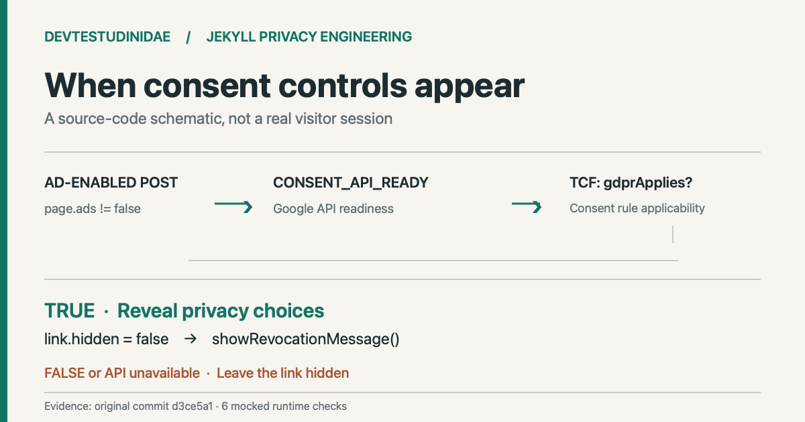

> 한국어판: [광고 동의를 바꿀 수 있게: Jekyll 푸터에 조건부 철회 링크를 넣다](/jekyll-eu-consent-revocation-ko/)

A consent message can disappear once a visitor has made a choice. That leaves a practical question: where can they change the choice later? On October 8, 2026, I added a <code>privacy choices</code> link to the footer of ad-enabled articles on my Jekyll blog. **The link appears only after Google's consent API is ready and TCF data reports <code>gdprApplies: true</code>.** The original implementation is in [commit d3ce5a1](https://github.com/saramjh/saramjh.github.io/commit/d3ce5a1be67c3e014db547521bd333f849d1fb53).

<figure>

<figcaption>An original diagram derived from the footer implementation. It does not depict a real visitor session, consent message or completed consent change.</figcaption>
</figure>

## Give the visitor a route back to consent settings

The blog's [privacy policy](/privacy/) already described advertising choices and browser storage. Its ordinary article footer, however, had no dedicated control for reopening the previous ad-consent decision. I put that entry point in the footer of articles that use AdSense, with conditions to keep it out of pages that do not use advertising.

Google's [Privacy & messaging JavaScript API reference](https://developers.google.com/funding-choices/fc-api-docs) documents <code>showRevocationMessage()</code>, which clears a previous EU regulations consent record and shows the message again. The same documentation describes waiting for <code>CONSENT_API_READY</code> and checking the TCF <code>gdprApplies</code> flag before revealing a link.

## Keep the link hidden until the API answers

The Jekyll template emits a footer link with the <code>hidden</code> attribute. It does so only for production builds with AdSense configured, an article date, advertising enabled on the page and no redirect. This excludes the homepage and the ad-free privacy policy.

On the client, the footer registers a <code>CONSENT_API_READY</code> callback with <code>googlefc.callbackQueue</code>. When that callback runs, the code checks for <code>__tcfapi</code> and subscribes using <code>addEventListener</code> with version <code>0</code>. The event result has to succeed, report that the relevant regulations apply, and expose the revocation method.

~~~javascript
window.googlefc.callbackQueue.push({
  CONSENT_API_READY: function () {
    if (typeof window.__tcfapi !== "function") return;
    window.__tcfapi("addEventListener", 0, function (tcData, success) {
      if (success && tcData && tcData.gdprApplies &&
          typeof window.googlefc.showRevocationMessage === "function") {
        link.hidden = false;
      }
    });
  }
});
~~~

This is an excerpt from the [actual footer source](https://github.com/saramjh/saramjh.github.io/blob/d3ce5a1be67c3e014db547521bd333f849d1fb53/_includes/footer.html). A click handler prevents navigation to <code>#</code> and calls <code>googlefc.showRevocationMessage()</code>. Missing APIs and unsuccessful checks leave the link hidden.

## Test the code paths without claiming live consent outcomes

I extracted the footer's JavaScript and ran six scenarios in an isolated Node environment. The test replaced browser and provider callbacks with controlled functions.

| Mocked condition | Observed code behavior |
|---|---|
| <code>gdprApplies=true</code>, required APIs present | Link appears; clicking calls the revocation function once |
| <code>gdprApplies=false</code> | Link stays hidden |
| TCF callback reports failure | Link stays hidden |
| <code>__tcfapi</code> is absent | Link stays hidden |
| Revocation method is absent | Link stays hidden |
| Footer link element is absent | Script exits without registering a callback |

The [reproducible runtime probe](https://github.com/saramjh/saramjh.github.io/blob/main/tests/eu_privacy_choices_runtime.cjs) makes no requests to Google's consent service.

I also fetched an existing [article](/jekyll-dnt-analytics-compress-regression-en/) and the [privacy policy](/privacy/) from the public blog. Both returned HTTP 200. The article HTML contained the conditional link and revocation handler; the privacy page contained neither. That confirms deployed markup, **not** the experience of an actual visitor under European regulations.

## What remains outside the test

If Google's consent API is unavailable or the region/applicability check never completes, this design leaves the link hidden. A hidden control alone cannot guarantee that every visitor has a route to change a consent decision. The regional message configuration and a real end-to-end consent change require separate verification. These code checks also do not establish legal compliance.

This case verifies the Jekyll rendering conditions and browser callback paths. I have no user-level consent outcome, advertising result or traffic measurement from it. For a separate privacy-related engineering incident on the same blog, see [the Do Not Track loader and HTML compression regression](/jekyll-dnt-analytics-compress-regression-en/).
