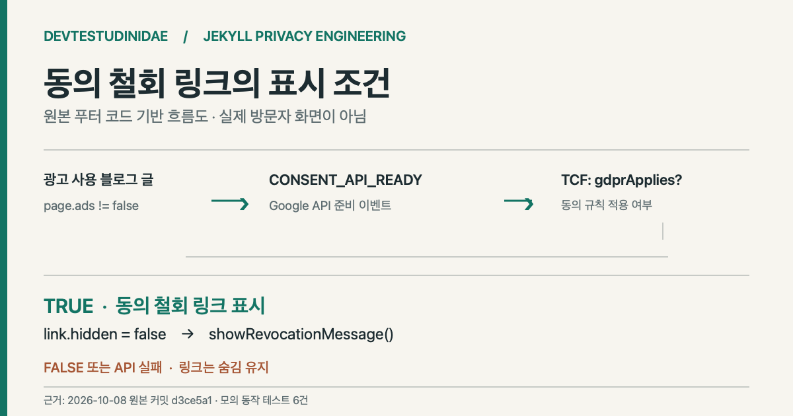

> **English:** [A Jekyll footer link for changing an earlier ad-consent choice](/jekyll-eu-consent-revocation-en/)

블로그에서 광고 동의 메시지를 닫고 나면, 이전 선택을 어디에서 바꾸는지 찾기 어려울 수 있다. 2026년 10월 8일 개발 블로그의 푸터에 <code>privacy choices</code> 링크를 추가했다. **Google 동의 API가 준비되고 TCF 데이터에서 <code>gdprApplies</code>가 참일 때만 링크를 보여주는 방식**이다. 실제 구현은 [원본 커밋 d3ce5a1](https://github.com/saramjh/saramjh.github.io/commit/d3ce5a1be67c3e014db547521bd333f849d1fb53)에 남아 있다.

<figure>

<figcaption>원본 <code>_includes/footer.html</code>을 바탕으로 그린 코드 경로 도식이다. 실제 유럽 방문자 화면이나 동의 처리 완료 기록이 아니다.</figcaption>
</figure>

## 메시지를 다시 여는 경로가 필요했다

기존 [개인정보 처리방침](/privacy/)에는 광고 동의와 브라우저 저장소에 관한 설명이 있었지만, 블로그 글에서 이전 동의 선택을 다시 여는 전용 링크는 없었다. 광고가 표시되는 글의 푸터에 해당 진입점을 두고, API 준비 여부를 확인한 뒤 노출하도록 바꿨다.

[Google Privacy & messaging JavaScript API 문서](https://developers.google.com/funding-choices/fc-api-docs)는 <code>showRevocationMessage()</code>를 통해 이전 EU 규정 동의 기록을 지우고 메시지를 다시 표시하는 기능을 설명한다. 같은 문서는 API 준비 이벤트인 <code>CONSENT_API_READY</code>와 TCF의 <code>gdprApplies</code> 검사 예시도 제공한다. 이번 코드는 그 경로를 사용한다.

## 처음에는 숨기고, 조건이 맞을 때만 표시하다

Jekyll 템플릿에는 <code>hidden</code> 속성이 있는 푸터 링크가 들어간다. 생성 조건은 프로덕션 빌드이고, AdSense가 설정됐으며, 광고가 허용된 날짜 있는 블로그 글이고 리디렉션 페이지가 아닐 때다. 홈이나 광고를 끈 페이지에 일괄적으로 링크를 배치하지 않는다.

클라이언트 코드에서는 <code>googlefc.callbackQueue</code>에 <code>CONSENT_API_READY</code> 콜백을 등록한다. 준비 이벤트를 받은 뒤 <code>__tcfapi("addEventListener", 0, ...)</code>로 TCF 데이터를 읽고, 콜백 성공과 <code>gdprApplies</code>, 철회 메서드 존재 여부를 확인한다.

~~~javascript
window.googlefc.callbackQueue.push({
  CONSENT_API_READY: function () {
    if (typeof window.__tcfapi !== "function") return;
    window.__tcfapi("addEventListener", 0, function (tcData, success) {
      if (success && tcData && tcData.gdprApplies &&
          typeof window.googlefc.showRevocationMessage === "function") {
        link.hidden = false;
      }
    });
  }
});
~~~

위 코드는 [원본 푸터의 해당 구간](https://github.com/saramjh/saramjh.github.io/blob/d3ce5a1be67c3e014db547521bd333f849d1fb53/_includes/footer.html)을 발췌한 것이다. 링크를 누르면 기본 <code>#</code> 이동을 막고 <code>googlefc.showRevocationMessage()</code>를 호출한다. API가 준비되지 않거나 TCF 검사가 실패하면 링크는 숨겨진 상태로 남는다.

## 표시 조건과 실제 동의 완료는 다른 검증이다

이번 사례를 정리하며 원본 푸터 스크립트를 Node의 격리된 실행 환경에서 모의 동작시켰다. 여섯 가지 경우를 확인했다.

| 모의 입력 | 확인한 코드 동작 |
|---|---|
| <code>gdprApplies=true</code>, 필요한 API 존재 | 링크 표시, 클릭 시 철회 함수 1회 호출 |
| <code>gdprApplies=false</code> | 링크 숨김 |
| TCF 콜백 실패 | 링크 숨김 |
| <code>__tcfapi</code> 없음 | 링크 숨김 |
| 철회 메서드 없음 | 링크 숨김 |
| 링크 요소가 없는 페이지 | 콜백 등록 없이 종료 |

이들은 실제 Google 서버에 요청한 결과가 아니다. [검증 스크립트](https://github.com/saramjh/saramjh.github.io/blob/main/tests/eu_privacy_choices_runtime.cjs)는 외부 제공자 호출을 모의 함수로 대체했다.

공개된 기존 [기술 글](/jekyll-dnt-analytics-compress-regression-ko/)과 [개인정보 처리방침](/privacy/)도 읽기 전용으로 가져와 확인했다. 광고 사용 글의 HTML에는 조건부 링크와 철회 코드가 있었고, 개인정보 처리방침 페이지에는 둘 다 없었다. 두 페이지 모두 HTTP 200을 반환했다. **이것으로 특정 지역의 실제 방문자에게 메시지가 표시됐거나 동의 변경이 끝났다고 판단하지 않는다.**

## 링크가 나타나지 않는 상황도 설명해야 한다

이 방식에서는 Google API가 로드되지 않거나 적용 여부를 판정하지 못하면 푸터 링크가 보이지 않는다. 따라서 숨겨진 링크만으로 모든 방문자의 동의 관리 접근성을 보장하지 않는다. 광고 메시지 설정과 지역별 제공 동작은 별도로 검증해야 하며, 법적 준수 여부도 이 코드 테스트로 확정할 수 없다.

이 변경으로 확인한 것은 Jekyll 템플릿의 표시 범위와 자바스크립트 콜백 경로다. 사용자의 실제 동의 선택, 광고 노출량, 방문자 수는 측정하지 않았다. 관련된 다른 개인정보 보호 구현은 [DNT를 켜도 GA4와 Clarity가 로드되던 문제](/jekyll-dnt-analytics-compress-regression-ko/)에서 확인할 수 있다.
