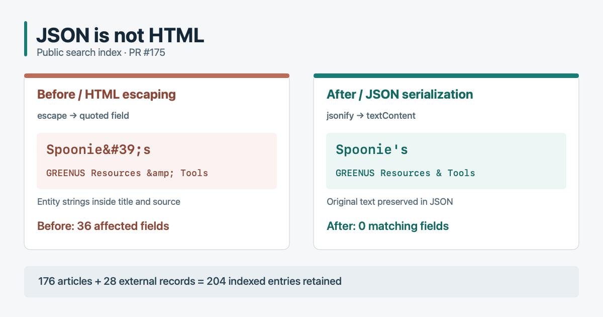

> 한국어판: [검색 JSON에 HTML 엔터티가 섞였다: Jekyll 직렬화를 고친 기록](/jekyll-search-json-native-text-ko/)

**I shipped a fix for HTML entities stored inside a public JSON search index.** The [archive](/archive/) showed readable titles, but the underlying data included HTML-escaped text. [PR #175](https://github.com/saramjh/saramjh.github.io/pull/175), merged November 16, 2026, corrected the source format rather than adding another workaround to the page.

<figure>
  
  <figcaption>Original diagram reconstructed from the actual template change and public index. It is not a screenshot of a user's browser or a traffic chart. [Editable SVG](/assets/img/dev-search-json-20261116/search-json-en.svg)</figcaption>
</figure>

## Why the site looked fine

The archive uses one JSON file for both articles and verified external records. The old Liquid template ran titles and descriptions through the HTML escape filter and inserted those results into JSON strings.

~~~json
{
  "title": "Spoonie&#39;s",
  "source": "GREENUS Resources &amp; Tools"
}
~~~

This is a reduced example of the observed encoding problem. The search JavaScript created a temporary textarea and used its innerHTML property to decode entities before displaying them. Most visitors therefore saw normal labels. But the published JSON was not plain text: any other consumer would need to know about that extra HTML decoding convention.

The old public index had encoded fields in **15 article titles and 13 article descriptions**, plus **four external-record titles and four descriptions**. Those are affected field counts, not counts of real users experiencing a visible bug.

## Make JSON at the source

The [source diff](https://github.com/saramjh/saramjh.github.io/pull/175/files) replaces HTML escaping with Liquid's JSON serializer:


~~~liquid
# Before: HTML-escaped text inserted into a JSON string
"title": "{{ post.title | escape }}"

# After: serialize the original text as JSON
"title": {{ post.title | jsonify }}
"description": {{ post.description | jsonify }}
"tags": {{ post.tags | join: ', ' | jsonify }}
~~~


The external-record title and source use the same approach, and its detail field now uses `record.detail | jsonify`. The search client no longer calls decoder.innerHTML. Result labels still use the DOM textContent property, so there is no need to interpret them as HTML.

HTML templates still need HTML escaping. This change is about one specific output context: a JSON endpoint.

## Reproduce, fix, deploy, check again

I added regressions that failed against the original code. The Python test checks that the relevant fields use JSON serialization. A Node runtime test checks that literal entity-like text is not silently decoded by the browser code.

After the change, all **200 Python tests** passed, along with the existing Node search, mobile navigation, and outbound-link tests. The [PR workflow #43802310024](https://github.com/saramjh/saramjh.github.io/actions/runs/43802310024) passed the Jekyll build, site checks, and real Chromium layout test. The [Pages deployment #43802506835](https://github.com/saramjh/saramjh.github.io/actions/runs/43802506835) succeeded.

The isolated Mac Ruby bundle lacked five existing gems, so its local Jekyll build did not run successfully. The GitHub Actions run, not the local environment, is the build evidence.

The deployed index retained **204 entries**: 176 articles and 28 external records. The targeted entity markers in titles, descriptions, and tags dropped to **zero**. I then ran the deployed search code against the actual public index:

| Query | Observed result |
|---|---|
| Spoonie's | Seven articles, one external record |
| GREENUS & Tools | One external record |
| Earth's 23.5° | One article |
| Spoonie | 41 matching articles, first 10 shown, More control enabled |

The original links into the [source-backed external recognition list](/portfolio/recognition/) remained intact.

## What the result means

The public JSON values and the displayed search labels now use the same text, without an HTML-decoding workaround. That makes the index easier to reuse in another first-party interface. The evidence covers the source diff, tests, actual deployment, and live search behavior. It does not demonstrate better rankings, higher traffic, or user adoption.

For another case where the generated page mattered as much as the source code, see [the Jekyll DNT loader regression](/jekyll-dnt-analytics-compress-regression-en/), or browse the [developer portfolio](/portfolio/).
