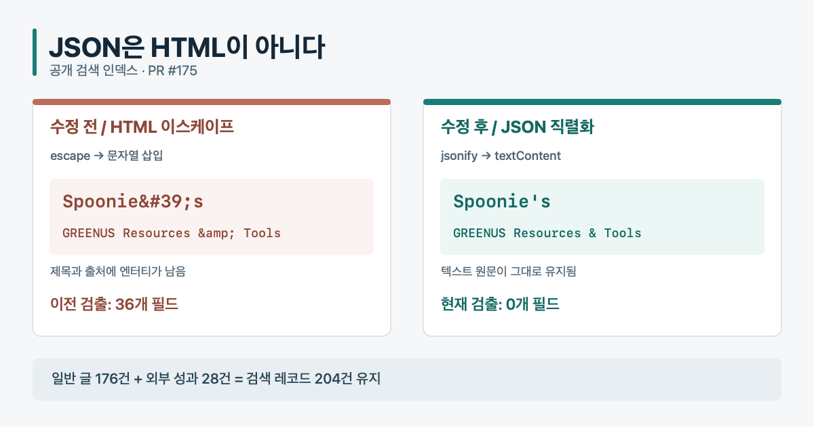

> English: [The search index was JSON, but its text was HTML-escaped](/jekyll-search-json-native-text-en/)

**블로그 검색 JSON의 문자열 인코딩을 고쳐 배포했다.** 글 제목이 화면에는 정상으로 보였지만 공개 [검색 인덱스](/assets/search.json)는 원문 대신 HTML 엔터티를 보관하고 있었다. 2026년 11월 16일 [PR #175](https://github.com/saramjh/saramjh.github.io/pull/175)를 병합해 이 불일치를 해결했다.

<figure>
  
  <figcaption>수정 전후 코드를 비교한 설명도이다. 실제 방문자 화면이나 트래픽 차트를 촬영한 자료는 아니다. [도식 SVG 원본](/assets/img/dev-search-json-20261116/search-json-ko.svg)</figcaption>
</figure>

## 화면에서는 왜 잘 보이지 않았을까

[글 아카이브 검색](/archive/)은 일반 글과 외부 성과 레코드를 하나의 JSON 파일에서 가져와 두 목록으로 표시한다. 이전 템플릿에서는 제목·설명을 HTML용 Liquid 필터인 escape로 처리하고, 그 결과를 다시 JSON 문자열에 넣었다.

~~~json
{
  "title": "Spoonie&#39;s",
  "source": "GREENUS Resources &amp; Tools"
}
~~~

이 값은 실제 검색 데이터의 인코딩 문제를 보여주는 축약 예시다. 브라우저에서는 별도 JavaScript가 임시 textarea의 innerHTML을 사용해 엔터티를 해독했다. 그래서 화면은 대부분 정상처럼 보였지만, 공개 JSON을 직접 읽는 다른 프로그램은 같은 보정을 해야 했다.

기존 운영 인덱스에서 인코딩된 문자열을 찾은 항목은 일반 글 **제목 15개·설명 13개**, 외부 성과 **제목 4개·설명 4개**였다. 이는 필드별 관측 수치다. 방문자가 그만큼 오류를 겪었다는 뜻은 아니다.

## 원본 데이터를 JSON으로 직렬화하기

[수정 코드](https://github.com/saramjh/saramjh.github.io/pull/175/files)에서는 HTML 이스케이프 단계를 제거하고 Liquid의 jsonify 필터를 값 자체에 적용했다.


~~~liquid
# 이전: HTML 텍스트를 JSON 문자열에 삽입
"title": "{{ post.title | escape }}"

# 변경: 실제 텍스트를 JSON으로 직렬화
"title": {{ post.title | jsonify }}
"description": {{ post.description | jsonify }}
"tags": {{ post.tags | join: ', ' | jsonify }}
~~~


외부 성과의 출처·제목 역시 먼저 HTML로 이스케이프하지 않고 JSON으로 직렬화했다. 상세 설명은 `record.detail | jsonify`로 처리했다. 브라우저 코드에서는 decoder.innerHTML 보정을 삭제했다. 결과 제목은 기존처럼 textContent 속성에 들어가므로 HTML 파서가 필요하지 않다.

HTML 문서를 만들 때 필요한 HTML 이스케이프까지 없앤 것은 아니다. 수정 범위는 **JSON 문맥으로 내보내는 데이터**와 그 데이터를 읽는 검색 클라이언트다.

## 실제 테스트와 배포

먼저 기존 코드에서 실패하는 회귀 테스트를 추가했다. Python 검사는 제목·설명·태그가 JSON 직렬화되는지 검사하고, Node 검사는 원문에 문자 그대로 앰퍼샌드와 엔터티 형태가 있을 때 브라우저가 이를 임의로 해독하지 않는지 확인한다.

수정 후 전체 Python **200개 테스트**와 기존 Node 검색·모바일 내비게이션·링크 테스트가 통과했다. [PR 빌드 #43802310024](https://github.com/saramjh/saramjh.github.io/actions/runs/43802310024)는 Jekyll과 실제 Chromium 레이아웃 검사까지 성공했고, [Pages 배포 #43802506835](https://github.com/saramjh/saramjh.github.io/actions/runs/43802506835)도 성공했다. Mac 격리 환경에서는 기존 Ruby gem 다섯 개가 부족해 로컬 Jekyll 빌드를 완료하지 못했다. 빌드 성공 근거는 GitHub Actions다.

배포 뒤 인덱스는 **204건(일반 글 176건, 외부 성과 28건)**을 유지했고, 제목·설명·태그에서 확인 대상 HTML 엔터티는 **0건**이었다. 실제 운영 JSON과 JavaScript를 함께 실행해 확인한 검색 결과도 다음과 같다.

| 검색어 | 관찰한 결과 |
|---|---|
| Spoonie's | 일반 글 7건, 외부 성과 1건 |
| GREENUS & Tools | 외부 성과 1건 |
| Earth's 23.5° | 일반 글 1건 |
| Spoonie | 일반 글 41건 중 10건 먼저 표시, 추가 보기 가능 |

[외부 성과 원문 목록](/portfolio/recognition/)으로 가는 링크도 유지됐다.

## 무엇을 확인했는가

이번 변경은 **공개 JSON에 들어 있는 값과 화면에 사용하는 텍스트를 일치시킨 것**이다. 검색 결과를 다른 인터페이스에서 재사용할 때 HTML 해독 보정에 의존하지 않아도 된다. 확인된 범위는 소스 코드, 테스트, 운영 배포, 검색 결과다. 검색 순위나 실제 방문자 증가를 입증하는 자료는 없다.

관련 작업으로 [Jekyll 분석 로더의 DNT 회귀 수정](/jekyll-dnt-analytics-compress-regression-ko/)과 [개발 포트폴리오](/portfolio/)도 참고할 수 있다.
