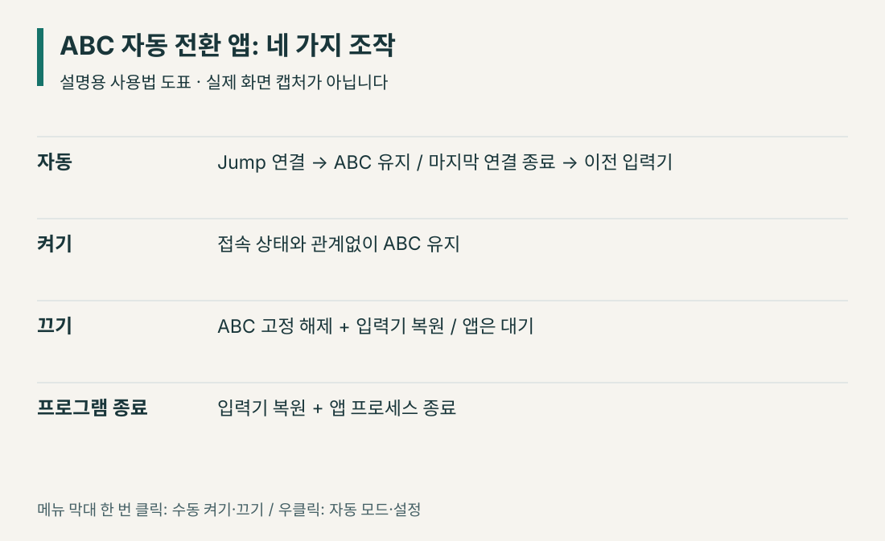
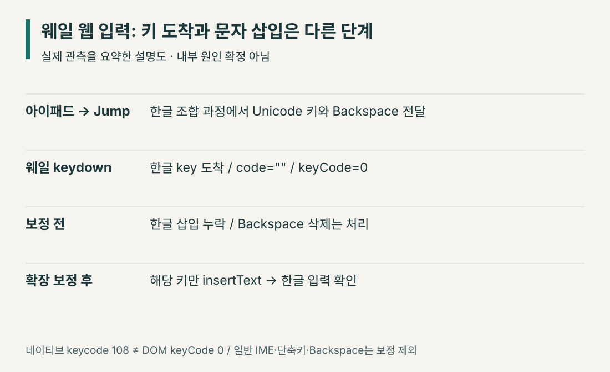
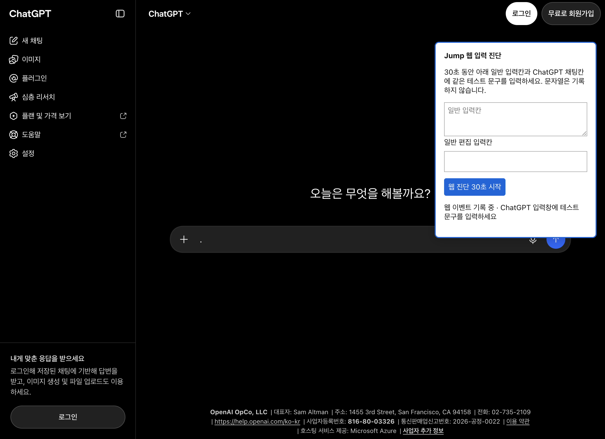

# 점프데스크톱 한글 입력 오류: 웨일 ChatGPT·뤼튼에서 해결한 방법

**아이패드 Jump Desktop으로 맥의 웨일에 접속했을 때, 주소창에는 한글이 써지는데 ChatGPT·뤼튼 입력칸에서는 안 써지거나 조합 중 사라진다면 이 사례와 조건이 비슷합니다.** 실제로 한글 키는 웹페이지까지 도착했지만 문자 삽입이 누락되고 Backspace 삭제는 처리됐습니다. 해당 키의 삽입을 보완하는 웨일 확장을 만든 뒤 두 사이트에서 정상 입력을 확인했습니다.

맥 입력기를 ABC로 유지하는 보조 앱도 함께 제공합니다. **ABC 고정만으로는 웨일 웹 입력 문제가 해결되지 않았습니다.** 확장은 웹 입력칸의 누락을 보완하고, 앱은 아이패드에서 한글을 조합하는 동안 맥 입력기가 바뀌지 않도록 관리합니다. 앱에는 자동 전환, 수동 켜기·끄기, 완전 종료를 넣었습니다.

## 30초 진단: 내 증상에도 이 방법이 맞을까?
{: #quick-check }

**다음 세 조건을 확인하세요.** 이 가이드는 모든 원격 한글 오류가 아니라, 아래 조건에서 재현한 **웨일 웹 입력칸의 문자 삽입 누락**을 해결한 사례입니다.

1. **접속 환경:** 아이패드의 Jump Desktop **Fluid**로 맥에 접속해 웨일을 사용합니다.
2. **비교 테스트:** 웨일 **주소창에서는 한글 입력이 됩니다.**
3. **문제 위치:** ChatGPT·뤼튼 같은 **웹 입력칸에서만** 한글이 입력되지 않거나 조합 중 글자가 사라집니다.

| 확인 결과 | 다음 단계 |
|---|---|
| 세 조건이 모두 맞음 | [웨일 한글 보정 확장 다운로드](JumpHangulWhale-0.1.1.zip) → [확장 설치 방법](#install-whale-extension) → [입력 테스트](#verify-korean-input) |
| 웹 입력은 보정됐지만 원격 접속 중 **맥 입력기가 자꾸 바뀜** | 선택적으로 [ABC 자동 전환 앱 사용](#install-abc-guard). **ABC 고정만으로 웹 문자 삽입 문제는 해결되지 않습니다.** |
| 주소창을 포함해 **모든 앱에서 한글이 안 됨** | 이 확장의 검증 대상과 다릅니다. Jump 키보드 입력 설정과 양쪽 기기의 입력기를 먼저 확인하세요. |
| Chrome·Safari 등 **다른 브라우저**에서도 동일함 | 이 글의 확장으로 해결된다고 확인하지 않았습니다. 브라우저별 문제를 별도로 재현해야 합니다. |

**핵심 답변:** 웹 입력칸에 한글 키 이벤트는 도착하지만 문자가 삽입되지 않는 증상을, 웨일 확장이 해당 입력에 한해 보완합니다. 원격 연결 중 맥을 ABC로 유지하는 앱은 **선택 사항인 별도 보조 도구**입니다. [진단 근거](#technical-evidence)와 [원본 소스](https://github.com/saramjh/whale-jump-hangul-fix)를 공개했습니다.


*2026년 10월 13일 검증. 개인 제작 우회 도구이며 NAVER Whale·Jump Desktop의 공식 패치가 아닙니다. 아래에는 직접 확인한 사실과 아직 확인하지 못한 범위를 구분했습니다.*

## 어떤 환경에서 문제가 있었나

대만 여행에서 아이패드로 한국에 켜 둘 맥에 접속해 코딩과 프로젝트 운영을 하려고 원격 환경을 준비하다가 발견한 문제입니다. 한글 조합이 깨지는 현상, 쌍자음 뒤 공백에서 글자가 바뀌는 현상, 웹 입력칸에서 아예 입력되지 않는 현상이 섞여 있었습니다.

| 항목 | 검증한 환경 |
|---|---|
| 아이패드 | iPad Pro 12.9형 3세대, Magic Keyboard |
| 아이패드 Jump Desktop | 10.15.42 |
| 접속 방식 | Fluid |
| 맥 Jump Desktop Connect | 10.15.42.0 |
| macOS | 26.6.2, 빌드 25G83 |
| 웨일 | 5.39.412.57, Chromium 150 |
| 문제가 난 입력칸 | ChatGPT 웹 채팅창, 뤼튼, 별도 일반 웹 편집 입력칸 |

아이패드와 맥의 버전 번호는 같은 제품의 버전으로 뭉뚱그리지 않고 따로 확인했습니다. iPadOS 버전은 확보하지 못했습니다. 아래 해결 범위는 이 환경과 실제 테스트한 입력칸을 기준으로 합니다.

**증상이 다르다면 [30초 진단](#quick-check)부터 다시 확인하세요.** 모든 앱에서 한글이 안 되거나 Cmd·Option 키가 계속 눌리는 문제는 이 확장의 보정 대상과 다를 수 있습니다.

## 초보자용: 무엇을 다운로드해야 하나
{: #downloads }

[GitHub 공개 저장소](https://github.com/saramjh/whale-jump-hangul-fix)에서 소스를 확인할 수 있고, [첫 공개 배포 v0.1.0](https://github.com/saramjh/whale-jump-hangul-fix/releases/tag/v0.1.0)에 파일을 올렸습니다. 이 글에서도 같은 ZIP을 직접 내려받을 수 있습니다.

| 다운로드 | 역할 | 버전 |
|---|---|---|
| [웨일 한글 보정 확장 ZIP](JumpHangulWhale-0.1.1.zip) | 웹 입력칸에 누락된 한글 문자 삽입 보완 | 0.1.1 |
| [맥 ABC 자동 전환 앱 ZIP](JumpInputGuard-2.0.3-macos-universal.zip) | Jump 연결 중 ABC 유지, 연결 종료 시 입력기 복원 | 2.0.3 |
| [SHA256SUMS.txt](SHA256SUMS.txt) | 위 두 ZIP의 SHA-256 확인 | 이번 배포 파일 기준 |

웹 입력 누락을 해결하는 구성요소는 **웨일 확장**입니다. 맥 앱은 원격 사용 중 입력기를 ABC로 유지할 때 사용합니다. 평소 맥에서 직접 입력하는 동안에는 자동 모드가 고정을 풀어 줍니다.

맥 앱은 macOS 13 이상을 대상으로 Apple Silicon·Intel 두 아키텍처를 빌드했습니다. 실제 실행 검증은 Apple Silicon에서 했고, Intel은 빌드·서명 검사까지 확인했습니다. Apple Developer ID 서명과 공증은 없는 개인 배포 앱입니다.

### 1. 웨일 확장 설치
{: #install-whale-extension }

1. 웨일 확장 ZIP을 내려받아 압축을 풉니다.
2. 폴더 안에 `manifest.json`, `fix.js`, `background.js`가 있는지 확인합니다.
3. 웨일 주소창에 `whale://extensions`를 입력합니다.
4. **개발자 모드**를 켭니다.
5. **압축해제 된 확장앱 설치**를 누르고 `manifest.json`이 들어 있는 `JumpHangulWhale` 폴더를 선택합니다.
6. ChatGPT 페이지를 새로고침합니다. 확장 버튼을 도구 막대에 고정하면 편합니다.

설치 뒤에도 확장 폴더를 지우거나 다른 위치로 옮기지 마세요. 스토어 설치 방식이 아니라 그 폴더에서 확장 파일을 읽습니다.

**ChatGPT는 자동 적용**됩니다. 뤼튼 등 다른 AI 사이트에서는 해당 페이지의 확장 버튼을 한 번 눌러 켭니다. 버튼을 다시 누르면 꺼집니다. 다른 사이트를 새로고침하거나 새 탭에서 열었으면 다시 켜 주세요. 이는 모든 사이트에 항상 접근하는 권한을 요청하지 않기 위한 선택입니다.

확장을 전부 중지하려면 `whale://extensions`에서 **Jump 한글 입력 보정**의 스위치를 끕니다. 제거 버튼으로 삭제할 수도 있습니다.

### 2. 맥 앱 설치와 자동 모드
{: #install-abc-guard }

1. 맥 앱 ZIP을 압축 해제합니다.
2. `JumpInputGuard.app`을 맥의 **응용 프로그램** 폴더로 옮깁니다.
3. 앱을 열고 설정 창에서 **자동**을 선택합니다.
4. 원격 접속 뒤 맥 메뉴 막대의 입력기가 ABC가 되는지 확인합니다.
5. **한영 전환은 아이패드에서 합니다.** 맥이 ABC인 상태에서 아이패드 입력기를 한국어로 선택해 입력하세요.

처음 다운로드한 앱이 차단되면 소스와 배포 출처를 먼저 확인하세요. 신뢰할 수 있다고 판단한 경우, 앱 실행을 한 번 시도한 뒤 **시스템 설정 → 개인정보 보호 및 보안 → 확인 없이 열기**에서 허용하는 절차를 [Apple의 공식 안내](https://support.apple.com/ko-kr/102445)로 확인할 수 있습니다. 소스로 직접 빌드하는 방법도 뒤에 적었습니다.

아이패드에서 한영을 바꿨는데 맥 메뉴 막대가 계속 ABC여도, 이 구성에서는 의도한 상태입니다. 한글 조합은 아이패드에서 하고 맥은 그 결과를 받는 경로를 사용하기 때문입니다. 맥 메뉴 아이콘이 한글로 바뀌어야만 한글을 쓸 수 있는 것은 아닙니다.

### 3. 켜기·끄기·완전 종료



*사용법을 설명하는 도표입니다. 실제 앱 화면 캡처는 아닙니다.*

| 조작 | ABC 고정 | 앱 실행 상태 |
|---|---|---|
| **자동** | 실제 Jump 연결 중 켜짐, 마지막 연결 종료 시 해제·복원 | 대기 유지 |
| **켜기** | 연결 여부와 관계없이 유지 | 실행 유지 |
| **끄기** | 해제하고 이전 입력기로 복원 | 실행 유지 |
| **프로그램 종료** | 해제하고 이전 입력기로 복원 | 프로세스 종료 |

메뉴 막대의 Jump 항목을 **한 번 클릭**하면 수동 켜기·끄기를 바로 전환합니다. **우클릭**하면 자동 모드와 설정 메뉴를 열 수 있습니다. 자동으로 돌아가려면 그 메뉴 또는 설정 창에서 **자동**을 선택하세요.

설정 창의 닫기 버튼은 창만 숨깁니다. 앱까지 끝내려면 설정 창 아래의 **프로그램 종료**를 누르세요. 앱을 다시 열면 기존 설정 창을 보여 주며 중복 인스턴스를 만들지 않습니다.

**로그인 시 자동 실행**은 별도 체크박스입니다. 원격 작업을 자주 한다면 켤 수 있고, 필요할 때만 쓰려면 체크를 해제합니다. macOS 승인이 필요하면 **로그인 항목 설정…**을 누릅니다. 로그인 자동 실행을 켠 상태에서 앱을 종료하면 다음 로그인 때는 다시 실행됩니다.

### 4. 실제로 입력해 보고 확인
{: #verify-korean-input }

아이패드 Jump에서 맥에 접속하고, 웨일의 ChatGPT 입력칸에 아래 문장을 입력해 보세요. 메시지를 전송할 필요는 없습니다.

```text
안녕하세요 테스트 때 때가 됐다
```

끝의 공백까지 입력한 뒤 `때`와 쌍자음이 유지되는지 봅니다. 뤼튼에서는 먼저 확장 버튼을 켜고 같은 테스트를 합니다. 실제 사용자는 두 사이트에서 정상 입력을 확인했습니다.

앱의 자동 동작도 확인했습니다. 원래 한글 두벌식인 맥에 접속했다가 연결을 끊고 다시 접속했을 때 **한글 → ABC → 한글 → ABC → 한글** 순서로 전환됐습니다.


*실제 상태 기록을 요약한 도표입니다. 연결이 없으면 앱은 대기하며 ABC 고정을 하지 않습니다.*

별도로 **프로그램 종료** 버튼을 눌러 이전 한글 입력기로 복원되고 보조 앱 프로세스가 0개가 되는 것을 확인했습니다.

### 5. 안 될 때 확인할 순서
{: #troubleshooting }

| 증상 | 먼저 확인할 것 |
|---|---|
| ChatGPT에서 여전히 입력 불가 | 확장이 켜져 있는지 확인하고 페이지 새로고침 |
| 뤼튼 등 다른 사이트에서 입력 불가 | 그 탭에서 확장 버튼을 눌러 켰는지 확인 |
| 페이지를 다시 연 뒤 보정이 사라짐 | ChatGPT 외 사이트는 다시 버튼 클릭 |
| 연결 중에도 맥이 한글로 바뀜 | 앱의 자동/켜기 모드와 상태 문구 확인 |
| 연결이 끝나도 ABC 유지 | 수동 **켜기** 상태인지 확인하고 **자동** 또는 **끄기** 선택 |
| 보정을 사용하지 않을 때 | 앱은 **프로그램 종료**, 확장은 확장 관리 화면에서 비활성화 |

새 Jump Connect 버전에서 자동 감지가 맞지 않으면 수동 켜기·끄기를 사용할 수 있습니다. 캔버스 기반 편집기나 특수 입력 컴포넌트까지 모두 지원한다고 검증하지는 않았습니다.

## 전문가용: 왜 글자가 사라졌나
{: #technical-evidence }

처음에는 한영 상태 불일치나 Caps Lock 매핑을 의심했습니다. 하지만 맥을 ABC로 유지해도 웨일 웹 입력 문제는 남았고, 기존 확장이 없는 별도 웨일 프로필에서도 실패했습니다. 실제 이벤트를 관측한 뒤에는 원격 입력의 **키 전달과 편집 동작 사이**에 문제가 있다는 것을 확인할 수 있었습니다.

### 실험 결과 요약: 관측 사실과 한계

| 구분 | 직접 확인한 사실 | 확인되지 않은 부분 |
|---|---|---|
| 네이티브 키 이벤트 | 202개 이벤트를 관측했고, 그중 keydown 100개·Unicode 키 59개였습니다. | 모든 Jump 송신·수신 경로에서 같은 현상이 발생하는지는 미검증 |
| 웨일 웹 편집 | 한글 `keydown`은 도착했지만 해당 문자 삽입 `beforeinput`·`input`은 관측되지 않았고 Backspace 삭제는 처리됐습니다. | 웨일 내부에서 어느 코드 분기가 삽입을 누락했는지는 미확정 |
| 보정 실행 | 해당 테스트에서 `insertText` 명령 56회 성공·0회 실패를 기록했습니다. | 전체 사용자 성공률이나 다른 브라우저·웹 편집기 호환성은 미검증 |
| ABC 자동 관리 | 실제 Fluid 연결·해제·재접속에서 입력기 복원 동작을 확인했습니다. | 추후 Jump Connect 버전에서도 내부 세션 감지 방식이 유지되는지는 미확인 |

자세한 재현 조건과 기록은 [공개 실험 근거](https://github.com/saramjh/whale-jump-hangul-fix/blob/main/docs/evidence.md)에 있습니다. 위 수치는 **2026년 10월 13일 검증 환경에서의 관측 결과**이며, 최신 버전에서의 일반적인 성공률이나 공식 원인 확정으로 해석해서는 안 됩니다.

### 네이티브 키 전달과 웹 문자 삽입의 차이

검사한 맥 Jump Connect 수신 경로는 `TISCopyCurrentKeyboardInputSource`로 현재 입력기를 확인하고 `UCKeyTranslate`를 통해 문자에 대응하는 키 후보를 찾습니다. 해당 경로에서 적절한 후보를 찾지 못하면 `CGEventKeyboardSetUnicodeString`으로 Unicode 문자열을 붙인 키 이벤트를 전달합니다.

따라서 “Jump가 macOS 입력기를 전혀 거치거나 참조하지 않는다”는 설명은 정확하지 않습니다. **키보드 배열의 문자 변환을 참조하는 것과 IME의 조합 상태를 완전히 재현하는 것은 다른 일**입니다. iPad 송신기의 전체 구현이나 모든 수신 경로를 분석한 것은 아닙니다.

네이티브 표본은 202개 이벤트, 그중 keydown 100개였습니다. Unicode 키 59개, Backspace 38개, Space 2개, Return 1개였습니다. 한글을 입력하는 동안 자모·음절이 바뀌면서 **이전 글자 삭제와 새 문자 전달이 함께 일어나는 패턴**을 관측했습니다. 표본 동안 맥은 ABC였고 Cmd·Option·Control·Caps Lock 플래그는 관측되지 않았습니다. 이 표본은 당시 웹 입력 누락을 계속 눌린 보조키로 설명할 근거를 주지 않았습니다.



### 웨일에서 직접 확인한 실패 지점

실제 웹 진단에서는 한글 `keydown`이 아래 형태로 도착했습니다.

```text
isTrusted = true
key       = 한글 문자
code      = ""
keyCode   = 0
isComposing = false
```

하지만 해당 한글에 대응하는 `beforeinput`·`input`의 문자 삽입은 관측되지 않았습니다. 반면 Backspace는 `deleteContentBackward`로 처리됐습니다. 새 문자가 삽입되지 않고 이전 문자를 지우는 동작만 반영되면, 사용자에게는 조합되는 순간 글자가 사라지는 것으로 보일 수 있습니다.

**네이티브 keycode 108과 DOM keyCode 0은 서로 다른 층의 값입니다.** 네이티브 값을 곧바로 웹 키코드라고 설명하면 잘못된 분석이 됩니다.



*개인 대화가 없는 별도 프로필의 실제 진단 화면입니다. 화면 오른쪽 도구는 진단 당시 사용했으며 배포 확장의 UI는 아닙니다. 키 이벤트 관측 결과는 공개 저장소의 근거 문서에 정리했습니다.*

당시 로그인하지 않은 ChatGPT 입력칸은 `textarea#mobile-composer-prompt`였습니다. 일반 `contenteditable` 입력칸도 실패했습니다. 특정 AI 서비스의 에디터 라이브러리 하나만 원인으로 단정할 수 없었습니다. 뤼튼도 보정 후 정상 입력을 확인했으므로 적용 범위를 일반 웹 편집 필드까지 넓혔습니다.

Apple의 [Unicode 키 이벤트 API 문서](https://developer.apple.com/documentation/coregraphics/cgevent/keyboardsetunicodestring(stringlength:unicodestring:))는 앱 프레임워크가 이벤트의 Unicode 문자열을 사용하지 않고 가상 키코드와 상태로 자체 변환할 수 있다고 설명합니다. 이번 실패와 부합하는 가능성이지만, **웨일 내부의 정확한 코드 분기는 아직 확인하지 못했습니다.**

다른 브라우저와 Parsec에서는 괜찮았다는 사용자의 비교 경험도 있습니다. 다만 동일 조건의 Chrome·Safari DOM 기록은 확보하지 않았으므로 모든 브라우저의 차이를 통제된 실험으로 증명했다고 쓰지는 않습니다.

### 확장이 하는 일

보정은 실제 사용자 입력에서 다음 조건을 모두 만족하는 한글 키로 제한했습니다.

- 신뢰된 이벤트이고 `isComposing`이 `false`일 것.
- `code`가 빈 문자열, `keyCode`가 0일 것.
- Cmd·Control·Option 조합이 아니고 이미 취소된 이벤트가 아닐 것.
- 현재 포커스가 편집 가능한 textarea, text/search input 또는 contenteditable일 것.
- 비밀번호, 비활성화된 입력칸, 읽기 전용 입력칸이 아닐 것.

해당 키를 발견하면 아래 편집 명령을 실행하고, 성공했을 때만 원래 키의 기본 동작을 취소합니다.

```javascript
if (document.execCommand('insertText', false, event.key)) {
  event.preventDefault();
}
```

Backspace를 일괄 차단하지 않았습니다. 관측한 원격 조합 경로는 이전 글자 삭제 뒤 교체하는 동작을 사용하므로, 삭제만 막으면 자모와 음절이 누적될 수 있기 때문입니다. 일반 IME의 조합 이벤트와 영어·단축키는 보정 조건에서 제외했습니다.

테스트에서는 삽입 명령 56회 성공, 0회 실패를 기록했습니다. 이는 해당 테스트의 실행 결과이며 전체 사용자 성공률이 아닙니다. `execCommand`는 [폐기 예정 API](https://developer.mozilla.org/en-US/docs/Web/API/Document/execCommand)이므로 브라우저나 사이트 편집 동작이 달라지면 다시 검증해야 합니다.

확장은 ChatGPT 두 도메인에 자동 주입합니다. 다른 사이트는 사용자가 버튼을 누를 때 [`activeTab`](https://developer.chrome.com/docs/extensions/develop/concepts/activeTab)과 `scripting`으로 해당 탭에 주입합니다. 입력 텍스트 기록, 네트워크 전송, 클립보드 읽기 코드는 없습니다.

### ABC 앱의 자동 감지와 복원

맥 앱은 현재 사용자 소유의 Jump Connect 프로세스 중 실제 Fluid 세션에 사용되는 `--desktopproxy` 인수를 확인합니다. 단순히 백그라운드 Connect 서비스가 켜져 있다는 이유로 ABC를 고정하지 않습니다.

자동 모드는 활성 세션이 하나 이상이면 ABC를 유지하고 마지막 세션이 끝나면 저장해 둔 입력기로 복원합니다. 여러 세션, 연결 해제·재접속, 수동 모드, 상태 감지 실패, 중단된 이전 실행 복구는 상태 테스트로 확인했습니다. 실제 연결 테스트도 별도로 통과했습니다. 감지 상태를 읽지 못하면 기존 자동 고정을 최대 3초 유지한 뒤 해제합니다.

`--desktopproxy`는 Connect 10.15.42에서 확인한 내부 구현이며 공식 API가 아닙니다. 버전 변경 시 감지가 바뀔 수 있습니다. 수동 모드를 함께 둔 이유입니다.

앱은 키 이벤트를 관측하지 않습니다. 로컬 상태 파일에는 모드, 현재·복원할 입력기, 세션 수와 오류 등의 메타데이터만 저장합니다.

```text
~/Library/Application Support/JumpInputGuard/status.json
```

이 글의 진단에 사용한 입력 모니터링 도구는 배포하지 않았습니다. 배포 앱의 역할은 입력기 전환과 복원입니다.

### Karabiner의 Caps Lock → F13은 별도 설정

평소 맥 내장 키보드에서 Caps Lock을 F13으로 바꾸어 한영 전환에 쓰고 있다면, 전역 Simple Modification보다 기기 조건을 둔 Complex Modification으로 제한할 수 있습니다. 이번에는 기존 글로벌 매핑을 **내장 키보드에만 적용하는 조건**으로 옮겼습니다.

```json
{
  "type": "basic",
  "from": {"key_code": "caps_lock"},
  "to": [{"key_code": "f13"}],
  "conditions": [{
    "type": "device_if",
    "identifiers": [{"is_built_in_keyboard": true}]
  }]
}
```

이는 한 개 manipulator의 예시입니다. 전체 설정 파일을 덮어쓰는 JSON은 아닙니다. 외장 키보드는 해당 기기의 vendor/product 식별자로 별도 조건을 정해야 하며, 다른 기기를 내장 키보드로 취급하도록 설정했다면 그 분류도 확인해야 합니다. 이 변경만으로 웨일 문자 삽입 누락이 해결되지는 않았습니다.

### 직접 빌드하고 확인하기

공개 저장소에는 앱·확장 소스, 상태 테스트와 빌드 스크립트가 있습니다. Xcode Command Line Tools, Swift, Node.js, Python 3이 필요합니다.

```bash
git clone https://github.com/saramjh/whale-jump-hangul-fix.git
cd whale-jump-hangul-fix
bash scripts/test.sh
bash scripts/build-macos.sh
```

출력은 `dist/JumpInputGuard.app`과 맥 앱 ZIP입니다. 앱은 키 수집 없이 TIS API로 입력기를 관리하고, 확장은 한글 키의 누락된 브라우저 삽입을 보완합니다. 두 도구의 소스는 MIT 라이선스로 공개했습니다. 웨일·Jump 자체 바이너리는 배포하지 않습니다.

ZIP을 같은 폴더에 내려받았다면 다음과 같이 체크섬을 확인할 수 있습니다.

```bash
shasum -a 256 -c SHA256SUMS.txt
```

## 자주 묻는 질문

### 점프데스크톱에서 맥을 ABC로 고정하면 한글을 못 쓰나요?

이 가이드는 아이패드에서 한글을 조합하고 맥은 ABC로 유지하는 경로를 사용합니다. 한영 전환은 아이패드에서 합니다. 웨일 웹 입력칸의 문자 삽입 누락은 별도 확장으로 보완합니다.

### Jump 연결을 끊으면 자동으로 꺼지나요?

자동 모드에서는 마지막 연결 종료 시 ABC 고정을 풀고 이전 입력기로 복원합니다. 앱 자체는 재접속 감지를 위해 메뉴 막대에서 대기합니다. 완전히 끄려면 프로그램 종료 버튼을 누릅니다.

### 끄기와 프로그램 종료는 무엇이 다른가요?

끄기는 ABC 고정만 해제하고 앱은 실행 상태로 남습니다. 프로그램 종료는 이전 입력기로 복원한 뒤 앱 프로세스까지 종료합니다. 로그인 자동 실행은 별도 설정입니다.

### ChatGPT 외의 AI 사이트에서도 쓸 수 있나요?

ChatGPT에는 자동 적용됩니다. 다른 사이트는 해당 탭에서 확장 버튼을 눌러 켭니다. 뤼튼에서 정상 입력을 확인했지만 모든 AI 편집기를 검증하지는 않았습니다. 다른 사이트를 새로고침하면 다시 켜야 합니다.

### 입력 내용을 기록하거나 외부로 전송하나요?

배포 앱은 키 이벤트를 수집하지 않습니다. 확장은 보정할 한글 키를 처리하지만 입력 텍스트를 저장하거나 전송하지 않습니다. 앱의 로컬 상태 파일에는 모드와 입력기·연결 상태 같은 메타데이터만 저장합니다.

### 웨일이나 Jump Desktop의 공식 패치인가요?

개인 제작 우회 도구입니다. 소스와 검증 범위를 공개했고 웨일 공식 GitHub 저장소에 이슈 24번을 등록했습니다. 정확한 웨일 내부 원인은 아직 확정하지 못했습니다.

## 소스·버그 보고와 후속 확인
{: #sources-and-updates }

- [소스와 한국어 README](https://github.com/saramjh/whale-jump-hangul-fix)
- [다운로드 및 배포 변경 사항](https://github.com/saramjh/whale-jump-hangul-fix/releases/tag/v0.1.0)
- [재현 환경·이벤트 관측·자동 전환 검증 근거](https://github.com/saramjh/whale-jump-hangul-fix/blob/main/docs/evidence.md)
- [웨일 공식 GitHub 버그 보고 #24](https://github.com/naver/whale-browser-developers/issues/24)

다른 환경에서 재현된다면 맥·웨일·Jump 양쪽 버전, 접속 방식, 입력칸 종류, ABC 유지 여부, 보정 전후 결과를 남겨 주세요. 개인 대화나 전체 원격 접속 로그는 올릴 필요가 없습니다.

원격 맥에서 AI 도구를 함께 쓰는 개발 환경은 [ChatGPT와 로컬 개발 도구를 연결하는 가이드](/chatgpt-mcp-local-development-setup/)에 따로 정리했습니다.

<script>
/* 긴 코드 예제의 키보드 스크롤 접근성을 제공합니다. */
document.querySelectorAll('main pre').forEach(function (block) {
  block.tabIndex = 0;
  block.setAttribute('aria-label', '코드 예제');
});
</script>
