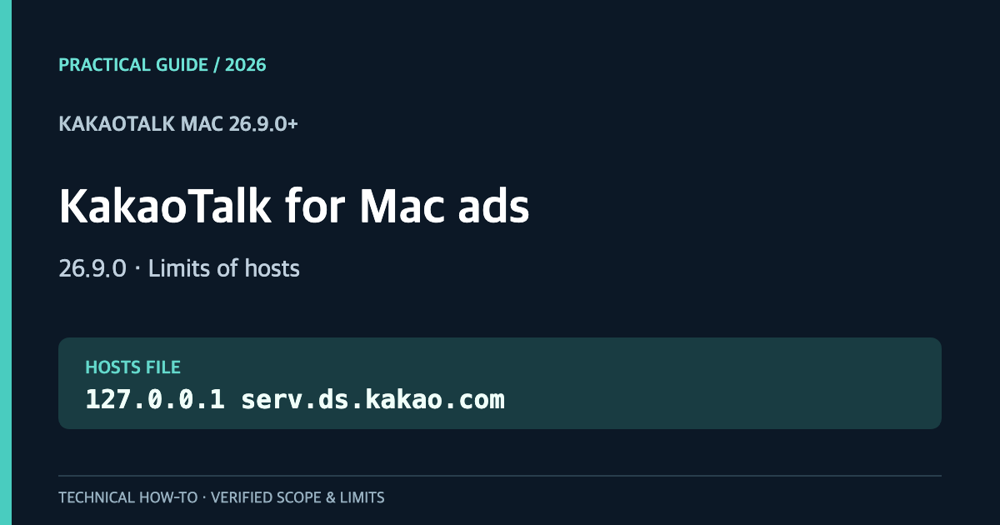
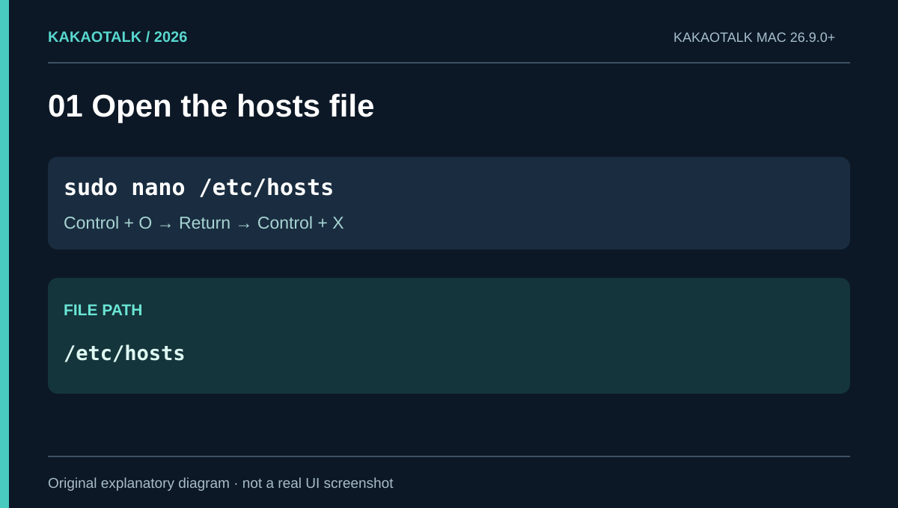
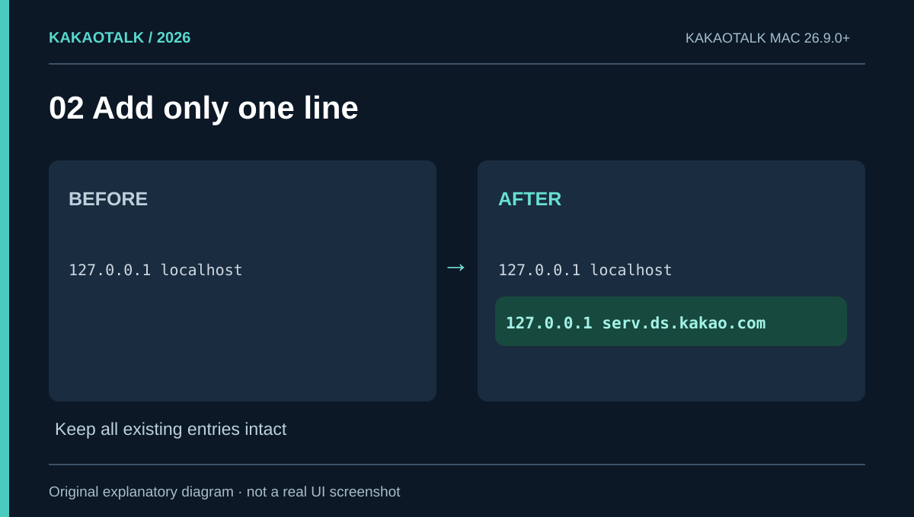
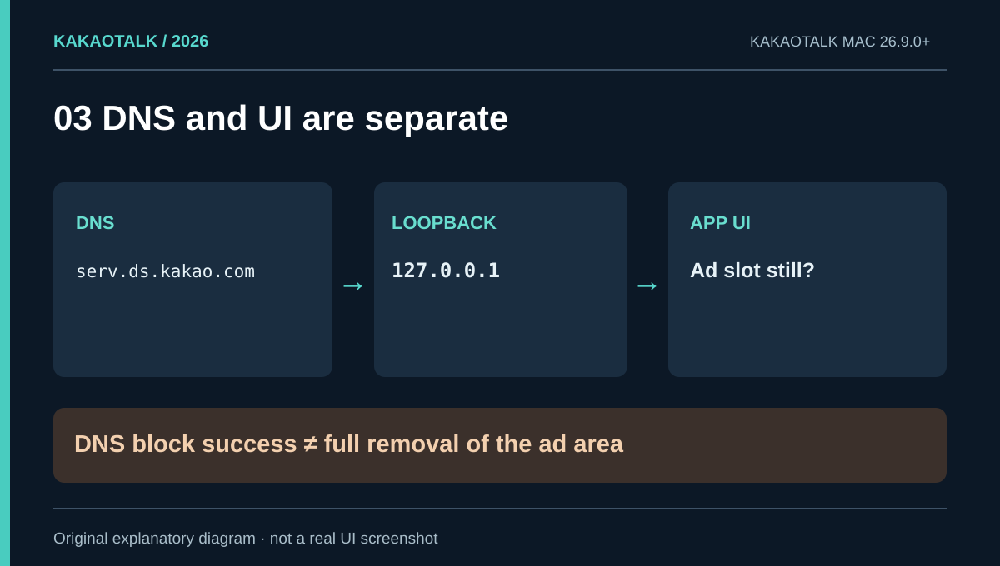
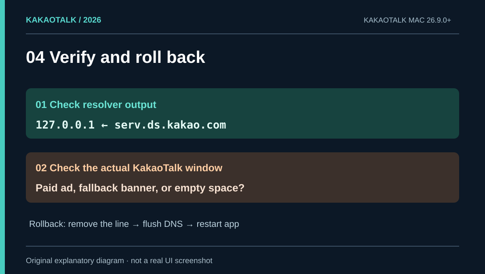
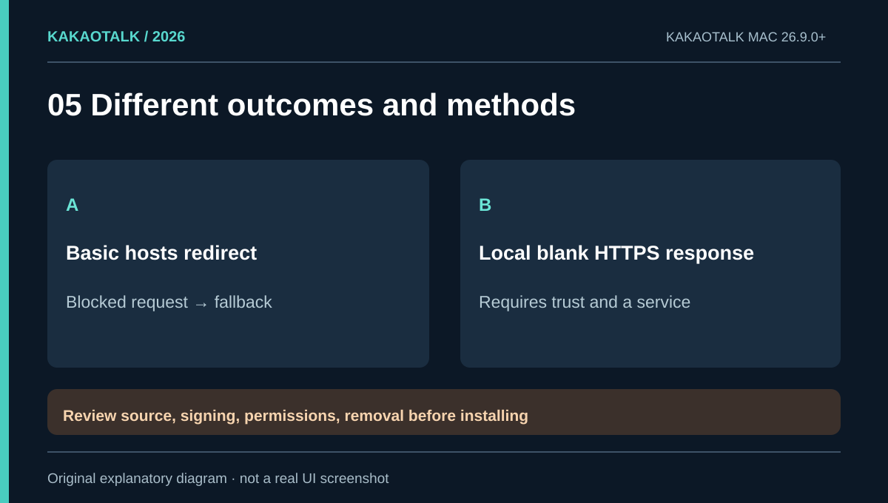

# KakaoTalk for Mac ads after version 26.9.0: why hosts alone may not work

**Short answer:** Editing `/etc/hosts` on macOS can redirect a KakaoTalk ad-related hostname, but it **may not remove the new bottom banner introduced in version 26.9.0**. On a Mac with KakaoTalk **26.9.0**, `serv.ds.kakao.com` resolved to `127.0.0.1` after the change—and the user still reported a visible ad. This is precisely why DNS success and actual ad removal need separate checks.

An [October 27, 2026 vendor support note](https://support.getunicorn.app/hc/ko/articles/63652151767065-macOS-%EC%B9%B4%EC%B9%B4%EC%98%A4%ED%86%A1%EC%97%90%EC%84%9C-%ED%95%98%EB%8B%A8-%EB%B0%B0%EB%84%88-%EA%B4%91%EA%B3%A0%EA%B0%80-%EB%82%98%EC%99%80%EC%9A%94) also confirms the bottom banner appeared in KakaoTalk for Mac **26.9.0 and newer**. Below is a reversible built-in macOS procedure, a breakdown of the remaining-ad problem, and an explanation of a third-party alternative—not an unqualified promise of a clean UI.

<p style="background: rgba(0, 120, 212, 0.08); border-left: 4px solid #0078d4; padding: 10px 14px; margin-bottom: 20px; border-radius: 4px;"><strong>한국어 버전:</strong> <a href="/kakaotalk-mac-ads-269-ko/">맥 카카오톡 26.9.0 광고 차단 안내</a></p>

<figure>
  <a href="cover.png"></a>
  <figcaption>Cover · Scope of the macOS troubleshooting guide.</figcaption>
</figure>

## Compare the approaches before changing anything

| Approach | Extra software? | What it can do | Limitation |
|---|---|---|---|
| Edit `/etc/hosts` | No | Redirect a selected hostname | A house banner can remain |
| Network filter | Sometimes | Block selected traffic | Per-app HTTPS compatibility matters |
| Local blank HTTPS response | Local service required | Return a valid empty-ad payload in some implementations | Certificate trust and service maintenance |
| Modify the KakaoTalk bundle | Separate modification | Attempt to alter UI code | Signing, integrity and update risks; not recommended |

**A refused connection and a valid blank-ad response are not equivalent.** Start with the reversible approach and understand what it does before considering other tools.

## Step 1 — Confirm the version and back up hosts

Check your KakaoTalk version. This article is specifically concerned with the lower banner introduced around **26.9.0**. Open Terminal and save a timestamped copy of your existing file:

```bash
sudo cp -p /etc/hosts "/etc/hosts.backup-$(date +%Y%m%d-%H%M%S)"
```

macOS may prompt for your administrator password; the terminal deliberately shows no characters while you type it. The backup can contain other private hostname entries, so do not publish it.

Open the original file:

```bash
sudo nano /etc/hosts
```

<figure>
  <a href="01-location.svg"></a>
  <figcaption>Figure 1 · File path and save sequence; an explanatory diagram, not an OS screenshot.</figcaption>
</figure>

## Step 2 — Add just one loopback mapping

Keep all existing entries. Add the following line only if there is not already a matching active rule:

```text
127.0.0.1 serv.ds.kakao.com
```

`127.0.0.1` is the IPv4 loopback address of your own machine. In Nano, press **Control + O**, **Return**, then **Control + X** to save and exit. A hosts redirect affects the machine's resolution for the exact hostname; it is not a KakaoTalk preference toggle.

<figure>
  <a href="02-edit.svg"></a>
  <figcaption>Figure 2 · Keep unrelated mappings unchanged.</figcaption>
</figure>

## Step 3 — Flush the cache and verify system resolution

Run these commands in Terminal:

```bash
sudo dscacheutil -flushcache
sudo killall -HUP mDNSResponder
dscacheutil -q host -a name serv.ds.kakao.com
```

A line reading `ip_address: 127.0.0.1` indicates that the macOS resolver is using your mapping. **It does not tell you what KakaoTalk will draw.** Quit KakaoTalk fully from its menu, reopen it, and inspect the actual bottom of the app window.

<figure>
  <a href="03-result.svg"></a>
  <figcaption>Figure 3 · DNS blocking and application UI are different layers.</figcaption>
</figure>

## Step 4 — Why does the ad remain even though DNS was changed?

A real test on October 30, 2026 established these points independently:

- KakaoTalk for Mac installed version: **26.9.0**
- Active `/etc/hosts` rule for `serv.ds.kakao.com`: present
- `dscacheutil` result: **`127.0.0.1`**
- Visual result reported by the user: **ad remained visible**

This rules out the simple claim that changing that hostname's DNS alone always clears the UI. It does **not** establish which specific endpoint, cache, fallback, or internal code path produced the displayed content.

A read-only inspection of that 26.9.0 application binary found ad-related strings including `AdFitMac`, `BannerAdFetcher`, `https://display.ad.daum.net`, and `https://serv.ds.kakao.com`. **A string embedded in a binary is not proof of a live network request**. We therefore did not indiscriminately block additional Kakao domains.

<figure>
  <a href="04-verify.svg"></a>
  <figcaption>Figure 4 · DNS resolution alone is not evidence of ad removal.</figcaption>
</figure>

## Step 5 — Can the remaining banner be replaced with empty space?

An independently maintained [open-source project called KleanTalk](https://github.com/showmeyourway-sketch/KleanTalk) documents a different mechanism: it blocks some ad hostnames and routes `serv.ds.kakao.com` to a **local HTTPS service that returns a well-formed blank advertising response**. The intended result is an empty ad area rather than KakaoTalk's own fallback notice. This is the project's **implementation claim**, not a successful result reproduced in our test.

<figure>
  <a href="05-options.svg"></a>
  <figcaption>Figure 5 · Certificate trust and persistence introduce additional security considerations.</figcaption>
</figure>

That mechanism comes with a materially different trust boundary. According to the project, it requires a localhost service and trust for a certificate serving the relevant hostname. Some releases are not Apple-notarized. **Do not bypass macOS security prompts simply because a project is open source.** Review its source, release provenance, code signing, requested permissions, persistence behavior, and removal procedure first. Check the specific [release requirements and notes](https://github.com/showmeyourway-sketch/KleanTalk/releases), which may differ by version.

A [KleanTalk issue report from October 29](https://github.com/showmeyourway-sketch/KleanTalk/issues/1) also describes ads returning in version 1.9 after switching accounts following lock mode. That is a user report, not a confirmed universal failure, but it is a reason not to promise persistent success.

The [vendor's KakaoTalk-specific support note](https://support.getunicorn.app/hc/ko/articles/63652151767065-macOS-%EC%B9%B4%EC%B9%B4%EC%98%A4%ED%86%A1%EC%97%90%EC%84%9C-%ED%95%98%EB%8B%A8-%EB%B0%B0%EB%84%88-%EA%B4%91%EA%B3%A0%EA%B0%80-%EB%82%98%EC%99%80%EC%9A%94) warns that generic HTTPS interception can cause errors with KakaoTalk's certificate validation. A local blank-response service still needs independent compatibility and security testing; it is not merely another line in hosts.

## Step 6 — Revert the built-in hosts change

Open `sudo nano /etc/hosts` again, remove **only the entry you added**, and save. Then clear DNS caches and fully restart KakaoTalk:

```bash
sudo dscacheutil -flushcache
sudo killall -HUP mDNSResponder
```

If you later installed a local HTTPS replacement tool, **removing the hosts entry alone may not uninstall it**. Follow the tool's removal instructions and check its running service, startup item, and certificate trust settings. Keep unrelated hosts mappings intact.

## Frequently asked questions

### Can I remove KakaoTalk for Mac ads with hosts alone?

You may block one remote ad-related hostname. **You cannot assume it will remove the 26.9.0 bottom banner**. A real test showed correct loopback resolution while the visible ad remained.

### Does this work without AdGuard or another ad blocker?

**Steps 1–4 use only built-in macOS tools.** Removing fallback content, however, may require a validated additional mechanism such as a properly reviewed local blank-response service.

### Is the Windows version the same?

The networking concept overlaps, but Windows has a different file path and can show a different banner or popup outcome. See the [Windows 10/11 instructions](/kakaotalk-windows-ads-hosts-en/).

## Sources and test boundary · October 30, 2026

- [October 27 vendor support: Mac 26.9.0 banner and HTTPS filtering](https://support.getunicorn.app/hc/ko/articles/63652151767065-macOS-%EC%B9%B4%EC%B9%B4%EC%98%A4%ED%86%A1%EC%97%90%EC%84%9C-%ED%95%98%EB%8B%A8-%EB%B0%B0%EB%84%88-%EA%B4%91%EA%B3%A0%EA%B0%80-%EB%82%98%EC%99%80%EC%9A%94) — new banner and a warning about TLS interception.
- [KleanTalk README and source](https://github.com/showmeyourway-sketch/KleanTalk) — project-described local blank-response mechanism.
- [KleanTalk Releases](https://github.com/showmeyourway-sketch/KleanTalk/releases) — security and compatibility notices.
- **Local verification:** KakaoTalk 26.9.0, hosts redirect, `dscacheutil` successful, ad still visible; **no installation or successful verification of a third-party blank-response mechanism**.

Figures are original explanatory drawings—not staged evidence of an ad-free KakaoTalk screen.
