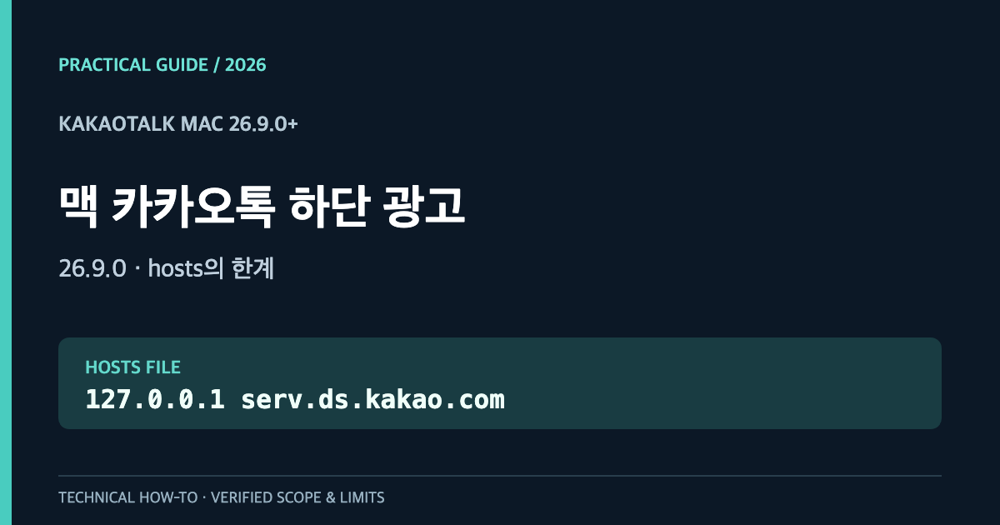
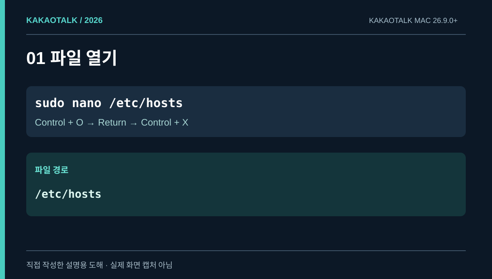
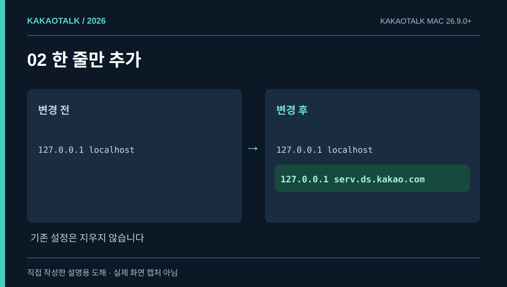
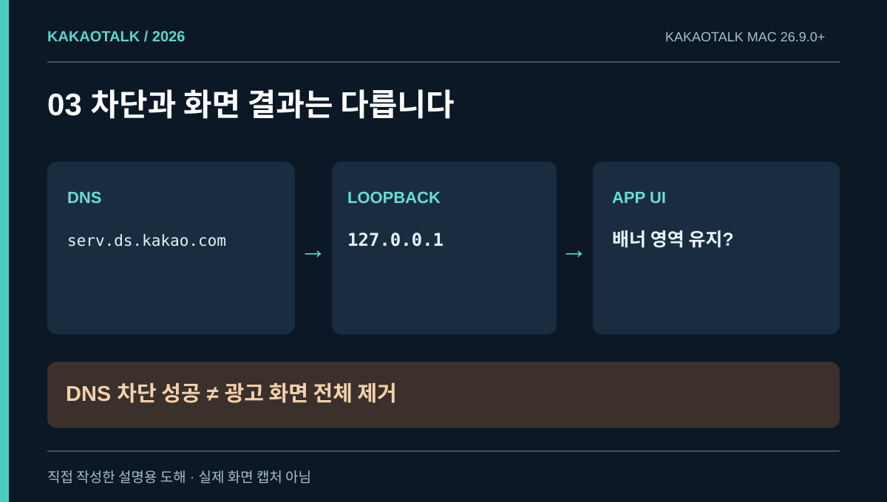
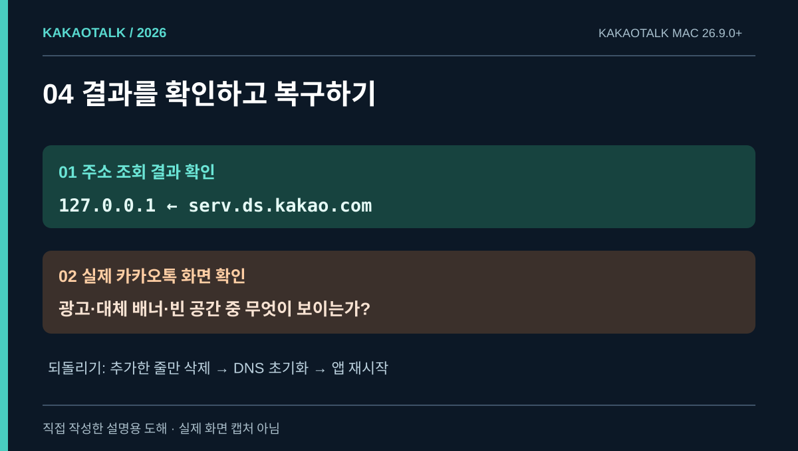
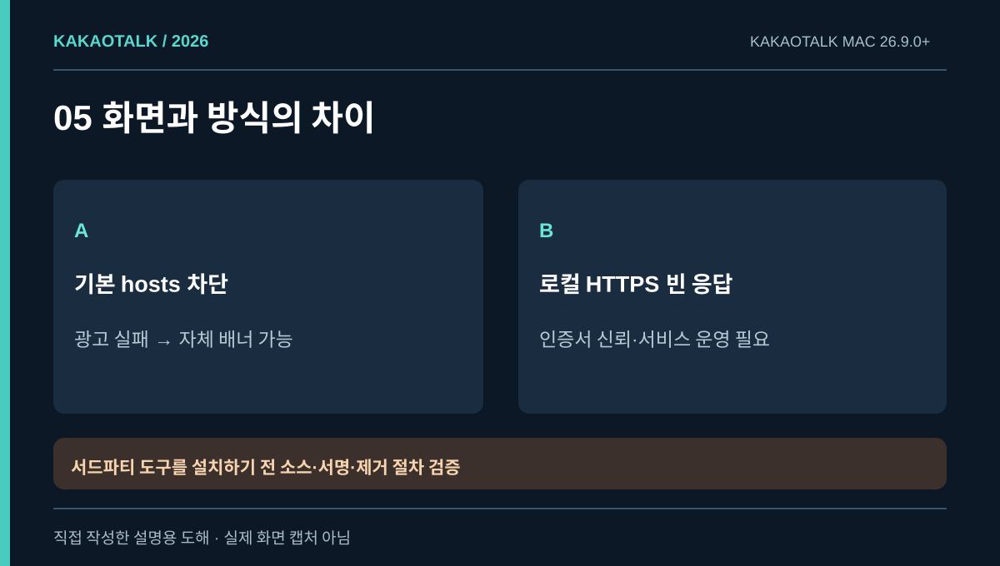

# 맥 카카오톡 26.9.0 하단 광고: hosts를 바꿨는데 왜 계속 보일까?

**결론부터:** macOS에서 `/etc/hosts`에 `127.0.0.1 serv.ds.kakao.com`을 추가하면 도메인 연결을 차단할 수 있지만, **카카오톡 하단 광고 공간까지 반드시 사라지지는 않습니다.** 실제로 카카오톡 **26.9.0**이 설치된 Mac 한 대에서 DNS가 정확히 `127.0.0.1`로 바뀌었는데도 광고가 여전히 보이는 상황을 확인했습니다.

2026년 10월 27일 [유니콘 공식 고객센터 문서](https://support.getunicorn.app/hc/ko/articles/63652151767065-macOS-%EC%B9%B4%EC%B9%B4%EC%98%A4%ED%86%A1%EC%97%90%EC%84%9C-%ED%95%98%EB%8B%A8-%EB%B0%B0%EB%84%88-%EA%B4%91%EA%B3%A0%EA%B0%80-%EB%82%98%EC%99%80%EC%9A%94) 역시 Mac용 카카오톡 **26.9.0부터 새 하단 배너가 추가됐다**고 안내합니다. 이 글에서는 별도 광고 차단 앱 없이 할 수 있는 것과, 그다음 단계에 필요한 기술을 구분합니다.

<p style="background: rgba(0, 120, 212, 0.08); border-left: 4px solid #0078d4; padding: 10px 14px; margin-bottom: 20px; border-radius: 4px;"><strong>English edition:</strong> <a href="/kakaotalk-mac-ads-269-en/">KakaoTalk for Mac 26.9.0 Ad Blocking Guide</a></p>

<figure>
  <a href="cover.png"></a>
  <figcaption>대표 그림 · 맥 전용 가이드.</figcaption>
</figure>

## Mac 광고 차단 방법 비교: 어떤 결과를 기대할 수 있나?

| 방법 | 별도 앱 | 기대 효과 | 주의할 점 |
|---|---|---|---|
| `hosts` 재지정 | 불필요 | 특정 광고 도메인 연결 차단 | 앱 내 대체 배너는 남을 수 있음 |
| 네트워크 필터 | 필요할 수 있음 | 규칙에 맞는 요청 차단 | 앱별 HTTPS 필터·호환성 점검 필요 |
| 로컬 HTTPS 빈 광고 응답 | 로컬 서비스 필요 | 대체 배너 대신 빈 응답을 제공하는 구현 사례 | 인증서 신뢰·서비스 운영에 보안 부담 |
| 카카오톡 앱 파일 직접 변경 | 별도 작업 필요 | UI 변경을 노리는 접근 | 서명·무결성·업데이트 문제로 비권장 |

**단순히 도메인을 차단하는 것과 카카오톡이 이해하는 ‘정상적인 빈 광고 응답’을 보내는 것은 다른 문제**입니다. 아래 순서대로 가장 되돌리기 쉬운 `hosts` 방법부터 확인합니다.

## 1. 카카오톡 버전을 확인하고 원본을 백업하기

카카오톡 메뉴에서 앱 버전을 확인합니다. 하단 배너 관련 변경은 **26.9.0 이상**을 중심으로 설명합니다. 터미널을 열고 현재 `hosts` 파일을 백업합니다.

```bash
sudo cp -p /etc/hosts "/etc/hosts.backup-$(date +%Y%m%d-%H%M%S)"
```

관리자 암호를 요청할 수 있습니다. 암호를 입력해도 터미널에는 문자가 표시되지 않는 것이 정상입니다. 이 백업에는 기존에 설정한 다른 도메인도 들어 있으므로 타인과 공유하지 마세요.

다음으로 파일을 엽니다.

```bash
sudo nano /etc/hosts
```

<figure>
  <a href="01-location.svg"></a>
  <figcaption>그림 1 · 편집기 경로와 저장 단축키. 실제 화면 캡처가 아닌 설명 도해.</figcaption>
</figure>

## 2. 광고 관련 도메인 한 줄만 추가하기

편집기에서 기존 설정을 유지하고 아래 내용이 **중복되지 않도록** 한 줄을 추가합니다.

```text
127.0.0.1 serv.ds.kakao.com
```

나노 편집기에서 **Control + O → Return(Enter) → Control + X** 순서로 저장하고 종료합니다. `127.0.0.1`은 현재 맥을 뜻하는 루프백 IP로, 해당 이름을 조회하는 클라이언트를 원격 광고 서버가 아닌 로컬 주소로 보내는 역할을 합니다.

<figure>
  <a href="02-edit.svg"></a>
  <figcaption>그림 2 · 기존 도메인 설정은 보존합니다.</figcaption>
</figure>

## 3. DNS 캐시를 초기화하고 결과 확인하기

터미널에서 다음 명령을 순서대로 실행합니다.

```bash
sudo dscacheutil -flushcache
sudo killall -HUP mDNSResponder
dscacheutil -q host -a name serv.ds.kakao.com
```

출력에 `ip_address: 127.0.0.1`이 나온다면 **macOS 호스트 이름 해석이 지정한 로컬 주소를 사용한다는 것**을 확인한 셈입니다. 하지만 그 결과만으로 카카오톡의 광고 UI까지 사라졌다고 말할 수는 없습니다. 카카오톡을 메뉴에서 완전히 종료한 다음 다시 실행해 실제 하단 화면을 확인하세요.

<figure>
  <a href="03-result.svg"></a>
  <figcaption>그림 3 · 네트워크 요청과 앱의 표시 내용은 다른 층입니다.</figcaption>
</figure>

## 4. 주소 차단에 성공했는데도 광고가 남는 이유

이번 실기기 점검에서는 다음 사실을 별도로 확인했습니다.

- 카카오톡 Mac 설치 버전: **26.9.0**
- `/etc/hosts`에 추가한 도메인 규칙: 한 줄
- `dscacheutil` 조회 결과: **`127.0.0.1`**
- 사용자에게 실제 표시된 결과: **광고가 계속 보임**

따라서 **네트워크 이름 해석의 적용 성공과 광고 화면 제거 성공은 별개**라는 결론을 낼 수 있습니다. 광고 서버가 달라졌거나 앱이 기존에 가진 대체 콘텐츠를 표시하는 등 여러 가능성이 있고, **어느 경로가 이번 화면을 만들었는지까지는 확정할 수 없습니다.**

Mac용 카카오톡 26.9.0 실행 파일에서는 광고 배너와 관련된 `AdFitMac` 및 `BannerAdFetcher` 구성 요소와 `https://display.ad.daum.net`, `https://serv.ds.kakao.com` 문자열이 확인됐습니다. 단, **프로그램에 문자열이 있다는 사실은 그 도메인이 해당 순간 실제 광고를 제공했다는 증거는 아닙니다.** 따라서 출처가 불명확한 주소를 무작정 차단하지 않았습니다.

<figure>
  <a href="04-verify.svg"></a>
  <figcaption>그림 4 · 실기기에서도 도메인 설정만 성공하고 광고는 남았습니다.</figcaption>
</figure>

## 5. 그럼 하단 배너를 빈 공간으로 만드는 것은 불가능할까?

완전히 불가능하다고 단정할 수는 없습니다. 공개 소스 프로젝트 [KleanTalk](https://github.com/showmeyourway-sketch/KleanTalk)는 **별도 광고 차단 프로그램에 의존하지 않고** 카카오톡 광고 영역에 정상 형태의 *빈 광고 응답*을 보내는 접근을 공개했습니다.

프로젝트의 설명에 따르면 `display.ad.daum.net`과 `analytics.ad.daum.net`을 hosts로 차단하고, `serv.ds.kakao.com`은 로컬 HTTPS 서버로 연결해 카카오톡이 처리할 수 있는 빈 광고 응답을 반환합니다. 그 결과 자체 대체 배너 대신 빈 영역을 표시하는 것이 목표입니다. 이는 **프로젝트 제작자의 설명**이며, 이 글에서 동일한 응답을 독립적으로 구현·성공 검증한 것은 아닙니다.

<figure>
  <a href="05-options.svg"></a>
  <figcaption>그림 5 · 로컬 서비스와 인증서 신뢰는 별도 보안 판단이 필요합니다.</figcaption>
</figure>

**보안 주의:** 이런 방식은 단순한 hosts 편집과 달리 로컬 백그라운드 서비스와 **도메인 인증서의 신뢰 설정 변경**이 필요할 수 있습니다. KleanTalk의 일부 릴리스에는 Apple 공증을 받지 않았다는 안내가 있습니다. 프로그램 이름이 오픈소스라고 해서 설치 파일이 안전하다고 보장되지는 않습니다. 사용한다면 코드·릴리스 출처·서명·요구 권한·제거 절차를 먼저 확인하고, 무작정 macOS 보안 경고를 무시하지 마세요. 배포 버전에 따라 시스템 요구사항도 달라질 수 있으므로 [GitHub Releases](https://github.com/showmeyourway-sketch/KleanTalk/releases)의 해당 버전을 확인해야 합니다.

참고로 [KleanTalk 이슈 #1](https://github.com/showmeyourway-sketch/KleanTalk/issues/1)에는 1.9 버전에서 잠금 후 계정을 전환하자 광고가 재등장했다는 사용자 보고도 있습니다. 따라서 이 방식의 재현성과 지속성을 모든 환경에서 확정할 수 없습니다.

또한 [유니콘의 카카오톡 안내](https://support.getunicorn.app/hc/ko/articles/63652151767065-macOS-%EC%B9%B4%EC%B9%B4%EC%98%A4%ED%86%A1%EC%97%90%EC%84%9C-%ED%95%98%EB%8B%A8-%EB%B0%B0%EB%84%88-%EA%B4%91%EA%B3%A0%EA%B0%80-%EB%82%98%EC%99%80%EC%9A%94)에서는 카카오톡의 인증서 신뢰 방식 때문에 일반적인 HTTPS 복호화 필터링이 연결 오류를 일으킬 수 있다고 경고합니다. **로컬 HTTPS 빈 응답 방식도 해당 Mac과 카카오톡 버전에서 안전하게 동작하는지 따로 검증해야 합니다.**

## 6. 설정을 완전히 되돌리는 방법

`sudo nano /etc/hosts`로 파일을 열어 본인이 추가한 `127.0.0.1 serv.ds.kakao.com` 줄만 삭제한 뒤 저장합니다. DNS 캐시를 다시 초기화하고 카카오톡을 재실행합니다.

```bash
sudo dscacheutil -flushcache
sudo killall -HUP mDNSResponder
```

나중에 로컬 HTTPS 서비스형 도구를 설치했다면 **hosts만 되돌려서는 끝나지 않을 수 있습니다.** 도구의 공식 제거 절차를 따라 서버·시작 항목·인증서 신뢰 설정까지 확인하세요. 기존 `hosts` 파일의 다른 규칙은 건드리지 마세요.

## 자주 묻는 질문

### 맥에서 hosts 파일만 수정해도 카카오톡 광고를 없앨 수 있나요?

일부 광고 요청을 막을 수는 있지만 **26.9.0의 실제 하단 광고 화면을 완전히 제거한다고 보장할 수 없습니다.** DNS가 `127.0.0.1`로 변경된 실기기에서도 광고가 남았습니다.

### 광고 차단 앱이 전혀 없는 사용자도 따라 할 수 있나요?

1~4단계의 **기본 hosts 설정은 macOS에 기본 포함된 터미널만으로 가능**합니다. 자체 배너까지 없애려면 추가적인 네트워크 응답 처리나 검증된 별도 도구가 필요할 수 있습니다.

### Windows에서도 같은 문제가 생기나요?

Windows 카카오톡은 하단 광고와 자체 공지·실행 팝업에 서로 다른 결과가 있을 수 있습니다. [윈도우 10·11용 광고 차단 가이드](/kakaotalk-windows-ads-hosts-ko/)에서 파일 경로와 확인법을 설명했습니다.

## 출처·검증 경계 (2026-10-30)

- [유니콘 공식 지원: macOS 카카오톡 26.9.0 하단 배너](https://support.getunicorn.app/hc/ko/articles/63652151767065-macOS-%EC%B9%B4%EC%B9%B4%EC%98%A4%ED%86%A1%EC%97%90%EC%84%9C-%ED%95%98%EB%8B%A8-%EB%B0%B0%EB%84%88-%EA%B4%91%EA%B3%A0%EA%B0%80-%EB%82%98%EC%99%80%EC%9A%94) — 26.9.0 도입 및 HTTPS 필터 주의점.
- [KleanTalk 공개 코드와 사용 설명](https://github.com/showmeyourway-sketch/KleanTalk) — 로컬 빈 광고 응답 구현 방식의 프로젝트 측 설명.
- [KleanTalk 릴리스](https://github.com/showmeyourway-sketch/KleanTalk/releases) — 버전별 배포 파일·보안 안내 확인.
- **실기기 확인:** Mac 카카오톡 26.9.0, hosts 매핑과 `dscacheutil` 성공, 하지만 화면 광고 잔존. **해당 테스트에서 빈 광고 응답 방식은 설치·검증하지 않음.**

본문 이미지는 모두 원리와 순서를 정확히 설명하기 위해 제작한 **원본 도해**이며, 광고가 성공적으로 사라진 것처럼 꾸민 화면 캡처가 아닙니다.
