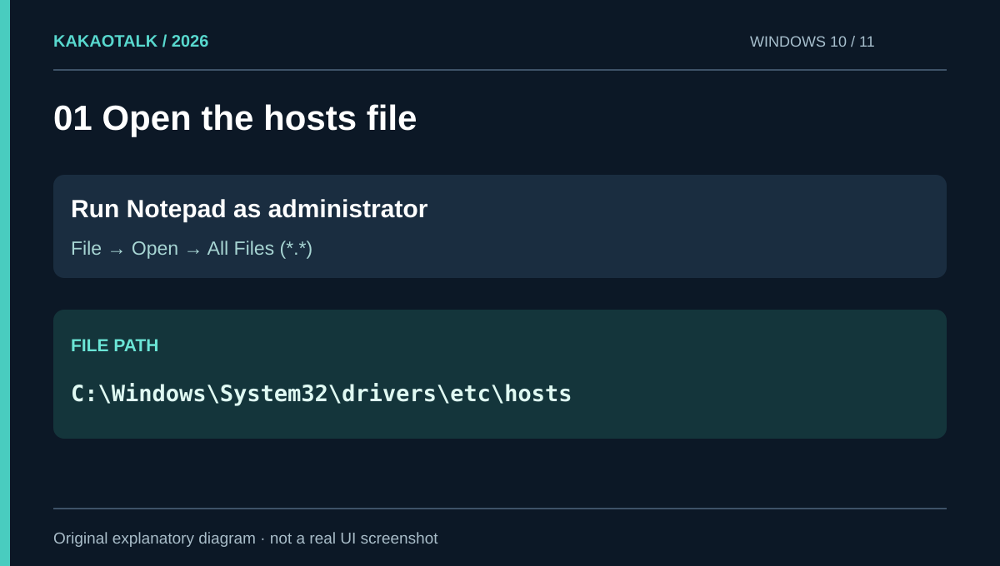
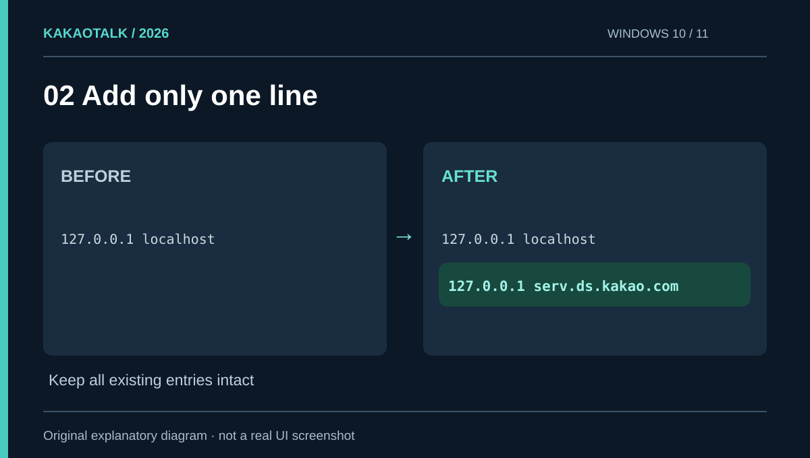
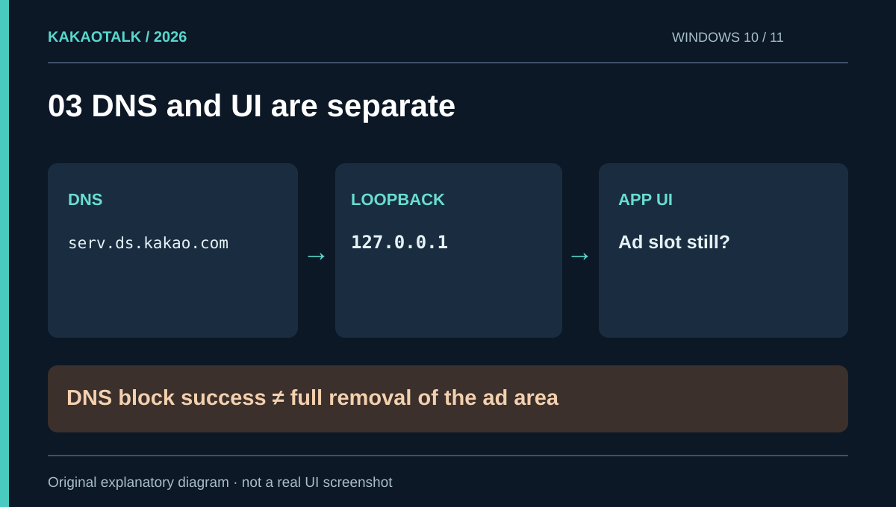
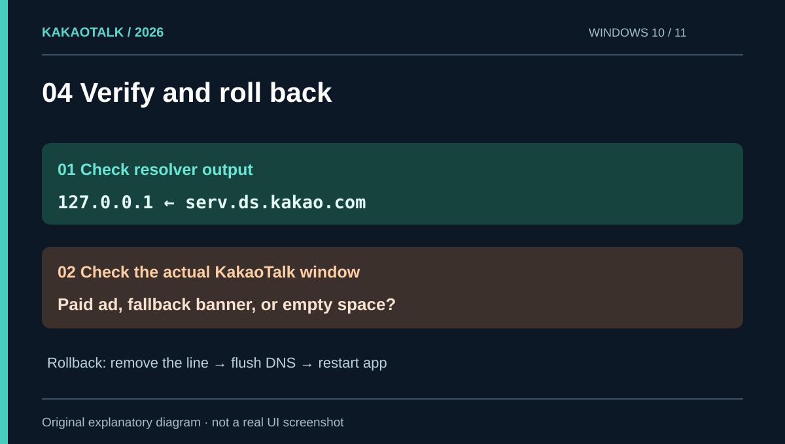
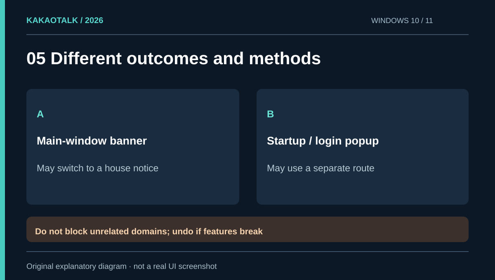

# How to block KakaoTalk PC ads on Windows, and what the fix cannot remove

**Quick answer:** You can redirect one KakaoTalk ad-related hostname in Windows 10 or 11 by adding this line to `C:\Windows\System32\drivers\etc\hosts` using elevated Notepad:

```text
127.0.0.1 serv.ds.kakao.com
```

This redirects the hostname to your computer rather than the remote service. **It does not guarantee the disappearance of every KakaoTalk ad**. An in-app fallback notice, the reserved banner space, or a separate startup popup may remain. This guide covers the no-extra-app procedure, two independent verification steps, and a safe rollback.

<p style="background: rgba(0, 120, 212, 0.08); border-left: 4px solid #0078d4; padding: 10px 14px; margin-bottom: 20px; border-radius: 4px;"><strong>한국어 안내:</strong> <a href="/kakaotalk-windows-ads-hosts-ko/">윈도우 카카오톡 PC 광고 차단 가이드</a></p>

<figure>
  <a href="cover.png"></a>
  <figcaption>Cover · Scope of the Windows 10 and 11 hosts-file approach.</figcaption>
</figure>

## Does one hosts rule remove the banner and popup?

Not necessarily. Kakao's [business advertising overview](https://business.kakao.com/info/reservedads) distinguishes the lower main-window ad placement from a floating Windows popup. The two need not use the same endpoint.

| Goal | What this approach establishes |
|---|---|
| Map `serv.ds.kakao.com` to `127.0.0.1` | Yes, when OS name resolution honors the entry |
| Prevent a remote fetch via that hostname | Can affect clients relying on OS resolution |
| Remove the bottom ad container | **Not guaranteed** |
| Remove Kakao's own fallback notice | **Not guaranteed** |
| Stop every login or startup popup | **Not established** |

Blocking an ad resource, displaying a house banner, and removing an element from the app UI are different outcomes.

## 1. Open hosts as an administrator

Close KakaoTalk first. Search for **Notepad** in Start, right-click, then choose **Run as administrator**. An ordinary Notepad window may read the file but be unable to save changes.

Select **File → Open**, navigate to the following directory, and switch the file-type dropdown from *Text Documents* to **All Files (*.*)**:

```text
C:\Windows\System32\drivers\etc
```

Open the file named `hosts` **without an extension**. Copy the original somewhere safe as a backup. Do not replace the entire file with a generic template: it may contain other required mappings.

<figure>
  <a href="01-location.svg"></a>
  <figcaption>Figure 1 · File path and permissions. Original schematic, not an actual UI capture.</figcaption>
</figure>

## 2. Append only the relevant line

At the bottom of the file add:

```text
127.0.0.1 serv.ds.kakao.com
```

`127.0.0.1` is the IPv4 loopback address. A hosts entry associates the selected name with that address before a normal remote lookup. If an active mapping for the same name already exists, investigate it rather than duplicating or conflicting with it. Save the original file as `hosts`, **not `hosts.txt`**.

<figure>
  <a href="02-edit.svg"></a>
  <figcaption>Figure 2 · Preserve every unrelated mapping.</figcaption>
</figure>

## 3. Flush DNS and completely restart the client

Open an elevated **Command Prompt** and run:

```bat
ipconfig /flushdns
```

Check local hostname resolution:

```bat
ping -4 -n 1 serv.ds.kakao.com
```

Look for the resolved target address **`127.0.0.1`**. Whether the ICMP packet gets a reply is secondary. Avoid `nslookup` as a hosts-file confirmation test: it generally queries a DNS server directly. Microsoft documents `ipconfig /flushdns` in its [Windows connectivity troubleshooting guide](https://support.microsoft.com/en-us/windows/experience/connectivity-networking/fix-wi-fi-connection-issues-in-windows).

Quit KakaoTalk from its **system-tray icon** before reopening it. Simply closing the window may leave it running.

<figure>
  <a href="03-result.svg"></a>
  <figcaption>Figure 3 · Network blocking is not UI removal.</figcaption>
</figure>

## 4. Why a KakaoTalk banner may still appear

There are **two separate success conditions**:

1. **Network resolution:** Does Windows resolve the hostname to `127.0.0.1`?
2. **App interface:** Does KakaoTalk show a paid ad, a Kakao-branded notice, an empty slot, or no slot at all?

An October 2026 [Windows user report](https://sunstar2.tistory.com/2630) describes a KakaoTalk news banner replacing the paid ad after the hosts entry was applied. That is a user observation, **not a tested promise for all releases**. The hosts file cannot directly remove an in-app element.

<figure>
  <a href="04-verify.svg"></a>
  <figcaption>Figure 4 · A resolver check cannot confirm the appearance of the app.</figcaption>
</figure>

## 5. Troubleshooting based on the ad placement

<figure>
  <a href="05-options.svg"></a>
  <figcaption>Figure 5 · Different placements can behave differently.</figcaption>
</figure>

**Paid banner unchanged?** Recheck the system-file path, elevated save, precise spelling, conflicting entries, and full KakaoTalk restart. If all are correct, this ad may be delivered via a different hostname or an internal content path.

**Kakao notice remains?** You may be seeing fallback content rather than the original paid ad. DNS blocking does not delete UI layout.

**Startup or login popup remains?** It may be a separate ad placement. The vendor itself lists different Windows PC ad formats. Avoid blocking unrelated `kakao.com` hostnames: broad lists can interfere with sign-in, messaging, links, and commerce functions.

**Security warning?** Verify the file and hostname. Do not automatically disable your security software to force a hosts-file edit.

## 6. Undo the change

Open the hosts file as administrator again, **remove only the one line you added**, and save. Then run `ipconfig /flushdns` and restart KakaoTalk completely. Leave all unrelated mappings alone. Microsoft's [official hosts-file explanation](https://support.microsoft.com/en-gb/windows/experience/how-to-reset-the-hosts-file-back-to-the-default) covers the basic format and why incorrect entries can break connectivity.

## Frequently asked questions

### Will this completely remove KakaoTalk PC ads?

No guarantee. It targets one hostname, not every advertising endpoint or the application's layout. A house banner or a separate popup may remain.

### Do I have to install an ad-blocking app?

Not to **apply this hosts redirect**. Removal of the visual ad area is a different technical task; third-party tools should be reviewed for permissions, safety, and compatibility before installation.

### Is the same fix appropriate for Mac?

The networking idea is similar, but the path and Mac app behavior differ. KakaoTalk for Mac gained a lower banner with 26.9.0. Read the [macOS-specific guide](/kakaotalk-mac-ads-269-en/).

## Sources and scope · October 30, 2026

- [Microsoft Support: Windows hosts file](https://support.microsoft.com/en-gb/windows/experience/how-to-reset-the-hosts-file-back-to-the-default) — format and name-to-address mapping.
- [Microsoft Support: Flush DNS](https://support.microsoft.com/en-us/windows/experience/connectivity-networking/fix-wi-fi-connection-issues-in-windows) — supported command.
- [Kakao Business: PC ad inventory](https://business.kakao.com/info/reservedads) — main-window and floating advertising placements.
- [October 2026 Windows user report](https://sunstar2.tistory.com/2630) — Kakao-branded fallback notice; an anecdote, not vendor-guaranteed behavior.

The Windows hosts file and an installed **KakaoTalk 26.9.1** were checked on a Windows machine, but the change was **not applied there to measure ad disappearance**. All figures here are original **illustrative diagrams, not fabricated application screenshots**.
