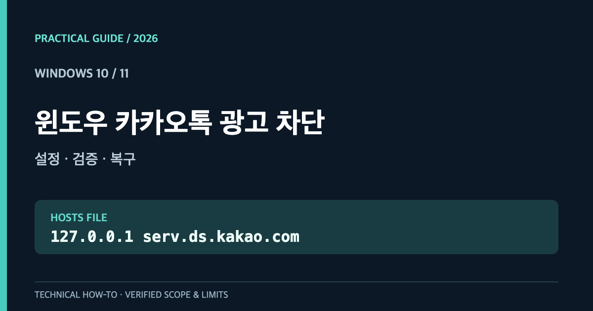
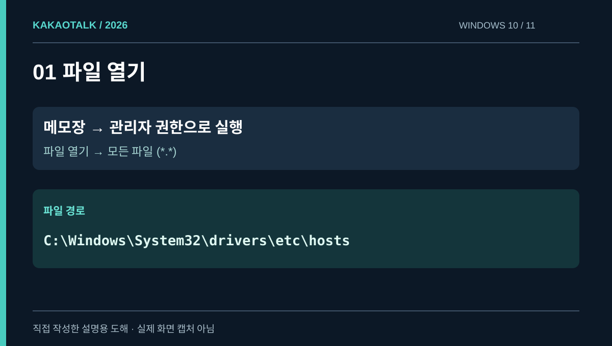
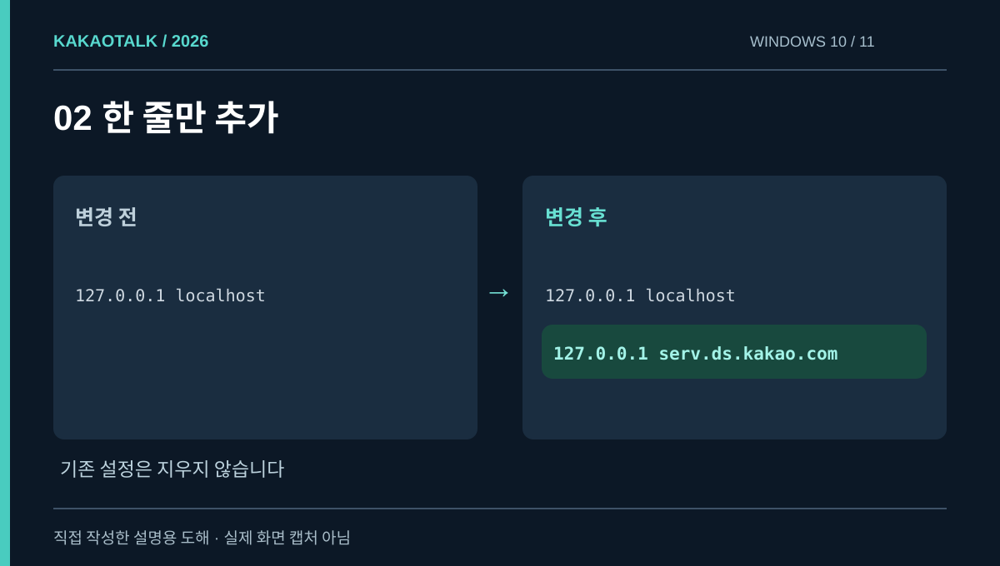
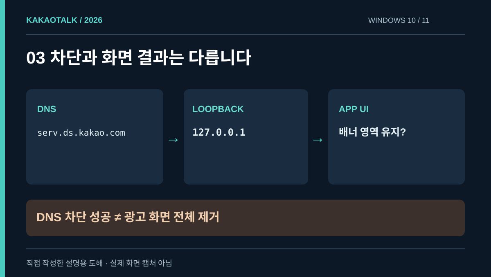
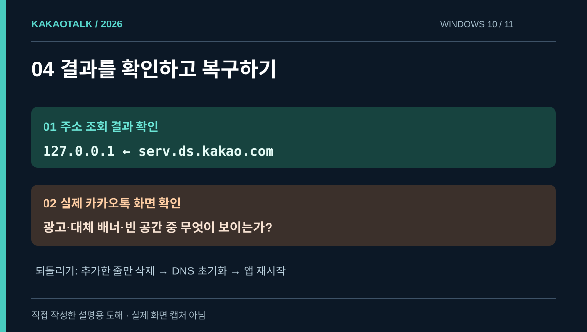
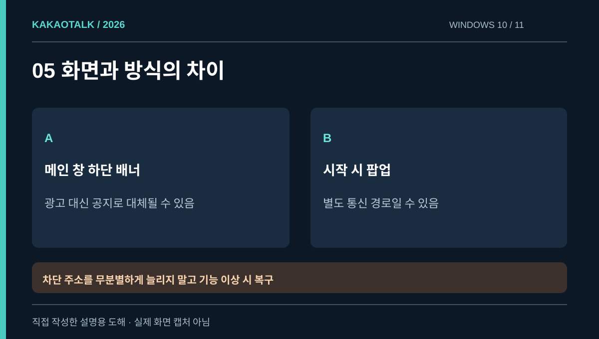

# 윈도우 카카오톡 PC 광고 차단: hosts 파일부터 원상복구까지

**빠른 답:** Windows 10·11에서 관리자 권한으로 `C:\Windows\System32\drivers\etc\hosts` 파일을 열고 아래 한 줄을 추가하면, 해당 광고 관련 도메인의 요청을 자기 컴퓨터로 돌릴 수 있습니다.

```text
127.0.0.1 serv.ds.kakao.com
```

이 설정은 **광고 서버와의 연결을 막는 방법**이지, 카카오톡 화면에서 광고 공간을 통째로 삭제하는 기능이 아닙니다. 상업 광고가 사라지더라도 *카카오톡 소식* 같은 자체 배너가 남을 수 있습니다. 2026년 10월 기준 앱 버전과 광고 지면별 결과는 다를 수 있습니다.

<p style="background: rgba(0, 120, 212, 0.08); border-left: 4px solid #0078d4; padding: 10px 14px; margin-bottom: 20px; border-radius: 4px;"><strong>English edition:</strong> <a href="/kakaotalk-windows-ads-hosts-en/">Block KakaoTalk PC Ads on Windows</a></p>

<figure>
  <a href="cover.png"></a>
  <figcaption>대표 이미지 · Windows 10·11용 설정의 범위.</figcaption>
</figure>

## 먼저 알아둘 점: 하단 배너와 팝업은 다르다

[카카오비즈니스 공식 PC 광고 설명](https://business.kakao.com/info/reservedads)에는 Windows 카카오톡 메인창 하단 배너와 별도의 플로팅 광고가 있습니다. 한 도메인의 요청 차단으로 이 둘을 모두 막을 수 있다고 가정하면 안 됩니다.

| 기대하는 변화 | hosts 방법의 범위 |
|---|---|
| `serv.ds.kakao.com`을 `127.0.0.1`로 해석 | OS가 hosts 규칙을 적용하면 가능 |
| 해당 서버로부터 원격 광고 요청 | 영향을 줄 수 있음 |
| 광고 영역 자체 삭제 | **보장하지 않음** |
| 자체 안내·대체 배너 제거 | **보장하지 않음** |
| 모든 로그인 팝업 차단 | **보장하지 않음** |

## 1. 관리자 메모장으로 hosts 파일 열기

카카오톡을 종료합니다. 시작 메뉴에서 **메모장**을 검색한 다음 마우스 오른쪽 클릭으로 **관리자 권한으로 실행**합니다. 일반 권한으로 파일을 열면 저장이 안 될 수 있습니다.

메모장에서 **파일 → 열기**를 선택하고 아래 폴더로 이동합니다.

```text
C:\Windows\System32\drivers\etc
```

오른쪽 아래 파일 형식이 *텍스트 문서*라면 **모든 파일 (*.*)** 로 바꾼 뒤 확장자가 없는 `hosts` 파일을 선택합니다. 수정 전 파일을 다른 안전한 폴더에 복사해 백업하세요. 기존 항목을 예제 파일로 통째로 교체하는 것은 피합니다.

<figure>
  <a href="01-location.svg"></a>
  <figcaption>그림 1 · 파일 경로와 관리자 권한을 설명하는 도해. 실제 UI 화면 캡처가 아닙니다.</figcaption>
</figure>

## 2. 파일 끝에 한 줄 추가

기존 내용은 그대로 두고 다음 내용 한 줄만 추가합니다.

```text
127.0.0.1 serv.ds.kakao.com
```

`127.0.0.1`은 자신의 장치를 의미하는 루프백 IP입니다. 도메인 이름을 실제 인터넷 서버가 아닌 이 주소에 연결합니다. 이미 같은 도메인에 대한 활성 규칙이 있다면 중복 입력하지 말고 먼저 확인하세요. 파일을 `hosts.txt`로 저장하지 않도록 주의합니다.

<figure>
  <a href="02-edit.svg"></a>
  <figcaption>그림 2 · 실제 파일의 다른 항목은 지우지 마세요.</figcaption>
</figure>

## 3. DNS 캐시 초기화와 카카오톡 재실행

시작 메뉴에서 **명령 프롬프트**를 관리자 권한으로 열어 다음 명령을 실행합니다.

```bat
ipconfig /flushdns
```

이후 로컬 이름 해석이 적용되는지 확인합니다.

```bat
ping -4 -n 1 serv.ds.kakao.com
```

출력에서 **대상 IP가 `127.0.0.1`인지** 살펴보세요. ICMP 응답 성공 여부보다 이름이 어느 주소로 해석됐는지가 중요합니다. `nslookup`은 DNS 서버를 직접 조회할 수 있으므로 hosts 파일 반영 확인용으로 적합하지 않습니다. DNS 캐시 초기화 명령은 [Microsoft 공식 Windows 네트워크 진단 안내](https://support.microsoft.com/en-us/windows/experience/connectivity-networking/fix-wi-fi-connection-issues-in-windows)에서도 확인할 수 있습니다.

카카오톡은 창만 닫으면 작업 표시줄 알림 영역에 남을 수 있습니다. 트레이 아이콘에서 **완전히 종료**한 뒤 다시 실행하세요.

<figure>
  <a href="03-result.svg"></a>
  <figcaption>그림 3 · DNS 차단은 화면 요소 삭제와 다릅니다.</figcaption>
</figure>

## 4. DNS가 바뀌었어도 광고가 남는 이유

확인 항목은 서로 다릅니다.

1. **이름 해석:** 도메인을 `127.0.0.1`로 연결했는가?
2. **실제 화면:** 카카오톡 하단에 상업 광고, 카카오 자체 안내, 빈 공간 중 무엇이 나타나는가?

2026년 10월 Windows 사용자 적용 사례에서는 `serv.ds.kakao.com` 차단 후 *카카오톡 소식* 배너가 대신 표시됐다고 기록합니다. 이는 사용자 사례이며 모든 카카오톡 버전에서 동일하다고 확언할 수는 없습니다. **광고 이미지 차단과 앱 내부 대체 콘텐츠 표시를 구분**해야 합니다.

<figure>
  <a href="04-verify.svg"></a>
  <figcaption>그림 4 · 한 가지 검증만으로 광고 제거 성공을 단정하지 않습니다.</figcaption>
</figure>

## 5. 해결되지 않을 때: 어느 광고인지 확인하기

<figure>
  <a href="05-options.svg"></a>
  <figcaption>그림 5 · 광고 유형을 구분해야 원인을 좁힐 수 있습니다.</figcaption>
</figure>

**상업 배너가 그대로라면** 관리자 권한으로 저장했는지, 올바른 `hosts`를 열었는지, 오타·중복 규칙은 없는지, 카카오톡을 완전히 재실행했는지 확인하세요. 이 모두가 맞는데도 그대로라면 해당 광고가 다른 도메인이나 앱 내부 경로로 제공될 수 있습니다.

**광고 대신 카카오 자체 공지가 남았다면** 도메인 차단의 한계일 수 있습니다. hosts는 화면의 빈 광고 영역을 없애는 도구가 아닙니다.

**실행 시 우측 하단 팝업이 남았다면** 메인 창 하단 광고와 별도의 광고 지면일 수 있습니다. [카카오 공식 광고 상품](https://business.kakao.com/info/reservedads)에서도 이를 구분합니다. 해결되지 않는다고 `kakao.com` 전체나 메시지·로그인과 관련된 도메인까지 막으면 정상 기능을 해칠 수 있습니다.

**백신·보안 경고가 나온다면** 무조건 허용하거나 보안 기능을 끄지 마세요. 변경 파일과 입력값을 확인하고 필요한 경우 복구합니다.

## 6. 원상복구 방법

메모장을 관리자 권한으로 다시 실행해 같은 `hosts` 파일에서 **본인이 추가했던 한 줄만 삭제**합니다. 저장하고 `ipconfig /flushdns` 명령을 실행한 다음 카카오톡을 다시 시작합니다. 다른 사용자나 프로그램이 설정한 항목은 지우지 마세요. 공식 설명은 [Microsoft의 hosts 파일 복구 안내](https://support.microsoft.com/ko-kr/windows/experience/how-to-reset-the-hosts-file-back-to-the-default)를 참고할 수 있습니다.

## 자주 묻는 질문

### 이 한 줄로 카카오톡 광고가 100% 없어지나요?

아닙니다. 지정한 도메인 요청을 우회할 뿐이며 앱 자체 배너, 광고 공간, 별도 팝업까지 모두 제거된다는 보장은 없습니다.

### 추가 프로그램이 꼭 필요한가요?

**이 방식에는 필요하지 않습니다.** 다만 광고 슬롯 자체까지 숨기는 것은 다른 기술적 문제이며, 추가 도구를 사용한다면 코드·권한·안전성을 검토해야 합니다.

### 맥북도 같은 방법인가요?

원리는 비슷하지만 파일 경로와 카카오톡 광고 구현이 다릅니다. [Mac 26.9.0 광고 차단 가이드](/kakaotalk-mac-ads-269-ko/)에서 별도로 설명합니다.

## 자료 출처와 검증 범위 · 2026-10-30

- [Microsoft Support — hosts 파일의 의미와 원상복구](https://support.microsoft.com/ko-kr/windows/experience/how-to-reset-the-hosts-file-back-to-the-default): 운영체제의 호스트명 매핑 및 기본 구문.
- [Microsoft Support — DNS 캐시 명령](https://support.microsoft.com/en-us/windows/experience/connectivity-networking/fix-wi-fi-connection-issues-in-windows): `ipconfig /flushdns` 안내.
- [카카오비즈니스 — PC 광고 상품](https://business.kakao.com/info/reservedads): 메인 창 하단과 팝업 광고의 구분.
- [2026년 10월 Windows 사용자 사례](https://sunstar2.tistory.com/2630): 한 줄 차단 후 카카오 자체 안내 배너가 나타난 사례이며 카카오 공식 보증은 아님.

Windows 실기기에서 카카오톡 **26.9.1 설치 버전 및 hosts 파일 존재는 확인**했지만, 이 Windows에 설정을 실제로 추가해 광고가 제거되는지 실측한 것은 아닙니다. 본문의 그림은 자체 제작한 **설명용 도해**이며 실제 프로그램 화면을 재현한 스크린샷으로 표현하지 않습니다.
