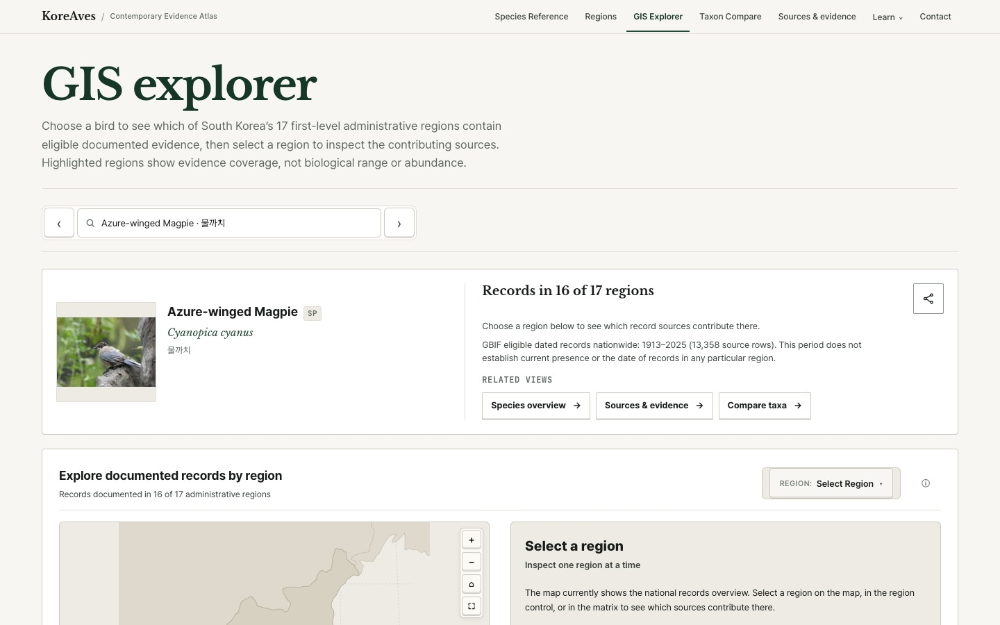

> 한국어판: [British Ornithologists’ Union에 게재된 KoreAves 지도·출처 기고](/koreaves-bou-when-records-become-maps-ko/)

On **November 23, 2026**, the **[British Ornithologists’ Union (BOU) published *When Records Become Maps*](https://bou.org.uk/blog-oh-when-records-become-maps/)** with **Jihun Oh** credited as the author. The publisher's page links to [KoreAves](https://koreaves.com/), its [methodology](https://koreaves.com/methodology/) and [source records](https://koreaves.com/sources/). The original page is the evidence for this byline and publication, rather than a draft or an accepted pitch.

The article grew from building an evidence atlas where a reader can start with a bird name, examine records for a region and trace the display back to a source. Making that trail visible was a software-design problem long before it became an essay.

<figure>
  
  <figcaption>The existing KoreAves GIS interface. This is a first-party project screenshot, not artwork or photography from the BOU article.</figcaption>
</figure>

## From a species name to inspectable evidence

KoreAves connects a checklist identity with regional occurrence records. The difficult part is not colouring a map: it is retaining enough information for a reader to check why a particular region has evidence and what that evidence can support.

In the application, a species name is an entry point. A regional marker is a summary of eligible records, not an estimate of the number of living birds. The underlying reference and its time and location matter. A blank region can mean that qualifying records are missing; it cannot, by itself, establish that a species is absent there.

I built these distinctions into the data organization and the interface. The [GIS explorer](https://koreaves.com/gis/) shows the regional view; the [methodology](https://koreaves.com/methodology/) and [sources](https://koreaves.com/sources/) give readers routes to check the assumptions behind it. A reader may disagree with a boundary or a source decision, but they should be able to identify what needs checking.

## Why this is a developer work sample

The BOU contribution is a public example of explaining technical evidence to people who did not build the software. Its subject comes from decisions I made about taxonomic names, data provenance and the separation between an observation and a claim made from it.

For a data engineer or software collaborator, the useful question is whether the system preserves that distinction all the way from source ingestion to the final interface. The article supplies the reasoning; the live application exposes what was implemented. Both can be reviewed independently.

The [BOU publication](https://bou.org.uk/blog-oh-when-records-become-maps/) establishes an author-credited external contribution. It does not establish peer-reviewed scientific validation, a formal institutional partnership, endorsement, measured referral traffic or verified conservation impact.

Two other published essays approached related problems from different angles: [image rights and a field-guide photograph](/koreaves-published-contributions-en/) and [why a bird map is not a bird count](/koreaves-unsustainable-bird-map-en/). For the system behind these explanations, see the [KoreAves development case](/koreaves-bird-evidence-atlas-en/) or open the [live project](https://koreaves.com/).
