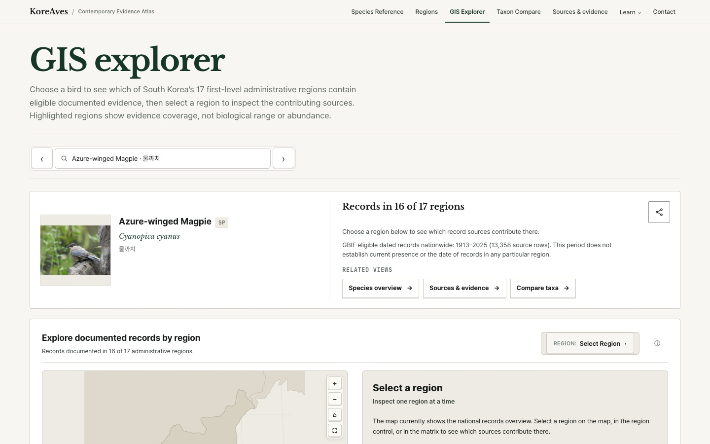

> English version: [My KoreAves article is on the British Ornithologists’ Union blog](/koreaves-bou-when-records-become-maps-en/)

**2026년 11월 23일, 영국 조류학회(British Ornithologists’ Union, BOU)의 공식 블로그에 [*When Records Become Maps*](https://bou.org.uk/blog-oh-when-records-become-maps/)가 게재됐다.** 원문에는 작성자로 **Jihun Oh**가 표시돼 있고, [KoreAves](https://koreaves.com/), [데이터 표현 기준](https://koreaves.com/methodology/), [출처 자료](https://koreaves.com/sources/)로 이어지는 링크가 있다.

기고의 출발점은 새 이름을 검색하는 화면과 지역별 기록 지도를 만들면서 생긴 질문이었다. 지도에 표시된 영역이 어떤 관찰 자료를 근거로 하는지, 그 자료를 어떻게 다시 찾게 할지 결정해야 했다.

<figure>
  
  <figcaption>기존에 공개한 KoreAves 자체 GIS 화면이다. BOU 원문의 사진이나 그림을 복제한 자료가 아니다.</figcaption>
</figure>

## 지도를 그리는 일보다 어려웠던 출처 연결

KoreAves에서는 한 종의 이름에서 지역별 관찰 근거로 이동할 수 있다. 하지만 특정 지역에 기록이 있다고 해서 그곳에 사는 새의 마릿수를 알 수 있는 것은 아니다. 반대로 지도에 색이 없는 지역을 해당 종이 살지 않는 곳으로 판단해서도 안 된다.

그래서 화면의 데이터도 구분했다. 표준 분류군의 이름, 개별 출처에서 확인되는 기록, 지역별 지도를 뒷받침할 수 있는 기록은 서로 연결돼 있지만 같은 정보는 아니다. 기록의 시점과 위치, 자료 출처를 남겨야 지도에 표시한 결과를 검토할 수 있다.

직접 개발한 [GIS 탐색기](https://koreaves.com/gis/)에서는 지역별 표시를 살펴볼 수 있고, [방법론](https://koreaves.com/methodology/)과 [출처](https://koreaves.com/sources/)에서는 그 표현의 기준을 확인할 수 있다. 데이터와 설명이 연결돼 있어야 독자가 지도 결과에 의문을 제기했을 때 실제로 확인할 곳이 생긴다.

## 해외 기고와 개발 역량의 관계

이번 글은 구현한 기능을 단순히 나열하는 대신, 왜 그런 데이터 구조와 탐색 경로를 만들었는지 독자가 이해하도록 설명한 결과물이다. 데이터 수집부터 정규화, 지역별 근거 표시, 화면 설명까지 의미가 바뀌지 않도록 유지하는 일이 중요한 개발 과제였다.

개발 프로젝트를 검토하는 사람에게는 글과 서비스를 나란히 보여줄 수 있다. [BOU 기고문](https://bou.org.uk/blog-oh-when-records-become-maps/)에서 설계 의도를 읽고, 실제 KoreAves에서 그 의도가 어떻게 구현됐는지 확인할 수 있다.

원문에서 확인되는 실적은 **작성자 명의의 외부 기고 게재**다. 학술 동료심사, BOU와의 공식 제휴나 기관 추천, 실제 독자 수 또는 환경 보전 성과까지 입증하는 자료는 아니다.

이미 [10,000 Birds 기고](/koreaves-published-contributions-ko/)에서는 사진 사용 권리와 지역 소개를, [Unsustainable Magazine 기고](/koreaves-unsustainable-bird-map-ko/)에서는 관찰 지도와 개체 수 해석을 다뤘다. 이번 BOU 글은 한 종의 이름에서 지도와 근거 자료까지 이어지는 구조에 초점을 맞췄다. 구체적인 구현은 [KoreAves 개발 기록](/koreaves-bird-evidence-atlas/)에서 확인할 수 있다.

