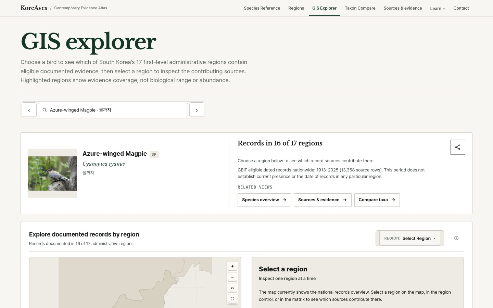

> 한국어판: [KoreAves 지역 검색 오류를 고치고 실제 운영 화면에서 32개 검사를 통과했다](/koreaves-region-search-mobile-hotfix-ko/)

**I fixed a region-search bug in KoreAves and shipped the change to production on November 16, 2026.** Non-matching region cards remained visible after a search, while the mobile layout crowded regional counts and left too little space around the search field. The deployed pages then passed 32 live browser checks.

The [KoreAves regions catalogue](https://koreaves.com/regions/) is an entry point for exploring bird evidence by region. When excluded results remain on screen, people cannot easily tell whether the filter has worked. At narrow widths, the evidence count was squeezed into a second column, and the warning text sat too close to the search field.

<figure>
  
  <figcaption>An existing KoreAves GIS view. The hotfix changed the region catalogue's filtering and mobile spacing.</figcaption>
</figure>

## Why the filter left excluded cards visible

The search code already set the HTML `hidden` attribute on region items that did not match. The card styling also declared `display: grid` on `.catalog-item`. That author rule took precedence over the browser's default hidden styling. The DOM state changed, but the excluded cards remained visible.

I kept the existing filter logic and added an explicit CSS rule:

```css
.catalog-item[hidden] {
  display: none;
}
```

There was no need for a new filter component or a change to the data model. The stylesheet now respects the `hidden` state that the search code already sets.

## The mobile layout changes

The same hotfix adjusted the region cards at narrow widths:

- Card content and the evidence count now use one column.
- Card padding and spacing follow the existing design tokens.
- The gap between the scope note and search field changes with the viewport.
- The two regional summary metrics remain side by side on small screens.

The source change stayed in `ui/ssg/species-static.css`. It did not alter species data, regional evidence counts, rights records or image files. A new content-hashed stylesheet, `/assets/species-static.44437b12d2d9.css`, was linked from 19 HTML pages: the 17 region details, the regions index and the species browser.

## Deploying without replacing unrelated production files

The working directory's data did not match the live production data. For example, the local pre-launch Jeju count was 381 while the previous live count was 360. Rebuilding the entire site from that directory could have mixed unrelated data changes into a CSS hotfix.

I used the previous Cloudflare Pages deployment's 3,894-file manifest as the baseline. I matched 1,726 files already present locally and recovered and hash-verified the remaining 2,168. There were no missing files or hash mismatches. The production change was limited to 19 HTML entries and the build-manifest provenance record; the other 3,874 files retained their previous hashes.

The preview deployment passed 12 of 12 checks across four viewport widths, covering search, empty results and reset on the regions index, Jeju page and species browser. On the live production site, I checked those three pages at 320, 390, 768, 1024 and 1440 pixels, then checked all 17 region detail pages at 390 pixels. That made 32 checks. Computed display states and result counts matched, and no horizontal overflow appeared.

The [live regions catalogue](https://koreaves.com/regions/) and the new stylesheet respond from the public production site. The exact work is documented in the [source commit](https://github.com/saramjh/koreaves/commit/35052ecbbf4dfdc4b4a65867a06e1a00a436508e), its [deployment and QA report](https://github.com/saramjh/koreaves/blob/35052ecbbf4dfdc4b4a65867a06e1a00a436508e/reports/ux/REGIONS_SEARCH_MOBILE_HOTFIX_2026-11-16.md), and the [CSS diff](https://github.com/saramjh/koreaves/blob/35052ecbbf4dfdc4b4a65867a06e1a00a436508e/ui/ssg/species-static.css).

## What this release demonstrates

This was a browser-rendering defect, not a missing search feature. I traced the mismatch from the filter's DOM state to the CSS cascade, then corrected it without changing the data model or the existing style tokens. For deployment, I verified the old artifact manifest and limited the release to the affected pages and stylesheet. People using the region search now see the results that match their query, with a layout that remains readable on a phone.

The checks cover the specified search flows and viewport sizes. They do not represent assistive-technology user testing or a full product quality sign-off.

[Try the live region catalogue](https://koreaves.com/regions/). For the broader data and mapping design, see the [KoreAves technical overview](/koreaves-bird-evidence-atlas-en/) and the [KoreAves portfolio page](/portfolio/koreaves/).
