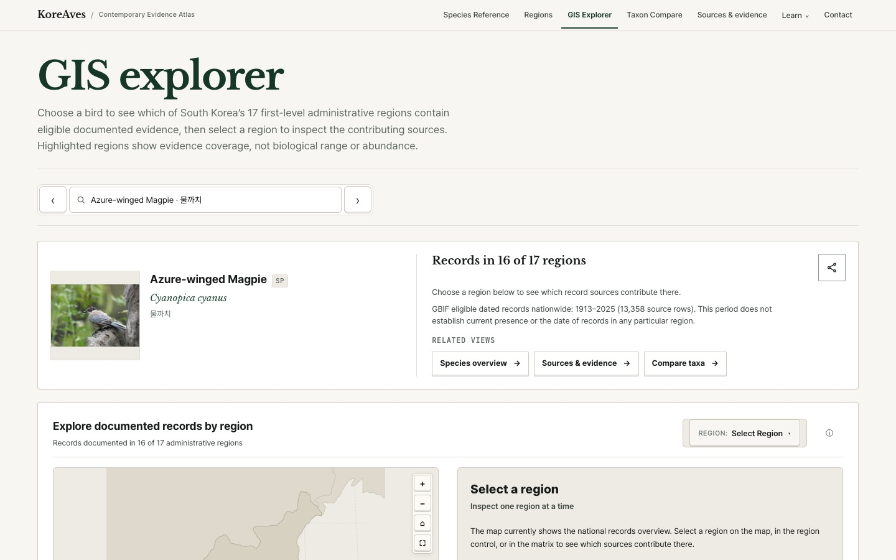

> English version: [A KoreAves region-search hotfix passed 32 live browser checks](/koreaves-region-search-mobile-hotfix-en/)

**KoreAves 지역 목록의 검색 필터 오류를 수정해 2026년 11월 16일 운영 환경에 반영했다.** 지역 이름이나 분류군을 검색해도 제외된 카드가 화면에 남던 문제와 좁은 화면에서 지역 카드와 지표가 답답하게 배치되던 문제를 함께 다뤘다. 배포된 운영 페이지에서 실제 브라우저 검사 32건도 통과했다.

[KoreAves 지역 목록](https://koreaves.com/regions/)은 지역별 조류 자료를 찾아보는 진입점이다. 검색 결과에서 일치하지 않는 항목이 계속 보이면 사용자는 필터가 작동하는지 판단하기 어렵다. 모바일에서는 지역 카드의 관찰 근거 수가 좁은 두 번째 열에 밀리고, 검색창과 안내 문구 사이 간격도 부족했다.

<figure>
  
  <figcaption>기존 KoreAves GIS 화면. 이번 수정은 지역 목록의 검색 동작과 모바일 간격을 대상으로 했다.</figcaption>
</figure>

## 검색 필터가 항목을 숨기지 못한 이유

검색 코드는 일치하지 않는 지역 항목에 HTML의 `hidden` 속성을 설정하고 있었다. 문제는 카드 스타일에 있었다. `.catalog-item`에 `display: grid`가 지정되어 브라우저 기본 스타일의 숨김 규칙보다 우선 적용됐다. DOM 상태는 바뀌었지만 화면에서는 항목이 계속 보이는 상황이었다.

수정은 기존 필터 구조를 유지하면서 CSS에 다음 규칙을 추가하는 방식으로 끝냈다.

```css
.catalog-item[hidden] {
  display: none;
}
```

새 필터 컴포넌트나 데이터 의미를 추가하지 않았다. 검색 로직이 이미 사용하는 `hidden` 상태를 작성자 CSS에서도 명시적으로 존중하도록 했다.

## 390px 화면에서 함께 고친 부분

같은 핫픽스에서 지역 카드의 모바일 레이아웃도 조정했다.

- 지역 카드의 내용과 관찰 근거 수를 한 열로 배치했다.
- 카드 안쪽 여백과 카드 사이 간격을 기존 디자인 토큰에 맞췄다.
- 검색창 앞의 안내 문구 간격을 화면 크기에 맞춰 조정했다.
- 지역 요약 지표 두 개는 작은 화면에서도 나란히 읽히도록 유지했다.

이 변경은 `ui/ssg/species-static.css` 한 곳에 한정했다. 종 데이터, 지역별 근거 수, 권리 상태, 이미지 파일은 수정하지 않았다. 새 스타일시트 `/assets/species-static.44437b12d2d9.css`를 만들고 지역 상세 17개, 지역 목록, 종 탐색 페이지까지 총 19개 HTML 페이지가 이를 참조하도록 했다.

## 기존 운영 파일을 보존한 배포

당시 작업 디렉터리의 데이터는 운영 데이터와 일치하지 않았다. 예를 들어 제주 지역의 로컬 사전 배포 수치는 381이었고 기존 운영 수치는 360이었다. 이 상태에서 전체 사이트를 다시 생성해 배포하면 이번 CSS 수정과 관계없는 데이터 변경이 섞일 수 있었다.

그래서 직전 Cloudflare Pages 배포의 3,894개 파일 manifest를 기준으로 배포 파일을 복원하고, 각 파일의 manifest 해시를 대조했다. 로컬에서 동일성이 확인된 파일은 1,726개였고, 나머지 2,168개는 내려받아 검증했다. 누락이나 해시 불일치는 없었다. 최종 배포에서 바뀐 범위는 19개 HTML 파일과 빌드 manifest 기록이며, 나머지 3,874개 파일은 기존 해시와 일치했다.

미리보기 배포는 4개 화면 폭에서 지역 목록, 제주 지역, 종 탐색의 검색·빈 결과·초기화 동작을 확인해 12/12를 통과했다. 운영 apex에서는 320, 390, 768, 1024, 1440px 화면 폭으로 세 검색 페이지를 확인하고, 17개 지역 상세 페이지도 390px에서 검사했다. 합계 32/32였으며 실제 CSS의 표시 상태와 검색 결과 수가 일치했고 가로 넘침도 발생하지 않았다.

현재 [지역 목록](https://koreaves.com/regions/)과 새 스타일시트는 공개 운영 주소에서 응답한다. 수정 내용은 [원본 커밋](https://github.com/saramjh/koreaves/commit/35052ecbbf4dfdc4b4a65867a06e1a00a436508e)과 그 안의 [배포·검증 기록](https://github.com/saramjh/koreaves/blob/35052ecbbf4dfdc4b4a65867a06e1a00a436508e/reports/ux/REGIONS_SEARCH_MOBILE_HOTFIX_2026-11-16.md), [CSS 변경](https://github.com/saramjh/koreaves/blob/35052ecbbf4dfdc4b4a65867a06e1a00a436508e/ui/ssg/species-static.css)에서 확인할 수 있다.

## 이 수정으로 확인한 개발 역량

이번 작업은 검색 상태와 실제 렌더링 결과가 어긋나는 원인을 브라우저의 CSS cascade까지 추적하고, 기존 스타일 소유권과 데이터 의미를 유지한 채 수정한 사례다. 운영 배포에서는 이전 파일 전체를 무작정 다시 만들지 않고, 기존 산출물의 해시를 확인해 변경 범위를 제한했다. 지역 검색을 사용하는 사람에게는 필터 결과가 화면과 일치하고 작은 화면에서도 카드 정보를 읽을 수 있게 됐다.

검증 범위는 해당 검색 흐름과 명시한 화면 크기다. 보조공학을 이용한 사용자 테스트나 전체 제품의 품질 승인을 의미하지는 않는다.

[실제 지역 목록에서 검색해 보기](https://koreaves.com/regions/). 프로젝트의 데이터와 지도 설계는 [KoreAves 개발 기록](/koreaves-bird-evidence-atlas/)과 [KoreAves 포트폴리오](/portfolio/koreaves/)에 정리했다.
