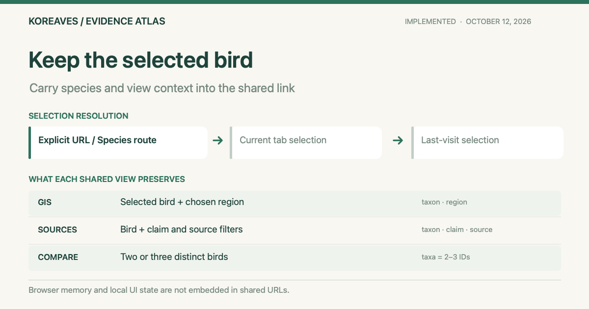

> 한국어: [KoreAves에서 선택한 새를 지도와 비교 화면까지 이어 보는 방법](/koreaves-selected-bird-share-links-ko/)

A bird selected in KoreAves can follow the reader from its Species page into the map and evidence views. The Share action builds a URL that another reader can open with the same species and relevant view settings. I implemented this in the [October 12, 2026 source change](https://github.com/saramjh/koreaves/commit/3135d7e041b1bdbf7f3f35cf70c2f7fc6640da4d).

## Keeping a species while moving between pages

A reader might start with the [Oriental Stork Species page](https://koreaves.com/species/ciconia-boyciana/), inspect its map, and then open [evidence sources](https://koreaves.com/evidence-explorer/). Re-selecting the bird at every step makes that investigation needlessly repetitive.

The shared `ui/shared/subjectState.mjs` module records a deliberate taxon selection in per-tab `sessionStorage` and in `localStorage` for the last visit. Explicit URL parameters and canonical Species paths take precedence. Without an explicit selection, the current tab's remembered bird comes first; the last-visit value is the fallback. A browser that blocks storage can still open an explicit species URL.

The Regions catalogue does not have a species selector and does not overwrite the remembered bird merely because it was opened. Search text, keyboard focus, dialogs and map zoom position remain local to the page instead of being persisted.

## What a shared link preserves

`shareUrlForState()` in `ui/shared/shareAction.mjs` reads the current selection when the Share button is pressed. Each page has a specific link contract.

| View | Included in the link | Left out |
| --- | --- | --- |
| Species and Quick View | The canonical Species route | Dialog and focus state |
| GIS | Species plus the selected region, if any | Map zoom and pan position |
| Sources | Species, claim and source filters | Unsubmitted search text |
| Compare | Two or three distinct, valid taxon IDs | Duplicate or incomplete comparisons |

Invalid taxon IDs and duplicated comparison selections do not produce a share URL. Clicking Share does not change the browser's address or the saved subject. The control uses the platform's native share sheet where available, then falls back to clipboard copying or a copy prompt.

For an educator or birder checking a species across multiple evidence sources, that gives a colleague a reproducible starting point. The receiving browser's earlier species selection cannot override a species explicitly named in the link.

## One action, placed in the context of each view

The component and styling are shared through `shareAction.mjs` and `shareAction.css`. Its position belongs to the task: below the Species identity, inside the GIS and Sources context summaries, after the Compare selectors, or in the Quick View footer. The action does not float over a search input.

The touch target is at least 44px high and feedback uses `role="status"`. The source change includes tests for taxon validation, blocked browser storage, explicit URL precedence and two- or three-species comparison links.

## What the evidence covers

On November 20, 2026, the production Species route, GIS, Compare, Evidence Explorer, `shareAction.mjs` and `subjectState.mjs` all returned HTTP 200. The deployed share module contains `shareUrlForState()`, while the deployed subject module includes `rememberSubjectTaxon()`. This verifies that the pages and implementation are served publicly.

I did not send a test link to another person or replay the receiving browser's interaction in this review. Share counts, research adoption and assistive-technology user outcomes remain unmeasured. The precise link and restoration behavior is supported by the [source-level share tests](https://github.com/saramjh/koreaves/blob/3135d7e041b1bdbf7f3f35cf70c2f7fc6640da4d/tests/test_share_action.mjs) and [subject-state tests](https://github.com/saramjh/koreaves/blob/3135d7e041b1bdbf7f3f35cf70c2f7fc6640da4d/tests/test_subject_state.mjs).

[Open KoreAves Compare](https://koreaves.com/compare/) · [Source commit](https://github.com/saramjh/koreaves/commit/3135d7e041b1bdbf7f3f35cf70c2f7fc6640da4d) · [KoreAves project](/portfolio/koreaves/) · [Region-search usability repair](/koreaves-region-search-mobile-hotfix-en/)
