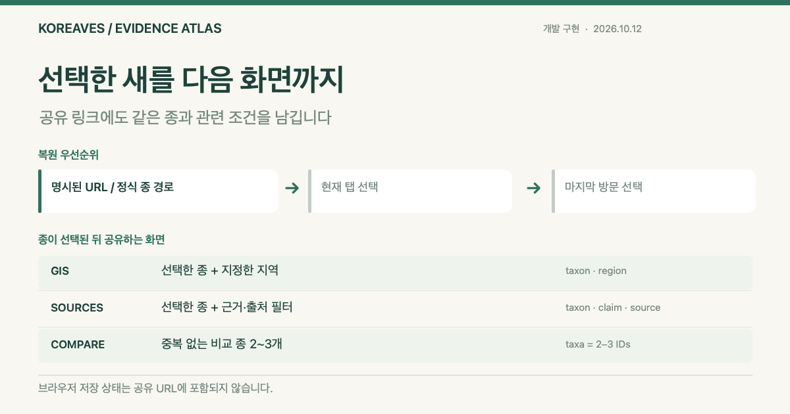

> English: [How KoreAves keeps a bird selection across maps and shareable views](/koreaves-selected-bird-share-links-en/)

KoreAves에서는 새 한 종을 선택해 지도로 이동한 뒤에도 그 종을 이어서 볼 수 있다. 공유 버튼은 받는 사람이 같은 종과 관련 화면 조건을 열 수 있는 URL을 만든다. 2026년 10월 12일 반영된 [종 선택 및 공유 기능의 원본 변경](https://github.com/saramjh/koreaves/commit/3135d7e041b1bdbf7f3f35cf70c2f7fc6640da4d)을 바탕으로 구현했다.

## 종을 다시 고르지 않아도 되는 이유

[Species 페이지](https://koreaves.com/species/ciconia-boyciana/)에서 한 종을 확인한 후 [GIS](https://koreaves.com/gis/)나 [근거 자료](https://koreaves.com/evidence-explorer/)로 이동할 때 선택이 초기화되면, 여러 화면에 걸친 조사를 매번 시작해야 한다. `ui/shared/subjectState.mjs`는 사용자가 선택한 분류 ID를 현재 탭의 `sessionStorage`와 마지막 방문을 위한 `localStorage`에 기록한다.

복원 순서는 명확하다. 링크에 종 ID가 있거나 정식 Species 경로가 종을 지정하면 해당 값이 우선한다. 명시적 선택이 없을 때 현재 탭의 기록을 읽고, 그것도 없으면 마지막 방문 기록을 확인한다. 저장소 접근이 차단되거나 비활성화돼도 명시적 URL로 들어오는 경로는 계속 동작하도록 예외를 처리한다.

Regions 페이지에는 종 선택기가 없다. 그 페이지를 방문했다는 이유만으로 저장된 종을 다른 종으로 바꾸지 않는다. 검색어, 키보드 포커스, 모달, 지도 확대 위치처럼 개별 화면에만 해당하는 상태도 저장 대상에서 제외했다.

## 공유 링크에는 무엇이 들어가나

`ui/shared/shareAction.mjs`의 `shareUrlForState()`는 공유 버튼을 누르는 시점의 선택 상태를 읽는다. 화면별 URL에 포함되는 정보는 다음과 같다.

| 화면 | 공유되는 상태 | 공유하지 않는 상태 |
| --- | --- | --- |
| Species·Quick View | 선택한 종의 정식 Species 경로 | 열린 팝업과 포커스 위치 |
| GIS | 선택 종, 명시적으로 고른 지역 | 지도 확대·이동 위치 |
| Sources | 선택 종, 현재 claim 및 source 필터 | 임시 검색 입력 |
| Compare | 유효한 비교 종 ID 2~3개 | 중복·불완전한 선택 조합 |

유효하지 않은 분류 ID나 중복된 비교 조합은 공유 URL을 만들지 않는다. 공유 버튼 자체는 주소창의 현재 URL이나 브라우저 저장값을 변경하지 않는다. 가능한 환경에서는 시스템 공유창을 사용하고, 그렇지 않으면 클립보드 복사와 복사 프롬프트 순서로 처리한다.

이는 사용자가 동료에게 현재 조류 비교를 보내거나, 지역별 기록 출처를 함께 검토할 때 유용하다. 받은 사람은 URL에 적힌 종과 필터 조건을 열게 된다. 상대방 브라우저의 이전 선택 종이 링크를 덮어쓰지 않는다.

## 한 개의 공유 동작을 화면별 맥락에 배치했다

공유 처리 로직과 버튼 스타일은 `shareAction.mjs` 및 `shareAction.css`에서 공통으로 관리한다. 버튼 위치는 화면마다 다르다. Species에는 종 이름 영역, GIS와 Sources에는 종별 근거 요약, Compare에는 비교 종 선택 영역 아래, Quick View에는 상세 팝업 하단에 둔다. 검색 입력부 위에 뜨는 별도 버튼을 만들지 않았다.

터치 영역은 최소 44px이며 상태 메시지는 `role="status"`를 사용한다. 이 접근성 규칙과 더불어 선택 ID 검증, 저장소 접근 거부, URL 우선순위, 2~3종 비교 조합을 원본 변경의 테스트에서 다룬다.

## 검증한 범위

2026년 11월 20일 운영 사이트의 Species 정식 경로, GIS, Compare, Evidence Explorer와 배포된 `shareAction.mjs`, `subjectState.mjs`가 모두 HTTP 200을 반환했다. 배포된 공유 모듈에는 `shareUrlForState()`, 상태 모듈에는 `rememberSubjectTaxon()` 구현이 포함되어 있었다. 이는 해당 기능의 코드와 페이지가 공개 서비스에서 제공된다는 확인이다.

이번 기록에서는 타인에게 실제 링크를 보내거나 수신자의 조작을 재현하지 않았다. 실제 공유 횟수, 연구 활용도, 접근성 보조기기 사용 결과도 측정하지 않았다. 공유 URL 계약과 복원 우선순위는 [원본 테스트](https://github.com/saramjh/koreaves/blob/3135d7e041b1bdbf7f3f35cf70c2f7fc6640da4d/tests/test_share_action.mjs) 및 [상태 테스트](https://github.com/saramjh/koreaves/blob/3135d7e041b1bdbf7f3f35cf70c2f7fc6640da4d/tests/test_subject_state.mjs)를 근거로 설명한다.

[직접 열어 보기: KoreAves Compare](https://koreaves.com/compare/) · [원본 커밋](https://github.com/saramjh/koreaves/commit/3135d7e041b1bdbf7f3f35cf70c2f7fc6640da4d) · [KoreAves 프로젝트](/portfolio/koreaves/) · [지역 검색 사용성 개선 기록](/koreaves-region-search-mobile-hotfix-ko/)
