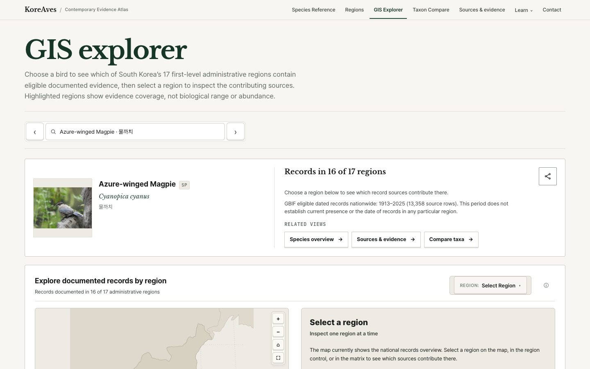

> English version: [My KoreAves bird-map essay was published in Unsustainable Magazine](/koreaves-unsustainable-bird-map-en/)

2026년 11월 6일, **[Unsustainable Magazine에 *Why a Bird Map Is Not a Bird Count* 기고문](https://www.unsustainablemagazine.com/why-a-bird-map-is-not-a-bird-count/)**이 실렸다. 원문에는 작성자가 Jihun Oh로 명시돼 있고, **“Edited and reviewed by Brett Stadelmann”**이라는 편집·검토 크레딧도 표시돼 있다. 이 글의 배경이 된 프로젝트로 KoreAves가 소개돼 있다. 매체에 게재된 기고문과 편집자 표기는 확인할 수 있지만, 학술 동료심사를 받은 연구라는 뜻은 아니다.

한국의 새를 출처와 함께 탐색하는 [KoreAves](https://koreaves.com/)를 만들면서 반복해서 부딪힌 문제가 글의 출발점이었다. 어느 지역에서 관찰 기록을 찾았다는 사실과 그 지역에 새가 몇 마리 사는지는 전혀 다른 정보다. 그런데 지도를 보기 좋게 만들수록 그 차이가 화면에서 쉽게 가려진다.

<figure>
  
  <figcaption>이전에 공개한 KoreAves 자체 GIS 화면이다. Unsustainable Magazine의 사진을 가져온 것이 아니며, 이 지도는 살아 있는 새의 개체 수를 측정한 결과가 아니다.</figcaption>
</figure>

## 관찰 기록을 표시한 지도를 읽는 방법

예를 들어 한 종의 관찰 기록이 몇 개 지역에서 발견됐다고 하자. 지역에 색을 칠하면 분포가 한눈에 들어온다. 하지만 관찰자가 얼마나 오래 조사했는지, 언제 기록을 남겼는지, 어디가 조사되지 않았는지는 지도만으로 알기 어렵다.

KoreAves의 지역별 탐색 기능을 개발할 때는 데이터를 몇 단계로 구분했다. 표준 분류군에 대응하는 이름이 있고, 각 출처에서 수집한 기록이 있으며, 그중 특정 시점의 지역별 근거를 표시하는 데 적합한 기록이 있다. 출처를 추적할 가치가 있는 자료라도 현재 화면의 지도 표현에는 그대로 사용할 수 없는 경우가 생긴다.

기고문에서는 이 구분이 왜 필요한지 설명했다. 관찰이 없는 지역을 곧바로 부재 지역으로 판단하거나, 기록 건수를 개체 수로 해석하는 오류를 피하기 위해서다.

## 개발 과정에서 얻은 판단을 글로 옮겼다

내가 KoreAves에서 구현한 것은 조류 명칭과 분류 정보, 자료 출처, 지역별 관찰 근거를 서로 찾아갈 수 있도록 만든 구조다. 사용자는 지역 지도를 보다가 [GIS 탐색 화면](https://koreaves.com/gis/)에서 자료의 성격을 확인할 수 있고, [방법론 페이지](https://koreaves.com/methodology/)에서 표현 기준을 읽을 수 있다.

이 과정에서는 화면의 색과 숫자를 정하는 것만큼이나 원본 기록을 남기는 방식이 중요했다. 기록의 날짜와 위치, 표준 분류군과의 관계를 구분해야 어떤 주장을 지도가 뒷받침할 수 있는지 설명할 수 있다.

해외 환경 매체에 글을 쓰면서는 복잡한 데이터 처리 과정을 독자가 직접 판단할 수 있는 질문으로 바꿨다. "이 지도에서 실제로 셀 수 있는 것은 무엇인가?"라는 질문이다. 구현 결과와 설명이 서로 일치하도록 만드는 능력은 데이터를 다루는 소프트웨어 개발에서 계속 필요한 역량이라고 생각한다.

## 해외 기고 실적의 활용

[Unsustainable Magazine의 원문](https://www.unsustainablemagazine.com/why-a-bird-map-is-not-a-bird-count/)은 KoreAves 밖의 환경 매체에 공개된 작성자 크레딧이 있는 글이다. 교육자나 데이터 검토자, 잠재적 협업 상대는 기고문에서 데이터 해석 기준을 읽은 뒤 실제 서비스와 비교해 볼 수 있다. 새로운 공동 작업을 논의할 때도 코드 설명 이전에 어떤 문제를 조심해서 다루는지 보여줄 자료가 된다.

확인된 성과는 기고문 게재다. 이를 학술적 검증이나 환경 보전 효과, 실제 독자 수로 확대해 말할 근거는 없다.

앞서 [10,000 Birds에 게재된 두 글](/koreaves-published-contributions-ko/)에서는 이미지 사용 권리와 순천만을 소개하는 글의 출처 기준을 다뤘다. 이번에는 지도를 통해 무엇을 알 수 있는지에 집중했다. 더 자세한 구현 배경은 [KoreAves 데이터 지도 개발 기록](/koreaves-bird-evidence-atlas/)에 정리돼 있다.
