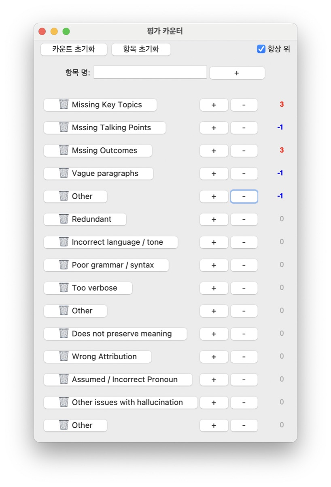

## Introduction



In today's fast-paced world, keeping track of multiple items can be a challenge. Whether you're managing inventory, tracking tasks, or simply counting items, having a reliable tool is essential. Introducing the [Outlier Dimension Rating Counter Program](https://github.com/saramjh/pycounter), a user-friendly application designed to help you manage and track counts for various items effortlessly.

## Purpose of the Program

The primary objectives of this tool are:

1. **Efficient Item Management**: Easily add, remove, and track items with a simple interface.
2. **User-Friendly Design**: Intuitive controls make it accessible to users of all skill levels.
3. **Customizable Options**: Features like "Always on Top" and reset buttons enhance usability.

## How to Use

### 1. Add Items

- Enter the name of the item in the "항목 명:" input field.
- Click the "+" button or press the Enter key to add the item to the list.

### 2. Adjust Counts

- Use the "+" and "-" buttons next to each item to increase or decrease the count.
- The count number changes color based on its value: gray for zero, red for positive, and blue for negative.

### 3. Manage Items

- Click the trash icon button to delete an item.
- Use the "항목 초기화" button to remove all items at once.

### 4. Additional Features

- Enable the "항상 위" checkbox to keep the window always on top.
- Use the "카운트 초기화" button to reset all counts to zero.

## Installation and Use

1. **Download**: Get the [source archive](https://github.com/saramjh/pycounter/archive/refs/heads/main.zip) for the repository's `main` branch. This is a source snapshot, not a versioned release.
2. **Unzip**: Extract the downloaded archive.
3. **Run**: Use Python 3 with Tkinter as shown below. The `dist/` directory also contains built files, but their compatibility depends on your operating system.

To run the source directly:

```bash
git clone https://github.com/saramjh/pycounter.git
cd pycounter
python3 pycounter.py
```

The original source uses Tkinter and does not include a separate pip requirements file. Your Python installation needs Tkinter support to open the GUI.

## Conclusion

The Outlier Dimension Rating Counter Program is a versatile tool that simplifies the process of assessment tracking. Its intuitive design and practical features make it an ideal choice for anyone needing to manage counts efficiently. Whether you're organizing tasks, managing inventory, or simply keeping track of items, this program offers a straightforward solution.

We invite you to try out the Outlier Dimension Rating Counter Program and see how it can enhance your productivity and organization.

#### Links

- [Simple Counter Program on GitHub](https://github.com/saramjh/pycounter)
