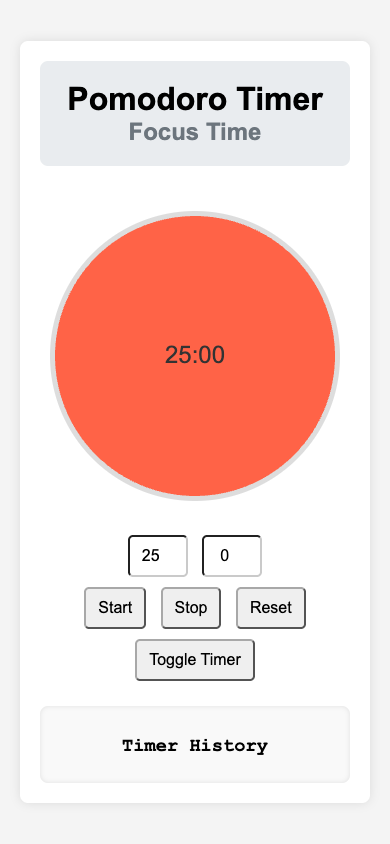
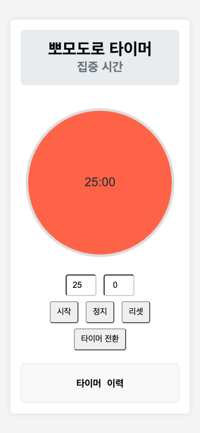

> 한국어판: [포모도로 타이머의 모바일 화면과 다이얼 입력을 고쳤다](/pomodoro-timer-mobile-canvas-fix-ko/)

# The Pomodoro timer now fits a phone screen

On 20 November 2026, I shipped a mobile fix to both the English and Korean Pomodoro timers. At narrow widths, the timer card could overflow the viewport and vertical centering could move its top edge out of view. A second bug made the circular dial select the wrong time after CSS reduced the canvas to fit the screen.

The two editions still use the same 25-minute focus and 5-minute break defaults. The [English timer](/pomodoro-timer-en/) and [Korean timer](/pomodoro-timer-kr/) guides explain the existing controls; this update records the mobile repair.

<figure>
  
  <figcaption>The English edition, captured from the live page at 390 × 844 CSS pixels after deployment.</figcaption>
</figure>

## Two problems appeared on narrow screens

The timer container declared a width of 350 pixels and added 20 pixels of padding on each side. Without border-box sizing, that padding sat outside the declared width. The page also used a fixed `height: 100vh` while vertically centring the card. When the controls and history made the card taller than the viewport, the top of the card could move above the visible area.

The dial had a separate coordinate error. Its canvas draws into a 300 × 300 pixel buffer, but CSS can display that canvas at a smaller size. The old click calculation added half the intrinsic canvas width and height to the displayed rectangle's top-left corner. Those values describe different coordinate spaces.

The regression case made the mismatch concrete. With a 200 × 200 displayed canvas at `left: 20, top: 50`, a click at `219, 150` should select 375 seconds, or 6:15. The old calculation selected 185 seconds, or 3:05.

## Make the layout follow the available space

The CSS change lets the page grow when its content needs more height and keeps the card inside the viewport:

- The body now uses `min-height: 100vh`, border-box sizing and 16 pixels of padding.
- The timer container has `max-width: 100%` and border-box sizing, so its padding is included in the available width.
- The canvas can shrink with `max-width: 100%` while keeping its aspect ratio.
- Inputs and buttons use border-box sizing as well.

The dial now measures the canvas where it is actually displayed. The click coordinates and the centre calculation therefore use the same viewport coordinate system:

```js
const rect = this.canvas.getBoundingClientRect()
const centerX = rect.left + rect.width / 2
const centerY = rect.top + rect.height / 2
```

The drawing buffer remains 300 × 300. Only the hit-testing calculation changed.

## Test the smaller canvas, not just the desktop one

Each repository now has three Node tests for the timer interaction:

1. The app initializes against the actual `timerCanvas` element.
2. A click at the quarter-circle position sets the timer to 375 seconds and updates the minute and second inputs to 6 and 15.
3. The same interaction works when CSS scales the displayed canvas to 200 × 200 pixels.

The scaled-canvas test uses the `left: 20, top: 50` rectangle from the regression case. All six tests across the two editions passed.

I then checked both live pages in headless Chrome at 280, 320, 375, 390, 768 and 1440 pixels wide. At 280, 320 and 375 pixels, the document width matched the viewport, the card started 16 pixels below the top edge, and the canvas displayed at 208, 248 and 300 pixels respectively. Vertical scrolling remained available, and the desktop geometry stayed unchanged.

The live-browser click test also ran at 280, 320 and 375 pixels in both editions. Each tested position selected 375 seconds and displayed 6 minutes and 15 seconds in the inputs.

<figure>
  
  <figcaption>The Korean edition uses the same responsive layout and dial calculation.</figcaption>
</figure>

## Both editions are live

The English change merged in [PR #2](https://github.com/saramjh/pomodorotimerEN/pull/2), and the Korean change merged in [PR #2](https://github.com/saramjh/pomodorotimerKR/pull/2). Their [English merge commit](https://github.com/saramjh/pomodorotimerEN/commit/7716a286eac02b90f771ffbe7ba6f86b0efb6600) and [Korean merge commit](https://github.com/saramjh/pomodorotimerKR/commit/f23f6b3033012e0f8b420ba0bbdcbed7d75bb5da) contain the CSS, JavaScript and regression-test changes.

Both GitHub Pages deployments completed successfully. The live [English timer](https://saramjh.github.io/pomodorotimerEN/) and [Korean timer](https://saramjh.github.io/pomodorotimerKR/) return HTTP 200, and their served CSS and JavaScript files match the tested source hashes.

The checks cover the six tested viewport widths and the dial positions exercised in the browser. They do not measure product adoption or establish how the timer behaves on every physical phone.
