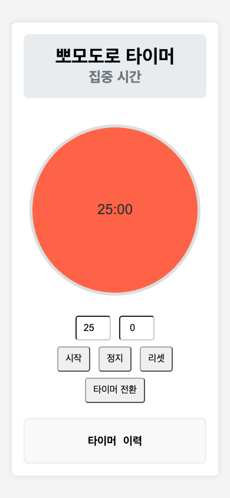
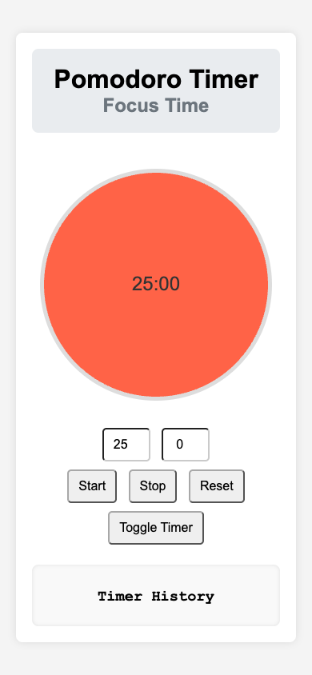

> English edition: [The Pomodoro timer now fits a phone screen](/pomodoro-timer-mobile-canvas-fix-en/)

# 포모도로 타이머의 모바일 화면과 다이얼 입력을 고쳤다

2026년 11월 20일, 영문·국문 포모도로 타이머에 모바일 수정 사항을 배포했다. 좁은 화면에서 타이머 카드가 화면 너비를 벗어나고, 세로 중앙 정렬 때문에 카드 윗부분이 화면 밖으로 밀리는 문제가 있었다. 캔버스가 화면에 맞게 축소되면 원형 다이얼을 누른 위치와 타이머가 계산하는 위치가 달라지는 문제도 함께 수정했다.

두 버전의 기본 설정은 집중 25분, 휴식 5분으로 유지된다. 기존 기능과 사용법은 [영문 안내](/pomodoro-timer-en/)와 [국문 안내](/pomodoro-timer-kr/)에서 확인할 수 있다. 이 글에서는 이후 진행한 모바일 수정을 다룬다.

<figure>
  
  <figcaption>배포 후 실제 국문 운영 페이지를 390 × 844 CSS 픽셀에서 캡처했다.</figcaption>
</figure>

## 작은 화면에서 두 가지 문제가 나타났다

타이머 컨테이너는 너비를 350픽셀로 지정하고 좌우에 20픽셀씩 여백을 더했다. 기존 CSS에는 `box-sizing: border-box`가 없어 패딩이 지정 너비 바깥에 더해졌다. 페이지 본문도 `height: 100vh` 상태에서 카드를 세로 중앙에 배치했다. 화면보다 콘텐츠가 길어지면 카드 윗부분이 화면 위로 올라갈 수 있었다.

원형 다이얼의 입력 좌표에도 문제가 있었다. 캔버스 내부 그림은 300 × 300픽셀 버퍼에 그려지지만, 모바일에서는 CSS가 표시 크기를 더 작게 줄인다. 기존 코드는 화면에 표시된 사각형의 시작 좌표에 캔버스 내부 너비와 높이의 절반을 더해 중심을 계산했다. 서로 다른 좌표 기준을 섞은 셈이다.

회귀 테스트에서는 표시 크기가 200 × 200픽셀이고 시작점이 `left: 20, top: 50`인 캔버스를 사용했다. 이 캔버스의 오른쪽 지점인 `219, 150`을 누르면 375초, 즉 6분 15초가 선택되어야 한다. 수정 전 계산 결과는 185초, 즉 3분 5초였다.

## 화면 크기에 맞게 레이아웃 수정

본문은 고정 높이 대신 `min-height: 100vh`를 사용하도록 바꿨다. 여기에 `box-sizing: border-box`와 16픽셀 패딩을 적용해 화면이 짧을 때도 콘텐츠를 세로로 스크롤할 수 있게 했다.

타이머 컨테이너에는 `max-width: 100%`와 border-box를 적용했다. 캔버스는 `max-width: 100%`, `height: auto`로 표시 영역에 맞춰 줄어들면서 원래 비율을 유지한다. 입력란과 버튼에도 border-box를 적용해 작은 화면에서 너비 계산이 어긋나지 않도록 했다.

다이얼 중심은 CSS가 실제로 표시하는 사각형에서 계산한다.

```js
const rect = this.canvas.getBoundingClientRect()
const centerX = rect.left + rect.width / 2
const centerY = rect.top + rect.height / 2
```

캔버스 내부의 300 × 300 그림 크기는 그대로 둔다. 클릭 위치를 해석하는 계산만 실제 표시 크기에 맞췄다.

## 축소된 캔버스까지 회귀 테스트

영문·국문 저장소에 각각 세 가지 Node 테스트를 추가했다.

1. 실제 `timerCanvas` 요소를 기준으로 앱이 초기화되는지 확인한다.
2. 원의 4분의 1 지점을 누르면 375초가 선택되고 분·초 입력란에 6과 15가 표시되는지 확인한다.
3. CSS로 표시 크기가 200 × 200픽셀로 줄어든 캔버스에서도 같은 결과가 나오는지 확인한다.

두 저장소의 테스트 여섯 개가 모두 통과했다.

이후 영문·국문 운영 페이지를 headless Chrome으로 열어 너비 280, 320, 375, 390, 768, 1440픽셀에서 확인했다. 280·320·375픽셀 화면에서는 문서 너비가 뷰포트와 일치했고, 타이머 카드의 위쪽은 화면에서 16픽셀 떨어져 있었다. 캔버스 표시 너비는 각각 208, 248, 300픽셀이었다. 세로 스크롤도 가능했고 데스크톱 레이아웃의 기존 크기와 배치는 유지됐다.

두 운영 페이지에서 280·320·375픽셀 화면의 다이얼 입력도 다시 실행했다. 여섯 조합 모두 375초를 선택했고, 입력란에는 6분 15초가 표시됐다.

<figure>
  
  <figcaption>영문 버전에도 동일한 반응형 레이아웃과 다이얼 좌표 계산을 적용했다.</figcaption>
</figure>

## 영문·국문 버전 모두 배포 완료

영문 변경은 [PR #2](https://github.com/saramjh/pomodorotimerEN/pull/2), 국문 변경은 [PR #2](https://github.com/saramjh/pomodorotimerKR/pull/2)로 병합했다. 각 저장소의 [영문 병합 커밋](https://github.com/saramjh/pomodorotimerEN/commit/7716a286eac02b90f771ffbe7ba6f86b0efb6600)과 [국문 병합 커밋](https://github.com/saramjh/pomodorotimerKR/commit/f23f6b3033012e0f8b420ba0bbdcbed7d75bb5da)에 CSS, JavaScript, 회귀 테스트 변경이 남아 있다.

두 GitHub Pages 배포가 성공했다. 운영 중인 [영문 타이머](https://saramjh.github.io/pomodorotimerEN/)와 [국문 타이머](https://saramjh.github.io/pomodorotimerKR/)는 HTTP 200을 반환하며, 실제 제공되는 CSS와 JavaScript의 SHA-256도 테스트한 원본 파일과 일치한다.

이번 검증은 여섯 화면 폭과 테스트에 포함된 다이얼 입력 위치를 대상으로 한다. 실제 사용자 증가나 모든 물리 기기에서의 동작까지 확인한 결과는 아니다.
