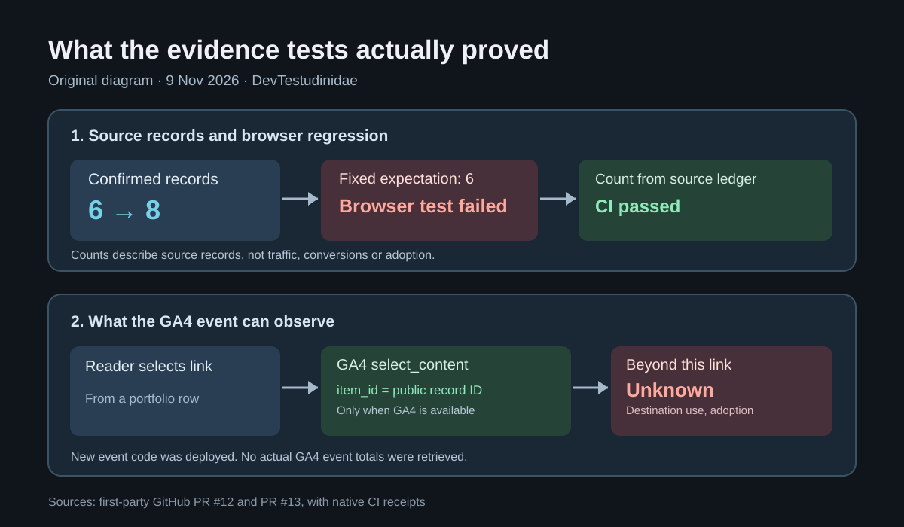

> **한국어:** [외부 성과 6건이 8건이 되자 브라우저 테스트가 실패했다](/portfolio-evidence-release-qa-ko/)

On November 9, I added two source-backed records to my [project portfolio](/portfolio/): a KoreAves article published by One Earth and a directory entry for Spoonie. I kept the publication and the listing in separate categories in the [evidence archive](/portfolio/recognition/).

Jekyll built the site after the data change, but [the first GitHub Actions run for PR #12](https://github.com/saramjh/saramjh.github.io/actions/runs/42596906716) failed. The Playwright smoke test expected six evidence cards at the 390px viewport. The source ledger had eight. A content count had been hard-coded into a layout test.

<figure>

<figcaption>Original diagram based on native pull-request and CI evidence. It is not a product screenshot or a traffic chart.</figcaption>
</figure>

## Let the records supply the expected count

The original assertion said that exactly six records must exist. It would fail whenever an approved entry was added, even if the page rendered the new entry correctly.

I changed the browser test to read confirmed records from <code>_data/recognitions.yml</code>. The overview and archive use the overall count; project case pages use their own subsets. The <code>publication</code> filter derives its expectation from the record types rather than another fixed number.

[PR #12](https://github.com/saramjh/saramjh.github.io/pull/12) passed after this change and [GitHub Pages deployed it](https://github.com/saramjh/saramjh.github.io/actions/runs/42598172448). That verifies consistency between the source records and the rendered page. It does not tell me whether a visitor read the One Earth article or used Spoonie.

## Which external source did someone select?

A pageview shows that the portfolio page loaded. It cannot identify which source link a visitor chose.

In [PR #13](https://github.com/saramjh/saramjh.github.io/pull/13), I reused the existing GA4 integration. Selecting an external evidence link can trigger <code>select_content</code> with <code>content_type: portfolio_external_evidence</code> and the public record's <code>item_id</code>. The new event payload carries no visitor name, email address or full destination URL.

The handler skips the event when the browser's Do Not Track value is <code>1</code> or the existing <code>gtag</code> function is missing. I tested it with a stub: one synthetic event with analytics present, zero with Do Not Track, and zero without <code>gtag</code>. Those are code-test results, not recorded visitor events.

The change passed [CI and production deployment](https://github.com/saramjh/saramjh.github.io/actions/runs/42601676883).

## Selection and adoption need different evidence

The new code can distinguish **which documented external source was selected**, provided the event is collected by the site's existing analytics setup. It cannot prove the destination loaded, the source was read or the underlying product was adopted.

I have **not retrieved real <code>select_content</code> totals** from GA4. There is no verified click-through rate, audience lift or conversion result to report. That requires a dated GA4 event report grouped by public record ID.

The finished work is an [eight-record public portfolio](/portfolio/recognition/), a browser regression that can grow with the source data, and an outbound link-selection event that has a narrower meaning than adoption.
