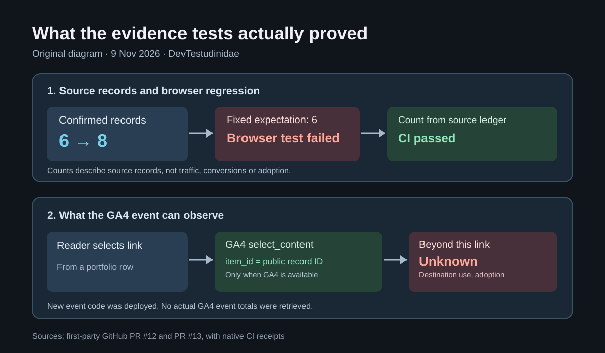

> **English:** [When two new portfolio records broke a browser test](/portfolio-evidence-release-qa-en/)

11월 9일, [프로젝트 포트폴리오](/portfolio/)의 외부 성과 목록에 원본 출처가 있는 기록 두 개를 추가했습니다. One Earth에 실린 KoreAves 기사와 Spoonie의 Web Apps Directory 등재입니다. [외부 성과 아카이브](/portfolio/recognition/)에서는 이를 기고와 디렉터리 등재로 구분해 표시합니다. [Spoonie 외부 디렉터리 등재 사례](/spoonie-webapps-directory-ko/)에는 어떤 제품 기능을 개발했고 왜 이 등재가 새로운 발견 경로인지 따로 정리했습니다.

변경 파일은 YAML 하나였고 Jekyll 사이트도 빌드됐습니다. 하지만 [PR #12의 첫 GitHub Actions 실행](https://github.com/saramjh/saramjh.github.io/actions/runs/42596906716)은 실패했습니다. 모바일 너비 390px에서 성과 카드가 여섯 개라고 가정한 Playwright 검사 때문이었습니다. 실제 원본 데이터에는 여덟 개가 있었습니다.

<figure>

<figcaption>실제 PR과 CI 실행에 근거해 직접 그린 설명도입니다. 사용량 그래프나 제품 실행 화면은 아닙니다.</figcaption>
</figure>

## 테스트가 데이터 변경을 따라가지 못했다

이전 검사는 성과 카드가 여섯 개라고 직접 적어 두었습니다. 새 출처를 추가하면 화면이 정상이어도 테스트가 실패하는 구조였습니다.

수정한 검사는 <code>_data/recognitions.yml</code>의 <code>status: confirmed</code> 기록으로 예상 건수를 계산합니다. 전체 목록은 여덟 건을, 프로젝트 사례 화면은 해당 프로젝트의 건수를 검사합니다. <code>publication</code> 필터 역시 원본 기록의 유형을 기준으로 검증하도록 고쳤습니다.

[수정된 PR #12](https://github.com/saramjh/saramjh.github.io/pull/12)는 다시 검사를 통과했고 [배포](https://github.com/saramjh/saramjh.github.io/actions/runs/42598172448)까지 확인했습니다. 이 결과는 기록과 화면이 일치한다는 증거입니다. 기사 열람이나 제품 사용량을 증명하는 검사는 아닙니다.

## 방문자는 어느 출처를 선택했을까?

페이지뷰만 보면 누군가 포트폴리오를 열었다는 사실과 외부 증빙 링크 중 무엇을 눌렀는지를 구분하기 어렵습니다.

[PR #13](https://github.com/saramjh/saramjh.github.io/pull/13)에서 기존 GA4 연결을 재사용해 외부 출처 링크 선택 시 <code>select_content</code> 이벤트를 보내는 코드를 넣었습니다. 이벤트에는 <code>content_type: portfolio_external_evidence</code>와 공개 기록 ID인 <code>item_id</code>를 사용합니다. 방문자의 이름, 이메일 또는 도착지 전체 URL을 새 이벤트 값으로 보내지 않습니다.

브라우저의 Do Not Track 값이 <code>1</code>이거나 <code>gtag</code>가 없으면 코드가 이벤트를 보내지 않습니다. 검증에서는 가짜 이벤트 함수를 사용했습니다. 일반적인 테스트 클릭은 이벤트 1건, 추적 거부와 GA4 부재 상황에서는 각각 0건이었습니다. 실제 방문자의 행동 기록이 아닙니다.

수정본은 [GitHub Actions 빌드와 배포](https://github.com/saramjh/saramjh.github.io/actions/runs/42601676883)를 통과했습니다.

## 링크를 눌렀다고 제품을 사용한 건 아니다

현재 구현은 **방문자가 어느 외부 출처 링크를 선택했는지** 측정할 준비가 됐습니다. 다만 출처 사이트의 페이지가 열렸는지, 글을 읽었는지, 제품을 사용했는지는 이 이벤트만으로 판단할 수 없습니다.

**실제 GA4 이벤트 건수는 아직 조회하지 않았습니다.** 따라서 클릭 수나 전환율, 방문자 증가 수치를 제시하지 않습니다. 다음 확인 대상은 날짜 범위와 공개 기록 ID를 지정한 GA4 이벤트 보고서입니다.

이번 작업으로 확보한 것은 [정확히 표시되는 외부 성과 8건](/portfolio/recognition/), 변경에 맞춰 동작하는 브라우저 검사, 출처 링크 선택을 구분할 수 있는 코드입니다. [One Earth에 게재된 KoreAves 기고](/koreaves-oneearth-author-achievement-ko/)에서는 지역별 관찰 근거를 지도에 표시할 때 지켜야 할 기준을 설명했습니다.
