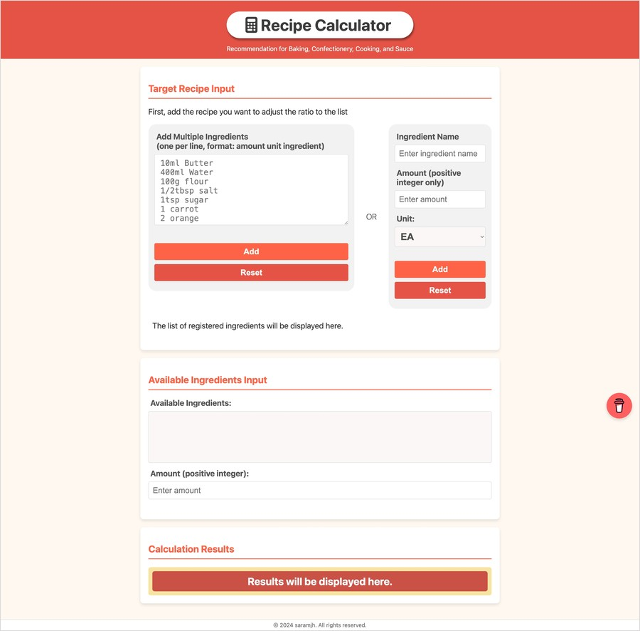

# Recipe scaling calculator: adjust ingredients from what you have

<p style="background: rgba(0, 120, 212, 0.08); border-left: 4px solid #0078d4; padding: 10px 14px; margin-bottom: 22px; border-radius: 4px; font-size: 0.95rem;">
  <strong>한국어 안내:</strong> <a href="/ko-recipe-scaling-application/">재료 비율 계산기 사용법</a>
</p>

I made a small [recipe scaling calculator](https://saramjh.github.io/recipeCalc/) for a common cooking problem: you have a different amount of one ingredient than the recipe calls for, but you want to keep the original proportions.

The tool takes the ingredients you enter, lets you choose one as the reference, and adjusts the rest by the same multiplier. It is useful for a smaller batch or for cooking with a particular amount already on hand.



## Worked example: from 100g flour to 150g

Suppose the original recipe contains **100g flour**, **200ml water**, and **20g sugar**. You have 150g of flour.

Enter the original quantities in the *Add Multiple Ingredients* field, one per line:

```text
100g flour
200ml water
20g sugar
```

Press **Add**, select **Flour** under *Available Ingredients*, and enter **150** as the available amount. The multiplier is `150 / 100 = 1.5`. The calculator then gives:

| Ingredient | Original | Adjusted |
|---|---:|---:|
| Flour | 100g | 150g |
| Water | 200ml | 300ml |
| Sugar | 20g | 30g |

The formula is `adjusted amount = original amount × (available reference amount / original reference amount)`. This is the same proportion used for every ingredient.

## Entering and editing a recipe

You can add ingredients one at a time or paste several lines into the bulk input. The app has **Edit** and **Delete** controls for individual ingredients. **Reset** reloads the page so you can start another recipe.

The live calculator and its source code are available here:

- [Open the Recipe Scaling Application](https://saramjh.github.io/recipeCalc/)
- [View the original project on GitHub](https://github.com/saramjh/recipeCalc)

## Limits to know before cooking

The calculator keeps the units attached to each ingredient. It does **not perform unit conversion** between grams, cups, milliliters or other measures, and it does not estimate nutrition or cooking yield. Use consistent units for each ingredient when checking your result.

In bulk input, the current parser reads a leading decimal number. Writing `1/2tbsp` does not reliably represent half a tablespoon; write `0.5tbsp` instead. The single-ingredient form also has its own numeric input constraints. The project is a ratio helper, so you should still review the result for the way ingredients behave in a real recipe.

I built it with plain HTML, CSS and JavaScript. The scaling calculation and the input behavior can be checked against the [original implementation](https://github.com/saramjh/recipeCalc/blob/main/js/script.js). This walkthrough describes the existing tool; it is not a record of a new app release.
