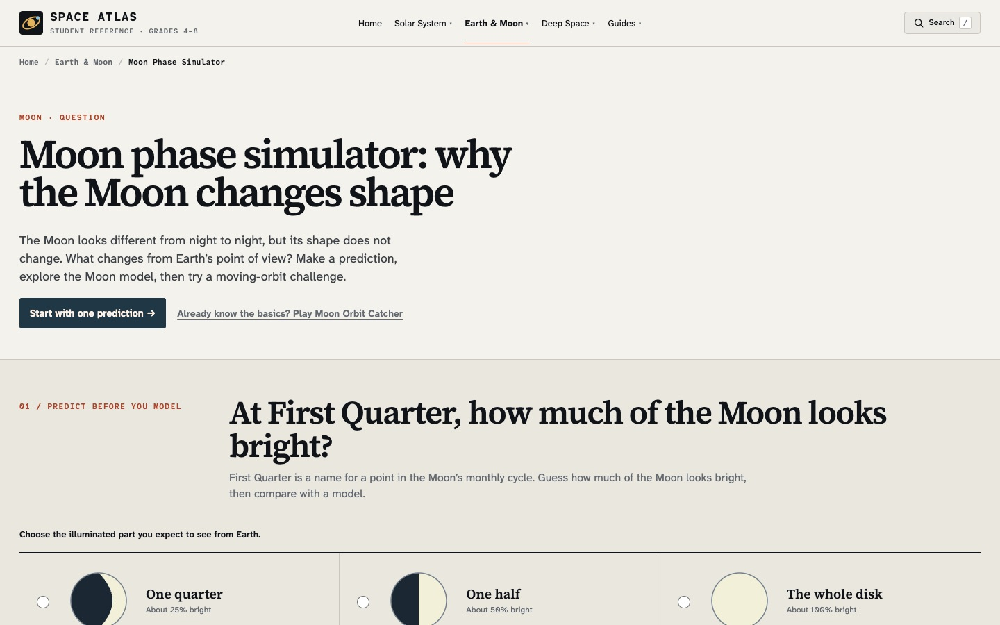

> 한국어판: [Space Atlas의 과학 설명 네 곳을 고친 기록](/space-atlas-science-accuracy-ko/)

On November 6, 2026, I merged [four science-text corrections into Space Atlas](https://github.com/saramjh/space_atlas_student/pull/2). I checked the public site again on November 12. The revised wording is now visible in all four lessons.

The problems were small pieces of text with consequences for interpretation. A simulator can show a convincing scene while leaving students with the wrong idea about its scale, the certainty of a prediction, or the duration of an astronomical event.

<figure>
  
  <figcaption>The Space Atlas learning interface. The lesson links below show the corrected explanations.</figcaption>
</figure>

## Four places where wording changed the lesson

**1. A solar-system model needs an honest scale label.** The [home page](https://spaceatlasedu.org/) uses a 3D model to let students inspect planets and orbits. I replaced wording that implied a simple, uniform size exaggeration with an explicit explanation: planet sizes, orbit spacing and animation rates are adjusted separately for visibility. A circular track on the screen does not preserve actual relative orbital periods. The measured scale labs are the appropriate comparison when scale matters.

**2. The Milky Way's merger with Andromeda is uncertain.** The [galaxy-types lesson](https://spaceatlasedu.org/galaxies/types/) had treated a future merger as inevitable. A [2025 study using Hubble and Gaia observations](https://doi.org/10.1038/s41550-025-02563-1) estimated roughly even odds of a merger within the next 10 billion years, with substantial uncertainty from other Local Group galaxies. The lesson now says the merger is possible. It links to [NASA's explanation of the reassessment](https://science.nasa.gov/missions/hubble/apocalypse-when-hubble-casts-doubt-on-certainty-of-galactic-collision/).

**3. An eclipse needs the right clock.** A previous claim on the [eclipses page](https://spaceatlasedu.org/moon/eclipses/) described about 1.5 hours as the maximum total lunar eclipse. I replaced it with the longest totality in the 21st century: approximately 1 hour 43 minutes during the July 27, 2018 eclipse, as recorded in [NASA's eclipse catalogue](https://eclipse.gsfc.nasa.gov/LEcat5/LE2001-2100.html). That number describes the fully eclipsed phase, not the entire eclipse from first to last contact.

**4. Stellar lifetime is more specific than a single number.** The [stellar life-cycle lesson](https://spaceatlasedu.org/stars/life-cycle/) compared a Sun-like star's approximately 10 billion years with a very massive star's few million years. I relabelled both as approximate *main-sequence lifetimes*. The Sun goes through later stages, and the few-million-year example is not a claim about every star above eight solar masses.

## What I actually changed

[The merged PR](https://github.com/saramjh/space_atlas_student/pull/2) updates four lesson HTML files and their scientific references. It does not change the physics engine or rescale the rendered orbits. I verified the built lessons and their scientific links, then confirmed the public pages serve the revised text.

For an educator reviewing the site, those distinctions are visible at the point where a student encounters the model or claim. There is still no measured classroom learning outcome from these wording corrections. The [Space Atlas project case](/portfolio/space-atlas/) records the other engineering and publication work behind the lessons.
