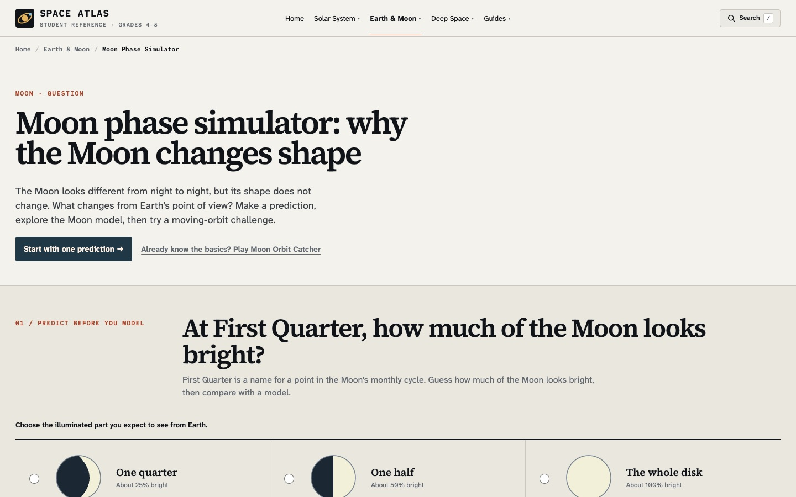

> English version: [Four science corrections I shipped in Space Atlas](/space-atlas-science-accuracy-en/)

2026년 11월 6일, [Space Atlas의 과학 설명 네 곳을 수정한 PR](https://github.com/saramjh/space_atlas_student/pull/2)을 병합했다. 11월 12일 실제 공개 사이트를 다시 확인했고, 네 학습 화면 모두 수정된 문구를 제공하고 있었다.

시뮬레이터의 그림이 그럴듯하더라도 설명 문장 하나 때문에 잘못 배울 수 있다. 축척이 다른 모형을 실측처럼 받아들이거나, 아직 불확실한 예측을 확정된 사실로 읽는 경우가 그렇다. 이번 작업에서는 화면의 설명과 근거 링크를 먼저 고쳤다.

<figure>
  
  <figcaption>Space Atlas의 기존 학습 화면. 교정된 문장은 아래에 연결한 각 학습 페이지에서 볼 수 있다.</figcaption>
</figure>

## 실제로 바로잡은 네 가지

**태양계 3D 모델의 축척.** [첫 화면](https://spaceatlasedu.org/)에서는 행성과 궤도를 돌려보며 위치 관계를 살핀다. 예전 설명은 행성 크기만 일정한 비율로 키우고 궤도 운동을 빠르게 보여준다는 인상을 줬다. 현재 문구는 행성 크기, 궤도 간격, 애니메이션 속도를 가시성을 위해 각각 조정했다고 명시한다. 화면의 원형 궤적이 실제 공전 주기 비율을 그대로 나타내는 것도 아니다. 크기를 비교할 때는 별도로 마련된 축척 학습 화면을 보도록 안내한다.

**우리은하와 안드로메다은하의 합병.** [은하 분류 학습](https://spaceatlasedu.org/galaxies/types/)은 두 은하가 장차 반드시 충돌할 것처럼 서술하던 부분을 바꿨다. [허블과 가이아 관측치를 사용한 2025년 연구](https://doi.org/10.1038/s41550-025-02563-1)는 앞으로 100억 년 안에 합병할 가능성을 약 절반으로 추정했다. 주변 은하의 영향과 관측 오차 때문에 결과에는 불확실성이 크다. 학습 페이지에는 합병이 가능한 시나리오임을 설명하고, [NASA의 연구 해설](https://science.nasa.gov/missions/hubble/apocalypse-when-hubble-casts-doubt-on-certainty-of-galactic-collision/)을 연결했다.

**개기월식이 지속되는 시간.** [식 현상 학습](https://spaceatlasedu.org/moon/eclipses/)에는 과거 약 1.5시간을 개기월식의 최대 지속시간으로 표시한 문장이 있었다. 이제 [NASA의 월식 목록](https://eclipse.gsfc.nasa.gov/LEcat5/LE2001-2100.html)을 근거로 2018년 7월 27일의 개기 구간, 약 1시간 43분을 소개한다. 이 시간은 달 전체가 본그림자 안에 들어간 구간을 뜻하며, 반영식과 부분식을 포함한 전체 진행시간과 다르다.

**항성의 주계열 수명.** [항성 진화 학습](https://spaceatlasedu.org/stars/life-cycle/)은 태양과 비슷한 항성의 약 100억 년, 매우 무거운 항성의 수백만 년을 비교한다. 이를 막연한 전체 수명이 아니라 수소 핵융합을 하는 *주계열 단계의 대략적인 수명*으로 바로잡았다. 태양은 이후 진화 단계도 거치며, 수백만 년이라는 값은 태양 질량의 8배가 넘는 모든 항성에 적용되는 수치도 아니다.

## 코드와 공개 화면에서 확인한 범위

[원본 PR](https://github.com/saramjh/space_atlas_student/pull/2)은 네 HTML 파일의 설명과 출처 링크를 수정했다. 3D 물리 계산이나 궤도 자체를 다시 구현한 변경은 아니다. 병합 후 실제 공개된 학습 화면에서도 문구를 확인했다.

학생이 모형이나 수치를 처음 보는 자리에서 설명의 한계와 출처를 직접 확인할 수 있도록 한 것이 이번 개발 작업의 결과다. 다만 교실에서의 학습 효과는 측정하지 않았다. 다른 구현과 외부 게재 성과는 [Space Atlas 프로젝트 소개](/portfolio/space-atlas/)에서 볼 수 있다.
