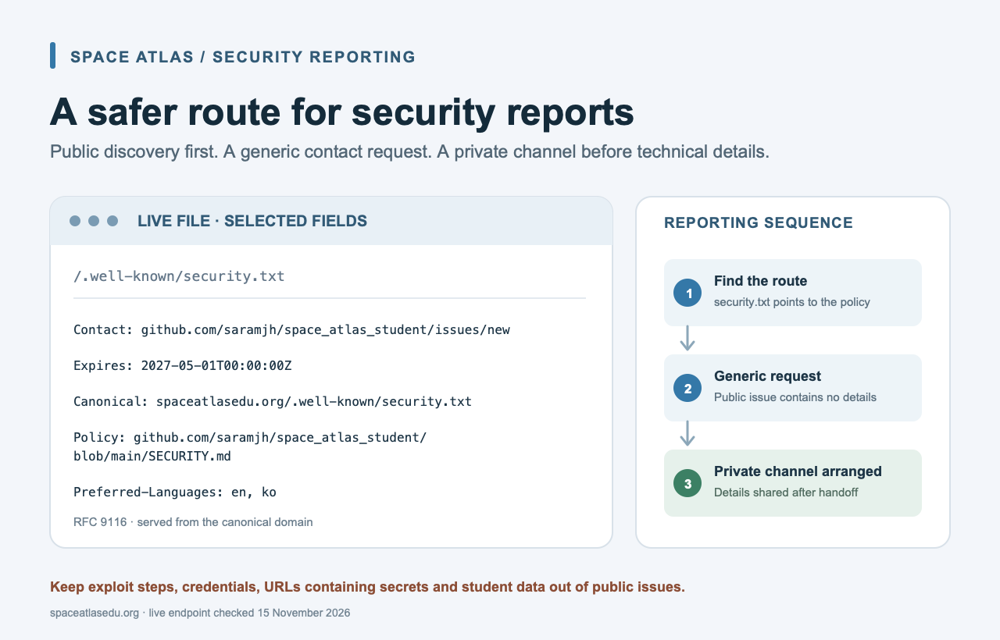

> 한국어판: [Space Atlas에 보안 제보 경로를 추가했다](/space-atlas-security-reporting-ko/)

I added an RFC 9116 `security.txt` file and a `SECURITY.md` policy to Space Atlas. They identify the first contact and explain what reporters should leave out of a public issue. The [live reporting endpoint](https://spaceatlasedu.org/.well-known/security.txt) returned HTTP 200 when checked on 15 November 2026.

<figure>
  
  <figcaption>This diagram uses the live `security.txt` file and the repository's `SECURITY.md` policy, both checked on 15 November 2026. It does not depict an actual report or security incident.</figcaption>
</figure>

## What the public file tells a reporter

The live `/.well-known/security.txt` file contains these fields:

```text
# Report only a generic contact request in a public issue, never exploit details.
Contact: https://github.com/saramjh/space_atlas_student/issues/new
Expires: 2027-05-01T00:00:00Z
Canonical: https://spaceatlasedu.org/.well-known/security.txt
Policy: https://github.com/saramjh/space_atlas_student/blob/main/SECURITY.md
Preferred-Languages: en, ko
```

`Contact` points to a new GitHub issue. `Expires` sets the file's expiry date to 1 May 2027. `Canonical` identifies the canonical file URL, while `Policy` links to the reporting instructions. `Preferred-Languages` lists English and Korean.

## Keep the public request generic

The [SECURITY.md policy](https://github.com/saramjh/space_atlas_student/blob/main/SECURITY.md) asks reporters to title the issue `Private security contact request` and include only a generic contact request. It says not to publish exploitation steps, vulnerable URLs containing secrets, credentials, student personal information or other sensitive details in the public issue.

The maintainer can arrange a private follow-up channel before receiving confidential technical details. The project does not offer a vulnerability-bounty program. Reporters are also asked not to access, alter or expose other visitors' data.

## Static build and regression checks

[PR #10](https://github.com/saramjh/space_atlas_student/pull/10) updates the build to copy `.well-known` into the public output and create `.nojekyll` there. This lets GitHub Pages serve the hidden path without processing it through Jekyll.

The regression check verifies that `security.txt` exists in the output, that its Contact, Expires, Canonical and Policy fields are present, and that `.nojekyll` was created. The same PR sets CI's `SITE_BASE` to the root of the `spaceatlasedu.org` custom domain, replacing the old project-site prefix.

PR #10 was merged on 9 November 2026. The implementation is in [commit 712deb4](https://github.com/saramjh/space_atlas_student/commit/712deb4ce576265439a54ce7794e10beee95e509). I checked the live endpoint on 15 November and received HTTP 200 with `text/plain; charset=utf-8`.

## Checks for other static-site maintainers

- Does the canonical `/.well-known/security.txt` URL serve the file on the production domain?
- Does the contact route ask for a generic request instead of sensitive technical details in public?
- Does the policy explain how a private follow-up is arranged before confidential details are shared?
- Are the expiry date, canonical URL and generated output checked during the build?

The separate child-data review remains open. The [privacy notice](https://spaceatlasedu.org/privacy/) says that direct unsupervised use by children under 13 is not recommended while child-directed advertising and data-handling controls are under review.

## Original sources and related work

- [Live security.txt](https://spaceatlasedu.org/.well-known/security.txt)
- [SECURITY.md reporting policy](https://github.com/saramjh/space_atlas_student/blob/main/SECURITY.md)
- [Implementation PR #10](https://github.com/saramjh/space_atlas_student/pull/10)
- [Merge commit 712deb4](https://github.com/saramjh/space_atlas_student/commit/712deb4ce576265439a54ce7794e10beee95e509)
- [RFC 9116: A File Format to Aid in Security Vulnerability Disclosure](https://www.rfc-editor.org/rfc/rfc9116)
- [Space Atlas](https://spaceatlasedu.org/) · [Space Atlas development portfolio](/portfolio/space-atlas/)
- [Earlier educator-resource records](/space-atlas-education-resource-paths-en/)
