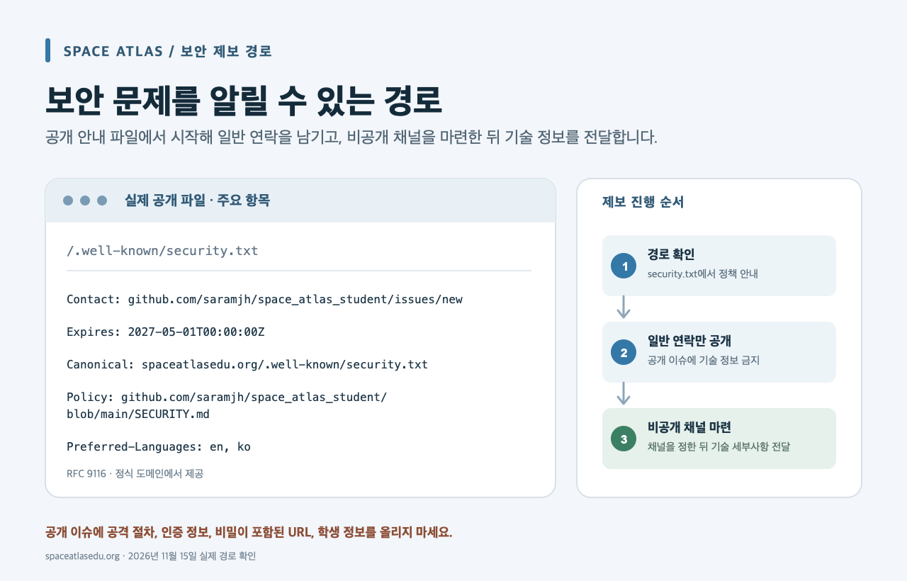

> English version: [Space Atlas now has a security-reporting route](/space-atlas-security-reporting-en/)

보안 문제를 발견한 사람이 공격 절차나 학생 개인정보를 공개 이슈에 남기지 않고 연락할 방법이 필요했다. Space Atlas에 RFC 9116 `security.txt`와 `SECURITY.md`를 추가했다. [정식 보안 제보 경로](https://spaceatlasedu.org/.well-known/security.txt)는 2026년 11월 15일 확인 당시 운영 서버에서 HTTP 200으로 응답했다.

<figure>
  
  <figcaption>2026년 11월 15일 운영 중인 security.txt와 저장소의 SECURITY.md를 바탕으로 만든 도해다. 실제 제보 사례나 보안 사고를 묘사하지 않는다.</figcaption>
</figure>

## 공개 파일에 담긴 정보

현재 운영 중인 `/.well-known/security.txt`에는 다음 항목이 있다.

```text
# Report only a generic contact request in a public issue, never exploit details.
Contact: https://github.com/saramjh/space_atlas_student/issues/new
Expires: 2027-05-01T00:00:00Z
Canonical: https://spaceatlasedu.org/.well-known/security.txt
Policy: https://github.com/saramjh/space_atlas_student/blob/main/SECURITY.md
Preferred-Languages: en, ko
```

`Contact`는 GitHub의 새 이슈 작성 화면으로 연결한다. `Expires`는 이 파일의 유효기간을 2027년 5월 1일까지로 표시하고, `Canonical`은 정식 파일 주소를 지정한다. `Policy`는 제보 방법을 설명하는 문서로 연결하며, `Preferred-Languages`에는 영어와 한국어를 적었다.

## 공개 이슈에는 일반 연락 요청만 남긴다

[SECURITY.md의 제보 지침](https://github.com/saramjh/space_atlas_student/blob/main/SECURITY.md)은 공개 이슈 제목을 `Private security contact request`로 지정하고, 내용에는 일반적인 연락 요청만 남기도록 안내한다. 공격 재현 절차, 비밀이 포함된 취약 URL, 인증 정보, 학생 개인정보와 그 밖의 민감한 내용은 공개 이슈에 올리지 말아야 한다.

관리자는 기밀 기술 정보를 받기 전에 비공개 후속 채널을 마련할 수 있다. 이 프로젝트는 취약점 제보에 대한 보상 프로그램을 운영한다고 약속하지 않는다. 다른 방문자의 데이터에 접근하거나 이를 변경·노출해서도 안 된다.

## 정적 사이트 빌드와 회귀검사

[PR #10](https://github.com/saramjh/space_atlas_student/pull/10)은 빌드 과정에서 `.well-known` 디렉터리를 공개 출력물로 복사하고, 출력 디렉터리에 `.nojekyll`을 생성하도록 바꿨다. 이 설정으로 GitHub Pages가 숨김 경로를 Jekyll 처리 없이 제공한다.

빌드 회귀검사는 공개 출력물에 `security.txt`가 포함되는지, Contact·Expires·Canonical·Policy 네 항목이 맞는지, `.nojekyll`이 생성되는지 검사한다. CI의 `SITE_BASE`는 기존 프로젝트 경로에서 정식 도메인 루트인 `spaceatlasedu.org`로 바뀌었다.

PR #10은 2026년 11월 9일 병합됐다. 구현은 [커밋 712deb4](https://github.com/saramjh/space_atlas_student/commit/712deb4ce576265439a54ce7794e10beee95e509)에 기록돼 있다. 11월 15일 운영 주소를 확인했을 때 HTTP 200과 `text/plain; charset=utf-8` 응답을 받았다.

## 정적 사이트 운영자를 위한 확인 사항

- 정식 도메인의 `/.well-known/security.txt`에서 파일이 실제로 제공되는가?
- 연락처가 공개 이슈에 민감한 기술 정보를 남기도록 유도하지 않는가?
- 공개 제보 정책이 일반 연락 요청과 기밀 기술 정보의 전달 단계를 구분하는가?
- 만료일과 정식 주소를 관리하고, 빌드 검사에서 실제 출력 경로를 확인하는가?

아동 데이터 처리 검토는 별도로 남아 있다. [개인정보 안내](https://spaceatlasedu.org/privacy/)는 아동 대상 광고와 데이터 처리 통제가 검토되는 동안 13세 미만 학생의 비감독 사용을 권장하지 않는다고 밝힌다.

## 원본과 관련 기록

- [실제 운영 중인 security.txt](https://spaceatlasedu.org/.well-known/security.txt)
- [SECURITY.md 제보 정책](https://github.com/saramjh/space_atlas_student/blob/main/SECURITY.md)
- [구현 PR #10](https://github.com/saramjh/space_atlas_student/pull/10)
- [병합 커밋 712deb4](https://github.com/saramjh/space_atlas_student/commit/712deb4ce576265439a54ce7794e10beee95e509)
- [RFC 9116: A File Format to Aid in Security Vulnerability Disclosure](https://www.rfc-editor.org/rfc/rfc9116)
- [Space Atlas](https://spaceatlasedu.org/) · [Space Atlas 개발 포트폴리오](/portfolio/space-atlas/)
- [교육 자료 경로와 외부 등재 기록](/space-atlas-education-resource-paths-ko/)
