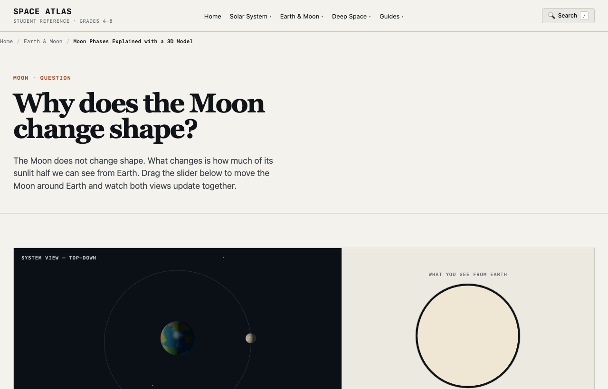

> 한국어판: [Space Atlas, 해외 홈스쿨링 과학 자료 목록에 소개되다](/space-atlas-worldschooling-guide-ko/)

[WorldlyTribe's guide to online programs for travelling families](https://worldlytribe.com/the-complete-guide-to-online-programs-for-homeschoolers-worldschoolers/) now includes **Space Atlas** in its science section. The entry describes a free, no-signup astronomy resource for ages 9–14 and links to [the working site](https://spaceatlasedu.org/). It places a project I developed independently where parents can discover learning materials by subject and age.

## Why I built controls around the science

An illustrated Moon with its phases labelled is useful, but I wanted learners to test *why* its appearance changes. In the [Moon Phases simulator](https://spaceatlasedu.org/moon/phases/), moving the Moon around Earth connects the sunlit half of the Moon with the portion visible from our viewpoint. The First Quarter position is a particularly helpful check: the name refers to a point in the phase cycle, even though roughly half the visible disk is illuminated.

The [Earth's seasons model](https://spaceatlasedu.org/earth/seasons/) addresses a different misconception. Changing the viewing angle lets learners explore how axial tilt affects seasonal sunlight instead of assuming that Earth's changing distance from the Sun causes summer and winter. Both models simplify real motion, and the lessons link readers to further source explanations.

<figure>
  
  <figcaption>A first-party screenshot of the Space Atlas Moon-phase model. This image is from the project, not from WorldlyTribe.</figcaption>
</figure>

## A short activity for a travelling family

A parent can open the Moon model on a connected device and ask a learner to predict what the Moon should look like at First Quarter. After moving the Moon to that position, compare the prediction with the view from Earth. A second question follows naturally: why do we see different fractions of the illuminated half as the Moon moves?

The WorldlyTribe guide labels Space Atlas as a free science resource for older children. Its age suggestion is the directory's classification, not a tested age-specific learning result. The site requires internet access and may display ads. It supplements a lesson; it does not provide a full curriculum.

## What the external listing establishes

WorldlyTribe collects more than 90 online learning options and explains that many have been researched rather than personally used by its family. Its Space Atlas entry is a public third-party discovery link. The guide does not report that a family completed an activity with the model, or provide referral traffic or learning outcomes. The date the Space Atlas entry first appeared is not established by the page.

For my development portfolio, the useful evidence is the route from a working, source-linked astronomy interface to a family-oriented education directory. This reaches a different type of reader from the [NCASE Programs listing](/space-atlas-ncase-programs-en/) and the [Share My Lesson Moon-phase activity](/space-atlas-share-my-lesson-en/).

The [original WorldlyTribe guide](https://worldlytribe.com/the-complete-guide-to-online-programs-for-homeschoolers-worldschoolers/) contains the entry. You can [test the Moon simulator](https://spaceatlasedu.org/moon/phases/), [try the seasons model](https://spaceatlasedu.org/earth/seasons/), or see the broader [Space Atlas project case](/portfolio/space-atlas/).
