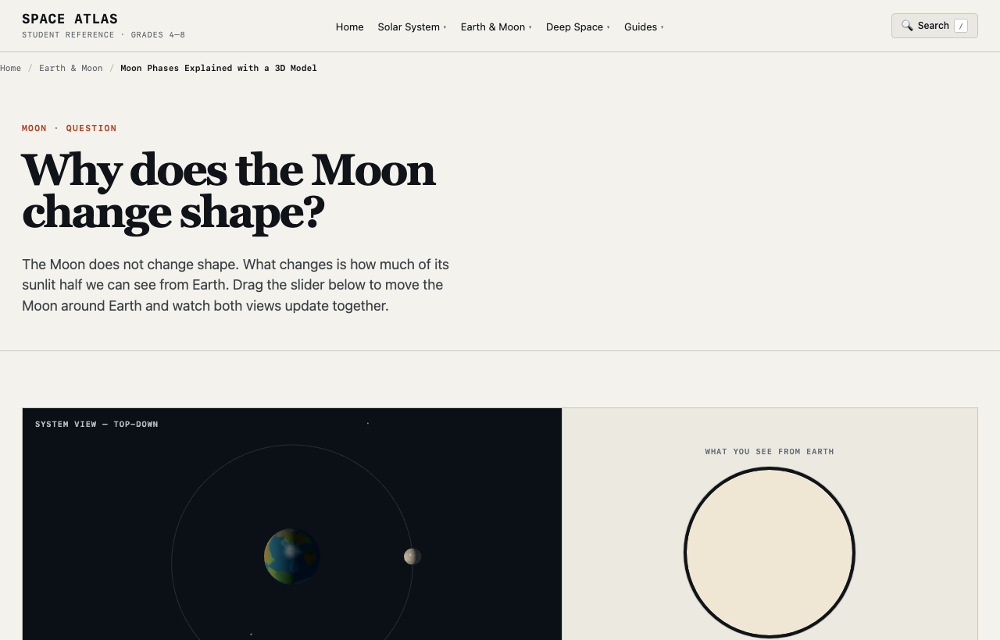

> English version: [Space Atlas in WorldlyTribe's science guide](/space-atlas-worldschooling-guide-en/)

여행하면서 아이와 공부할 온라인 프로그램을 정리한 [WorldlyTribe의 자료 가이드](https://worldlytribe.com/the-complete-guide-to-online-programs-for-homeschoolers-worldschoolers/)에 **Space Atlas**가 소개됐다. 과학 분야에서 9~14세를 위한 무료 천문학 자료로 분류하고 [실제 서비스](https://spaceatlasedu.org/)로 연결한다. 독립 개발한 프로젝트를 가정 학습 자료를 찾는 사람이 발견할 수 있는 경로가 하나 생겼다.

## 달의 위치를 직접 바꿔 보는 이유

달 위상은 이름과 그림을 외우기 쉽지만, 태양이 비추는 면과 지구에서 보이는 면을 연결해 이해하려면 관찰할 방법이 필요하다. [달 위상 시뮬레이터](https://spaceatlasedu.org/moon/phases/)에서는 달을 이동하며 두 모습을 비교할 수 있다. 상현달을 선택했을 때 지구에서 보이는 달 원반의 약 절반이 밝은 이유도 위치를 바꿔 살펴볼 수 있다.

[지구의 계절 모델](https://spaceatlasedu.org/earth/seasons/)은 또 다른 질문에 답하도록 만들었다. 여름과 겨울이 태양과 지구 사이의 단순한 거리 변화로 생기는 것처럼 오해하지 않도록 자전축 기울기와 햇빛의 방향을 살핀다. 두 시뮬레이터 모두 개념 학습을 위해 실제 천체 운동을 단순화한 모델이며, 설명과 출처 링크를 함께 제공한다.

<figure>
  
  <figcaption>개발 프로젝트의 실제 달 위상 화면. WorldlyTribe에서 이미지나 화면을 가져오지 않았다.</figcaption>
</figure>

## 집에서 해볼 수 있는 짧은 관찰

먼저 상현달일 때 지구에서 달이 어떻게 보일지 예측한다. 그다음 시뮬레이터에서 달을 상현 위치로 움직이고 지구 관찰자 화면과 비교한다. 왜 달의 밝은 면 전체가 항상 보이지 않는지도 같은 화면에서 질문해 볼 수 있다.

가이드에 표시된 9~14세는 WorldlyTribe가 붙인 이용 대상 분류다. 해당 연령에서 학습 효과가 측정됐다는 뜻은 아니다. 서비스에는 인터넷 연결이 필요하고 광고가 표시될 수 있으므로, 학부모와 교사는 사용 환경을 확인해야 한다. 별도의 전체 교과과정을 제공하는 사이트도 아니다.

## 이 외부 목록에서 확인된 것

WorldlyTribe는 홈스쿨링·월드스쿨링용 프로그램 90여 개 이상을 주제와 연령별로 정리한다. 사이트는 소개한 프로그램 중 많은 수를 직접 이용하지 않았다고 밝히고 있다. 따라서 이번에 확인한 것은 **외부 학습 자료 목록의 Space Atlas 소개와 공식 사이트 연결**이다. 실제 가정에서 사용했는지, 몇 명이 링크를 눌렀는지, 학습 성과가 있었는지는 확인되지 않았다. 해당 항목의 최초 등재 날짜도 알 수 없다.

개발자로서 의미 있는 부분은 천문학 개념을 조작 가능한 학습 경험으로 구현한 결과가 해외 가정 학습 가이드에서도 발견된다는 점이다. 이전에 확인한 [NCASE 교육 자료 등재](/space-atlas-ncase-programs-ko/)와 [Share My Lesson 수업 활동지](/space-atlas-share-my-lesson-ko/)는 독자가 다르므로 각각 근거를 구분해 기록한다.

[WorldlyTribe 원문](https://worldlytribe.com/the-complete-guide-to-online-programs-for-homeschoolers-worldschoolers/)에서 직접 목록을 확인하고, [달 위상 모델](https://spaceatlasedu.org/moon/phases/)과 [계절 모델](https://spaceatlasedu.org/earth/seasons/)을 조작해 볼 수 있다. 구현 배경은 [Space Atlas 개발 포트폴리오](/portfolio/space-atlas/)에 정리했다.
