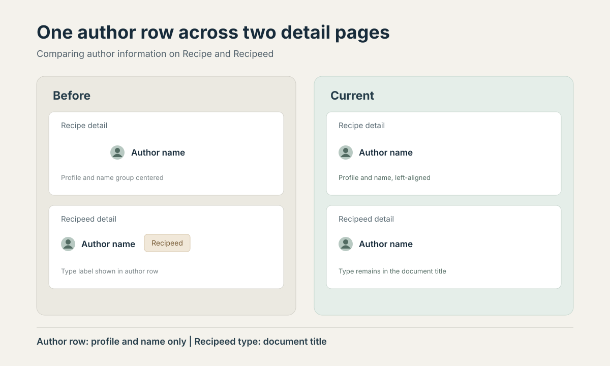

> 한국어판: [Spoonie Recipe와 Recipeed 상세 페이지의 작성자 헤더 통일](/spoonie-author-header-consistency-ko/)

Both detail pages now use the same author-row layout. The profile and author name sit on the left. The author row no longer carries a Recipeed type label; the document title still identifies the Recipeed page.

<figure>

<figcaption>A simplified schematic based on the owner's design brief and both public pages. No live screenshot is used.</figcaption>
</figure>

## How the original layouts differed

The initial Recipe detail view centered the profile-and-name group. Because the avatar occupied part of that group, the name itself appeared off-center.

The initial Recipeed view placed the author row on the left and added a separate "Recipeed" type label beside the name. The row displayed author identity and content type together.

## Separate author identity from content type

Both pages now use a left-aligned row containing the profile and author name. The Recipeed type remains in the browser document title.

On the current public Recipe detail page, the profile and author name appear on the left. The Recipeed page uses the same structure, without a separate type label beside the author name. "Recipeed" remains in the browser document title.

## What the public pages confirm

On November 10, 2026, I opened both public detail pages. Each returned HTTP 200, and both rendered the author link in the same left-aligned position.

- [Recipe detail page](https://spoonie.kr/recipes/c85823ee-5da4-4436-9455-9c2dbf0ff5a5)
- [Recipeed detail page](https://spoonie.kr/posts/61d12fa4-cb4c-413c-81e1-bb61339ea204)

The check covered public HTML and the rendered author row. Screen-reader testing and user interviews remain outside its scope. No click-through, cooking-record, return-visit or conversion measurements are available for this change. The verified result is that both detail pages place the author row in the same position and use the same structure.

For an earlier broader review of Spoonie UI, see the [hands-on design review](/en-impeccable-review-ai-ui-design/). This note focuses on the author header on the two detail pages.

[Open Spoonie](https://spoonie.kr/)
