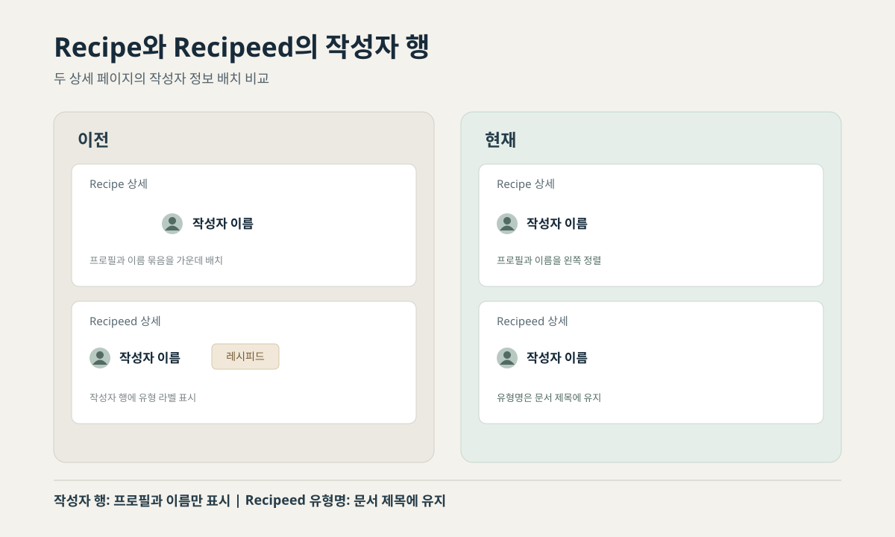

> English version: [A consistent author header for Spoonie's Recipe and Recipeed pages](/spoonie-author-header-consistency-en/)

두 상세 페이지에서 작성자 행을 같은 방식으로 배치했다. 프로필과 작성자 이름은 왼쪽에 두고, Recipeed 유형명은 작성자 행에서 제외했다.

<figure>

<figcaption>사용자 디자인 요청과 두 공개 페이지를 바탕으로 직접 그린 개념도다. 실제 화면 캡처를 사용하지 않았다.</figcaption>
</figure>

## 초기 화면에서 달랐던 점

초기 Recipe 상세 화면에서는 프로필 이미지와 작성자 이름을 하나의 묶음으로 가운데 배치했다. 프로필 영역까지 포함한 묶음은 이름의 시각적 중심이 화면 가운데와 어긋나 보였다.

초기 Recipeed 상세 화면은 작성자 행을 왼쪽에 두고, 이름 옆에 '레시피드' 유형 문구를 추가했다. 작성자와 콘텐츠 유형이 같은 행에 함께 표시됐다.

## 작성자 정보와 콘텐츠 유형 분리

두 화면 모두 작성자 행에는 프로필과 이름을 둔다. 왼쪽 정렬을 적용해 작성자 정보가 두 화면에서 같은 위치에 놓이도록 했다. Recipeed 유형명은 브라우저 문서 제목에 남겨 작성자 이름과 분리했다.

현재 공개된 Recipe 상세 화면은 프로필과 작성자 이름을 왼쪽에 배치한다. Recipeed 상세 화면도 같은 구조이며, 작성자 행에는 별도 유형 라벨이 표시되지 않는다. Recipeed 유형명은 브라우저 문서 제목에 남아 있다.

## 공개 화면 확인 범위

2026년 11월 10일 두 공개 페이지를 각각 열어 확인했다. 두 주소 모두 HTTP 200을 반환했고, 작성자 링크는 같은 왼쪽 정렬 구조로 렌더링됐다.

- [Recipe 상세 페이지](https://spoonie.kr/recipes/c85823ee-5da4-4436-9455-9c2dbf0ff5a5)
- [Recipeed 상세 페이지](https://spoonie.kr/posts/61d12fa4-cb4c-413c-81e1-bb61339ea204)

확인은 공개 HTML과 렌더링된 작성자 행에 한정된다. 스크린리더 평가와 사용자 인터뷰는 진행하지 않았다. 변경 이후의 클릭률, 기록 작성률, 재방문 또는 전환 지표도 확인되지 않았다. 이번에 확인된 결과는 두 상세 페이지의 작성자 행이 같은 위치와 구성으로 표시된다는 점이다.

Spoonie UI 전반을 다룬 [이전 리뷰](/impeccable-review-ai-ui-design/)도 함께 볼 수 있다. 이 글은 이후 상세 화면에서 정리된 작성자 헤더에 집중한다.

[Spoonie 프로젝트 사례](/portfolio/spoonie/)에서는 레시피 탐색과 커뮤니티를 포함한 제품의 전체 방향을 볼 수 있다.

[Spoonie 열기](https://spoonie.kr/)
