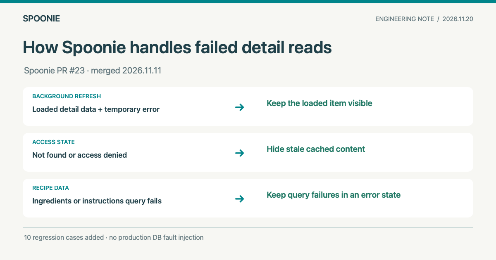

> 한국어: [Spoonie 상세 화면은 일시적 조회 실패에도 기존 데이터를 유지한다](/spoonie-detail-data-reliability-ko/)

Spoonie [PR #23](https://github.com/saramjh/spoonie/pull/23) handles three detail-page states. An item that has already loaded stays visible when a background refresh fails temporarily. The page hides cached content after a missing-item or access-denied response. A failed ingredients or instructions query is surfaced as a Recipe detail error.

## Keeping loaded data during a background refresh

SWR (stale-while-revalidate) can display available data first and request an updated result in the background. During that request, `item` can still contain the previous result while `error` describes the failed refresh.

The previous `RecipeDetailClient` and `PostDetailClient` returned an error state whenever `error` existed, even if `item` still held a loaded result. A temporary SWR refresh failure could therefore remove content that was already on screen. PR #23 keeps the detail view while `item` remains available. Missing-item and access-denied responses still return a state message.

## Hiding content after access changes

When a response confirms that an item is missing or access is denied, the page hides its cached content. The code checks for `not found` and `access denied` messages, along with Supabase error code `PGRST116`, before showing a state message.

## Required data for a Recipe

A Recipe detail page needs its ingredients and instructions. `fetchItemDetail` now throws when either query fails. A successful query that returns zero rows still produces an empty list, so the result remains distinct from a failed database read.

Before PR #23, the `data || []` fallback could make a failed query look like an empty list. A Recipeed records an actual cooking attempt. It does not require Recipe-only ingredients and instructions data, so failures in those reads do not block its detail page. [Spoonie's content model overview](/spoonie-webapps-directory-en/) explains the distinction.

The same PR moves `useItemDetail` error logging out of render and into `useEffect`. The effect records the message when the `error` object or `itemId` changes. Unrelated renders do not repeat the log.

## Verification and production readback

The PR was merged on 2026-11-11. Its verification record lists six background-error state tests and four Recipe data-fetch tests, for ten added regression cases. It also reports 351 passing Vitest tests across 80 files, a TypeScript check, a Next.js 16 Webpack production build, and ESLint. ESLint retained one pre-existing `` warning. These results come from the PR record and were not rerun for this blog update.

The PR's Netlify Deploy Preview status was `success`. On 2026-11-20, the production recipe listing and a public detail route returned HTTP 200. The production client bundle contained the revised `useItemDetail: request failed for` logging path, the `ItemNotFoundError` class, and the `PGRST116` classification. The ingredients and instructions error path is documented by the merged data-loader code and the PR's mock-backed tests. No production database failure or live-account access change was reproduced. The PR reports no evidence of actual user harm.

Related notes cover [viewer-specific likes and saves](/spoonie-viewer-cache-isolation-en/) and [recipe prefetch after reader intent](/spoonie-rsc-prefetch-20261119-en/).

[Source PR #23](https://github.com/saramjh/spoonie/pull/23) · [Spoonie recipes](https://spoonie.kr/recipes) · [Project portfolio](/portfolio/)
