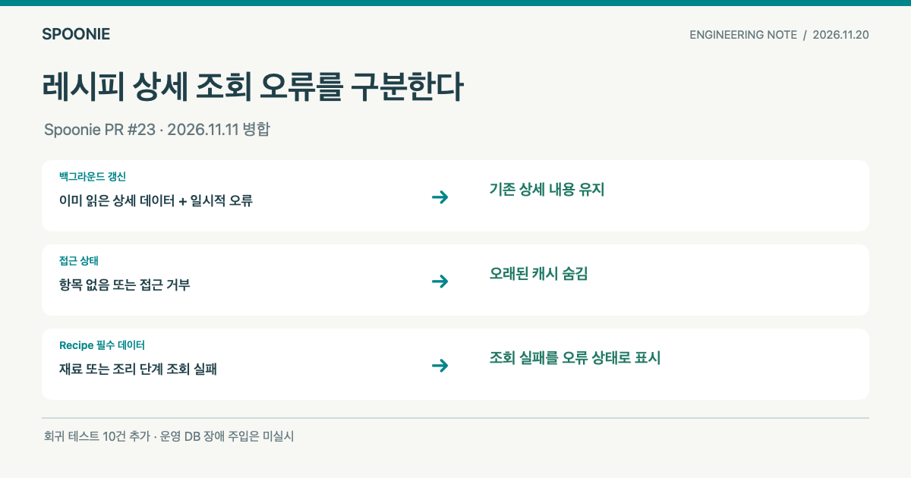

> English: [Spoonie preserves loaded detail content during refresh errors](/spoonie-detail-data-reliability-en/)

Spoonie [PR #23](https://github.com/saramjh/spoonie/pull/23)은 상세 화면의 조회 오류를 세 가지 상태로 처리한다. 이미 읽은 항목은 백그라운드 갱신이 잠시 실패해도 화면에 남는다. 삭제 또는 접근 거부가 확인되면 캐시를 숨긴다. Recipe의 재료나 조리 단계 조회에 실패하면 해당 오류를 전달한다.

## 이미 읽은 상세 데이터와 백그라운드 갱신

SWR(stale-while-revalidate)은 먼저 사용할 수 있는 데이터를 보여 주고, 뒤에서 최신 데이터를 다시 읽을 수 있다. 이때 `item`에는 이전 조회 결과가 있고 `error`에는 새 요청의 실패가 함께 들어올 수 있다.

기존 `RecipeDetailClient`와 `PostDetailClient`는 `error`가 있으면 `item`이 남아 있어도 오류 화면을 반환했다. SWR 갱신 요청이 잠시 실패하면 이미 읽은 상세 내용까지 화면에서 사라질 수 있었다. PR #23은 `item`이 남아 있는 동안 상세 화면을 유지하고, 삭제 또는 접근 거부 응답이 확인되면 상태 메시지를 표시한다.

## 삭제되거나 비공개가 된 항목

삭제 또는 접근 거부 응답이 확인되면 화면은 이전 캐시를 숨긴다. 코드는 오류 메시지에 `not found` 또는 `access denied`가 포함됐는지, Supabase의 `PGRST116` 코드가 왔는지를 확인한다. 이 조건에 해당하면 상태 메시지를 표시한다.

## Recipe의 재료와 조리 단계 조회

Recipe 상세 화면에는 재료와 조리 단계가 필요하다. `fetchItemDetail`은 두 쿼리 중 하나라도 실패하면 해당 오류를 다시 던진다. 쿼리가 성공했지만 결과 행이 0개라면 빈 목록을 사용한다. 이 분기로 실제 빈 결과와 데이터베이스 조회 실패를 구분한다.

이전 구현은 `data || []`를 사용해 조회 실패를 빈 배열처럼 보이게 할 수 있었다. PR #23은 Recipe 항목의 재료·조리 단계 조회 오류를 전달한다. Recipeed는 실제 조리 시도 기록이다. 재료·조리 단계 데이터는 Recipe 전용이므로 해당 조회 실패가 Recipeed 상세 화면을 막지 않는다. 두 콘텐츠 유형의 차이는 [Spoonie 콘텐츠 모델 소개](/spoonie-webapps-directory-ko/)에 정리돼 있다.

같은 PR에서 `useItemDetail`의 오류 로그를 렌더링 중 실행하던 방식에서 `useEffect`로 옮겼다. `error` 객체나 `itemId`가 바뀔 때 기록해 무관한 상태 변경으로 같은 오류가 반복 기록되는 일을 줄였다.

## 검증과 운영 확인

PR은 2026년 11월 11일 병합됐다. PR 기록에는 백그라운드 오류 상태 테스트 6건과 Recipe 필수 데이터 조회 테스트 4건, 총 10건의 회귀 테스트가 추가됐다. 같은 기록은 Vitest 80개 파일의 351개 테스트, TypeScript 검사, Next.js 16 Webpack 프로덕션 빌드와 ESLint 통과를 보고한다. ESLint에는 기존 `` 경고 1건이 남아 있다. 이 전체 테스트 결과는 PR 작성자가 기록한 수치이며, 이번 블로그 작업에서 다시 실행한 결과는 아니다.

PR의 Netlify Deploy Preview 상태는 `success`였다. 2026년 11월 20일 운영 레시피 목록과 공개 상세 경로는 HTTP 200을 반환했다. 운영 클라이언트 번들에서는 `useItemDetail: request failed for`, `ItemNotFoundError`, `PGRST116`을 확인했다. 재료·조리 단계 조회 오류 처리는 병합된 데이터 로더 코드와 PR의 모의 데이터 회귀 테스트를 근거로 설명한다. 운영 DB 장애나 실제 회원 계정의 권한 변경은 재현하지 않았다. PR 기록에도 실제 사용자 피해가 있었다는 근거는 없다.

이전 기록인 [계정별 좋아요·저장 캐시 분리](/spoonie-viewer-cache-isolation-ko/)와 [레시피 사전 요청 시점 조정](/spoonie-rsc-prefetch-20261119-ko/)에서는 상세 데이터와 탐색 요청의 다른 경로를 다룬다.

[PR #23 원본](https://github.com/saramjh/spoonie/pull/23) · [Spoonie 레시피 목록](https://spoonie.kr/recipes) · [프로젝트 포트폴리오](/portfolio/)
