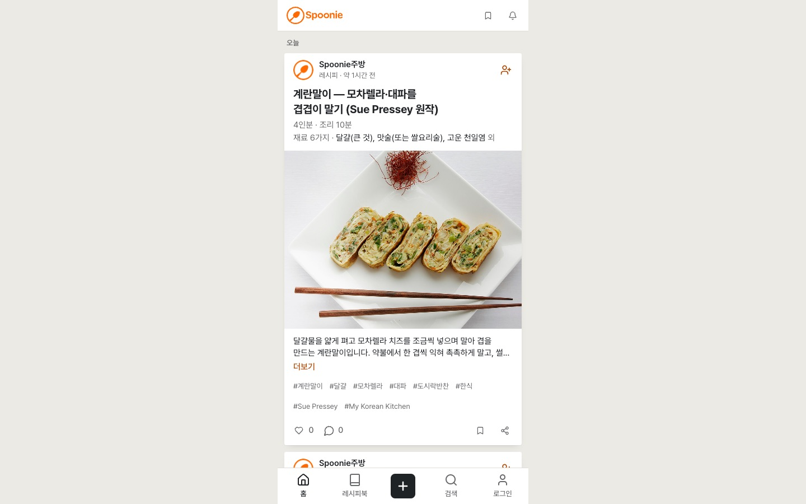

> 한국어판: [Spoonie 글을 비공개로 바꿀 때 다른 계정의 캐시에서 제거하기](/spoonie-privacy-cache-transition-ko/)

On November 12, 2026, [Spoonie PR #38](https://github.com/saramjh/spoonie/pull/38) merged a fix for the moment a post changes from public to private while old browser caches and asynchronous requests are still active.

When a post becomes private, it is removed from public lists and other viewers' cached details. The author's private recipe book keeps it. A save started by one account must not land in the feed of the account that signs in next.

<figure>
  
  <figcaption>Spoonie's public recipe interface. PR #38 changes how the browser handles private posts and account changes.</figcaption>
</figure>

## The visibility boundary

When an item that was public becomes private, the cache update now removes it from public, guest and other-viewer lists and invalidates cached detail entries belonging to other viewers. The author's own private inventory is preserved.

[PR #37's viewer-specific likes and saves](https://saramjh.github.io/spoonie-viewer-cache-isolation-en/) separated personal reaction state by viewer. PR #38 extends that account boundary to visibility changes and late save responses.

## Keep asynchronous work with its original account

The save paths receive the author ID at the start. A late new-item callback exits if the session has changed, and an edit remains scoped to the author who started it.

Authentication initialization tracks a request generation that advances on sign-out or a different sign-in. A delayed profile response is ignored unless that generation and the active user still match.

For SWR infinite lists, the updater normalizes page keys to the first-page container and patches that container once, avoiding duplicate page-level updates.

## Verification

CI for [PR #38](https://github.com/saramjh/spoonie/pull/38) reported 395 passing tests across 90 Vitest files and six media-cleanup safety tests. TypeScript, changed-file ESLint and the Next.js 16.4.2 production Webpack build also passed. Mounted React/SWR Chromium checks exercised two-page cache updates and A-to-B-to-A account switches for likes and bookmarks. They also covered public-to-private eviction and authentication event races.

During my production check, `https://spoonie.kr/recipes` returned HTTP 200. Its route JavaScript and shared layout JavaScript matched the PR #38 Netlify preview assets byte for byte.

No two-account mutation test was run against real production member accounts, and adoption and retention were not measured.

- [Merged implementation: Spoonie PR #38](https://github.com/saramjh/spoonie/pull/38)
- [Spoonie project case](/portfolio/spoonie/)
- [Previous note: separating likes and saves by viewer](/spoonie-viewer-cache-isolation-en/)
- [Spoonie recipe discovery](/spoonie-search-discovery-en/)
