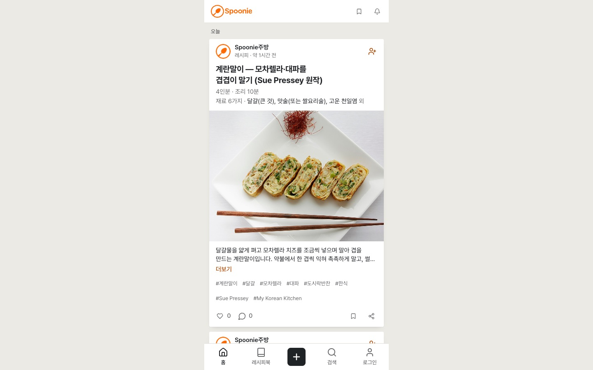

> English: [Removing newly private Spoonie posts from other viewers' caches](/spoonie-privacy-cache-transition-en/)

2026년 11월 12일, [Spoonie PR #38](https://github.com/saramjh/spoonie/pull/38)이 병합됐다. 공개 글을 비공개로 바꾸는 순간에도 이전 브라우저 캐시와 비동기 요청은 남아 있을 수 있다. PR #38은 이때 다른 계정에 이전 글이 계속 보이거나, 이전 계정에서 시작한 저장 응답이 현재 계정의 화면을 바꾸는 경로를 막는다.

비공개로 바꾼 글은 공개 목록과 다른 사용자의 상세 캐시에서 제거한다. 작성자 본인의 비공개 레시피북에는 유지한다. 한 계정에서 시작한 저장 작업도 다음에 로그인한 계정의 피드에 들어가서는 안 된다.

<figure>
  
  <figcaption>Spoonie의 공개 레시피 화면이다. PR #38은 비공개 글과 계정 전환을 처리하는 브라우저 캐시를 수정했다.</figcaption>
</figure>

## 공개 범위가 바뀌면 다른 화면의 캐시도 바뀌어야 한다

공개 상태였던 글을 비공개로 바꾸면 이제 게스트와 다른 계정의 공개 목록에서 해당 항목을 제거하고, 다른 사용자가 보던 상세 캐시도 무효화한다. 작성자 본인의 비공개 목록은 그대로 보존한다.

[PR #37의 계정별 좋아요·저장 캐시 분리](https://saramjh.github.io/spoonie-viewer-cache-isolation-ko/)는 사용자별 반응 상태를 분리했다. PR #38은 글의 공개 범위가 바뀌거나 저장 요청이 늦게 끝나는 상황까지 같은 소유권 원칙을 확장한다.

## 늦게 끝난 요청도 시작한 계정에 귀속한다

새 글과 수정 글의 캐시 처리에는 작업을 시작한 작성자 ID를 전달한다. 새 글 저장 응답이 돌아오기 전에 세션이 바뀌었다면 이전 계정의 응답은 현재 피드에 삽입되지 않는다. 수정 결과 역시 처음 전달받은 작성자 ID 범위에 반영한다.

인증 초기화 요청에는 세대 번호를 붙였다. 로그아웃하거나 다른 계정으로 로그인하면 번호가 바뀐다. 이전 요청에서 시작한 프로필 조회가 늦게 도착해도 세대 번호와 현재 사용자가 모두 일치하지 않으면 화면 상태를 덮어쓰지 않는다.

SWR 무한 목록은 페이지 키를 첫 페이지 컨테이너 기준으로 정규화하고 컨테이너를 한 번만 갱신한다. 개별 페이지 키의 중복 패치를 막는다.

## 검증 범위

[PR #38](https://github.com/saramjh/spoonie/pull/38)의 CI는 Vitest 90개 파일 395개 테스트와 미디어 정리 안전 테스트 6개 통과를 기록했다. TypeScript, 변경 파일 ESLint, Next.js 16.4.2 프로덕션 Webpack 빌드도 통과했다. 실제 React/SWR을 마운트한 Chromium에서는 2페이지 캐시 갱신과 A에서 B로 전환한 뒤 다시 A로 돌아오는 좋아요·저장 흐름을 확인했다. 공개 글의 비공개 전환과 인증 이벤트 경합도 시험했다.

운영 확인 당시 `https://spoonie.kr/recipes`는 HTTP 200을 반환했다. 해당 경로의 JavaScript와 공통 레이아웃 JavaScript도 PR #38 Netlify 미리보기의 파일과 바이트 단위로 일치했다.

실제 회원 두 계정으로 운영 환경에서 글 공개 범위를 바꾸는 테스트와 이용자·재방문 지표는 확인하지 않았다.

- [병합된 구현: Spoonie PR #38](https://github.com/saramjh/spoonie/pull/38)
- [Spoonie 프로젝트 사례](/portfolio/spoonie/)
- [이전 기록: 계정별 좋아요·저장 캐시 분리](/spoonie-viewer-cache-isolation-ko/)
- [Spoonie 레시피 검색·발견 기능](/spoonie-search-discovery-ko/)
